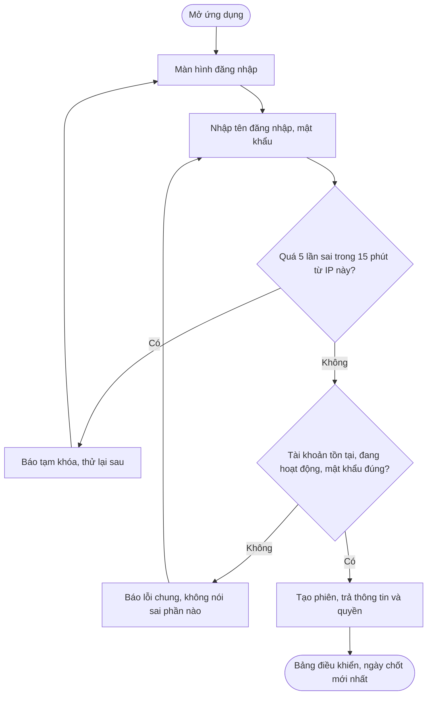
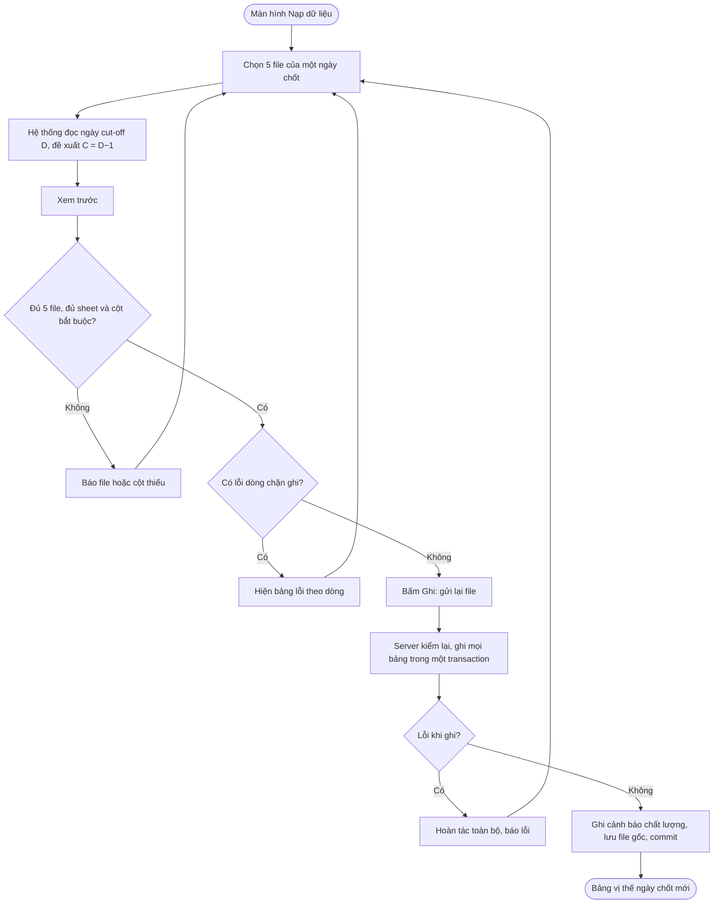

# Đặc tả nghiệp vụ PremixTrack (gói chuyển giao sang dự án mới)

Phiên bản: 1.0 · Ngày: 12/10/2026 · Người quyết định nghiệp vụ: chủ dự án
Nguồn: dự án cũ `PremixTrack-FE`, nhánh `refactor`, commit `2561034` (TASK-001 → TASK-038 DONE; TASK-039, TASK-040 đã duyệt chưa làm).
Trạng thái chung: các mục ghi `CONFIRMED` đã được chủ dự án chốt trong dự án cũ; `PROPOSED`, `NEEDS_CONFIRMATION` chưa phải yêu cầu chính thức.

## 0. Cách dùng file này

- File này đóng vai **"file đặc tả đầu vào"** (thay file Word) theo *Hướng dẫn Dự Án Web-APP* mục 3–4: 16 mục đúng khung mẫu. Dự án mới cho agent đọc file này cùng 7 tài liệu của giảng viên (`docs/references/`) rồi tạo `docs/`, `AGENTS.md`, rules, skills, task theo *6 bước triển khai*.
- Chỉ ghi **nghiệp vụ, dữ liệu, quyền, quyết định**. Không ghi cách cài đặt của stack cũ (Express, driver `mssql`). Phần kỹ thuật bắt buộc lấy từ `Architechture.md` và `skill.md` (mục 12).
- Giữ nguyên mã `BR-xx`, `Q-xxx`, `DEC-xx`, `AC-xx` để truy vết về dự án cũ. Dự án mới đánh số lại thì ghi bảng ánh xạ.
- Ký hiệu hay gặp: **C** = ngày chốt; **M** = tháng của C; **NM** = nhà máy; **NL** = nguyên liệu; **NCC** = nhà cung cấp; **cặp** = (NM, NL). Hằng số (28, 7, 15, 75, 90, 1.000, 3…) là **giá trị mặc định trong cấu hình**, không viết cứng.
- **Mọi chữ viết tắt, mã, thuật ngữ trong file: xem Phụ lục D (bảng chú thích).**
- **Phần dự án mới bắt buộc làm theo khung của giảng viên (khác dự án cũ), ghi theo từng module, thứ tự làm và chuẩn hoàn thành: xem Phụ lục E.** Nghiệp vụ ở mục 1–11 giữ nguyên; cách cài đặt theo Phụ lục E.

---

## 1. Bối cảnh và mục tiêu `CONFIRMED`

**Đề tài (thuyết minh M03):** "Xây dựng ứng dụng web PremixTrack hỗ trợ theo dõi tồn kho và đặt hàng nguyên liệu premix cho thức ăn gia súc."

**Vấn đề:** doanh nghiệp sản xuất thức ăn gia súc có nhiều nhà máy. Việc theo dõi tồn kho và đặt hàng nguyên liệu premix được tổng hợp tay từ nhiều file Excel xuất từ ERP D365, tốn thời gian, khó phát hiện sớm nguy cơ thiếu hụt hoặc tồn dư.

**Mục tiêu chung:** hỗ trợ theo dõi tồn kho và đặt hàng nguyên liệu premix, phát hiện sớm thiếu hụt hoặc tồn dư.

**Mục tiêu chi tiết (M03):** chốt quy tắc tính; CSDL SQL Server có khóa và ràng buộc; nạp file Excel từ ERP có kiểm tra lỗi; tính và cảnh báo bốn mức; giao diện bảng điều khiển, kế hoạch giao hàng, đề nghị mua, phân quyền; kiểm thử với 6 nhà máy × 10 nguyên liệu, đối chiếu bảng tính Excel đang dùng.

**Kết quả mong đợi (M03):**
- Nạp file Excel từ ERP theo ngày chốt, báo lỗi các dòng không hợp lệ.
- Tự động tính tồn khả dụng, số ngày tồn kho, ngày hết hàng, cảnh báo bốn mức.
- Bảng điều khiển tổng quan, lọc theo nhà máy và nhóm nguyên liệu.
- Kế hoạch giao hàng theo ngày, đối chiếu lượng đã nhận; xuất danh sách đề nghị mua.
- Phân quyền theo vai trò và theo nhà máy.
- Sản phẩm: ứng dụng web, CSDL SQL Server kèm ERD, dữ liệu mẫu, báo cáo.

**Thời gian (M03):** làm ứng dụng 05/10 → 01/11/2026; kiểm thử, hoàn thiện, báo cáo 02/11 → 29/11/2026. Nộp dự kiến ~25/11/2026.

**Ràng buộc:** chủ dự án làm một mình; ưu tiên MoSCoW, trễ thì cắt C rồi S.

## 2. Phạm vi

### 2.1. Làm trong bản đầu `CONFIRMED`

| Hạng mục | Ghi chú |
|---|---|
| Nhà máy theo Master Data | 6 NM: DN, BD, VL2, HG, BD1, BD2 |
| Nguyên liệu theo Master Data | 26 NL, 72 cặp NM–NL được theo dõi |
| Đơn vị kg, không có giá | BR-01 |
| Nạp Master Data, bộ 5 file ERP mỗi ngày chốt, file Forecast | BR-15 |
| Vị thế tồn kho, cảnh báo 4 mức | Lõi đề tài |
| Bảng điều khiển | |
| Tồn bị khóa (chặn tồn thủ công) | Ưu tiên S |
| Kế hoạch giao hàng, đề nghị mua | Ưu tiên M, kế hoạch giao làm trước (Q-002) |
| Dự phóng tồn 28 ngày, nhu cầu tháng sửa tay, PO trễ hạn nhận, đề xuất lịch giao | Đã chốt và làm trong dự án cũ (bản 2) |
| Phân quyền động (vai trò, quyền trong CSDL) | Đã duyệt (TASK-039, 040), chưa làm |
| Giao diện hai ngôn ngữ VI/EN, sáng/tối | Đã chốt 10/10/2026 |
| Sai số chấp nhận khoảng 5% (NL dùng ít cần chính xác hơn) | |

### 2.2. Làm sau

- Thuật toán gợi ý mua nâng cao (đặt-tới-mức theo lead time).
- Nút "Đề xuất" trên lưới kế hoạch giao (BR-36b, Q-049 đã chốt); danh sách cần mua (Q-045 đã chốt).
- Tự khớp đề nghị mua với PO khi nạp PO Pending (phần C của FEATURE-08).
- Trang chi tiết lịch sử một nguyên liệu (C).
- Nguyên liệu thay thế (Q-009 đã chốt): **giữ bảng trong CSDL, chưa làm giao diện, chưa dùng khi tính**. Lý do thay thế trong thực tế nhiều loại (thiếu hàng, đổi mã NL sử dụng…), cần khảo sát thêm trước khi đặc tả.

### 2.3. Không làm (non-goals) `CONFIRMED`

- Dữ liệu giá, tiền tệ, giá trị tồn.
- Kết nối trực tiếp D365 (chỉ nạp file).
- Điều xe, tối ưu tải trọng; trợ lý AI; BOM công thức; dự báo nhiều phiên bản có so sánh; ánh xạ cột Excel tự học.
- Nạp các file theo dõi tay `I_M_R...`, `Pre_W...` (chỉ tham khảo).
- Tự đăng ký tài khoản, quên mật khẩu qua email, SSO.
- Gom các NL cùng NCC về chung một ngày giao, ghép theo tải xe (Q-051 chốt 12/10/2026: không làm; mỗi cặp đề xuất độc lập).
- Tránh ngày lễ khi đề xuất lịch giao (chốt 12/10/2026: chỉ tránh Chủ nhật; người dùng tự dời trên lưới).

Agent không tự thêm các phần trên.

## 3. Người dùng, actor và quyền

### 3.1. Bảng actor (6 bước, bước 2)

| Actor | Loại | Hành vi chính |
|---|---|---|
| Quản trị (ADMIN) | Primary | Quản lý tài khoản, vai trò, quyền; sửa cấu hình chung, thuộc tính danh mục; mọi việc của PLANNER |
| Người lập kế hoạch, mua hàng (PLANNER) | Primary | Nạp file ERP, theo dõi vị thế, khóa hàng, lập kế hoạch giao, tạo và xuất đề nghị mua, sửa nhu cầu tháng, ghi đè ngưỡng theo cặp |
| Người dùng nhà máy (FACTORY) | Primary | Xem vị thế, kế hoạch giao của nhà máy được gán; khóa, mở khóa hàng tại nhà máy mình |
| Người chỉ xem (VIEWER, ban quản lý) | Primary | Xem bảng điều khiển, vị thế, kế hoạch giao, tồn bị khóa của mọi nhà máy |
| ERP D365 (qua file Excel người dùng xuất) | Secondary System | Cung cấp Master Data và 5 file mỗi ngày chốt (On Hand, Movement, PO Pending, PO receipt, Transfer Order) |
| Bộ phận lập Forecast | Secondary (ngoài hệ thống) | Gửi file "RM Usage" nhu cầu tháng, cuối mỗi tuần một version |
| Bộ phận mua hàng | Secondary (ngoài hệ thống) | Nhận file Excel đề nghị mua, tạo PO trên D365 (ghi mã đề nghị vào ghi chú PO) |

### 3.2. Vai trò khởi tạo `CONFIRMED`

| Vai trò | Ai | Phạm vi nhà máy |
|---|---|---|
| ADMIN | Quản trị hệ thống | Tất cả (`ALL`) |
| PLANNER | Lập kế hoạch, mua hàng nội bộ | Tất cả (`ALL`) |
| FACTORY | Người dùng tại nhà máy | Chỉ nhà máy được gán (`ASSIGNED`) |
| VIEWER | Ban quản lý, chỉ xem | Tất cả (`ALL`) |

Một người một vai trò.

### 3.3. Phân quyền động `CONFIRMED` (chốt 12/10/2026, chưa làm trong dự án cũ)

- **D1** ADMIN tạo, sửa, xóa vai trò; 4 vai trò trên là dữ liệu khởi tạo. ADMIN luôn toàn quyền, ma trận của ADMIN khóa.
- **D2** Quyền chi tiết theo hành động (xem / tạo / sửa / xóa / xuất), nhóm theo module.
- **D3** Xóa người dùng: xóa thật nếu tài khoản chưa có dữ liệu; đã có dữ liệu → từ chối, gợi ý khóa.
- **D4** Không có đăng ký; ADMIN tạo tài khoản.
- **A1** Danh mục mã quyền là hằng số trong code (gắn với chỗ code kiểm); CSDL chỉ lưu vai trò nào có mã nào. Ghi mã lạ → từ chối.
- **A2** Mã vai trò là khóa, không đổi được (chữ hoa, số, `_`, 2–30 ký tự). Tên, mô tả, phạm vi, quyền sửa được.
- **A3** Phạm vi nhà máy là thuộc tính của vai trò: `ALL` hoặc `ASSIGNED` (theo bảng gán nhà máy của người dùng).
- **A4** Vai trò hệ thống ADMIN: luôn đủ mọi quyền (tính trong code), phạm vi `ALL`, không sửa quyền, không xóa. Vai trò khác xóa được khi không còn ai dùng (409 kèm số người).
- **A5** API tra cứu dùng chung (nhà máy, NL, NCC, cặp, cấu hình, ngưỡng) mở cho mọi người đã đăng nhập (dùng làm ô chọn ở nhiều màn hình). Quyền `catalog.view` chỉ quyết việc hiện màn hình Danh mục.
- **A6** Đổi quyền có hiệu lực ngay ở request kế tiếp (đọc lại người dùng và quyền mỗi request), không cần đăng nhập lại.
- **Q-052** ADMIN đặt lại mật khẩu cho người khác (mật khẩu tạm ≥ 8 ký tự, không trả mật khẩu ra API).

**Danh mục 27 mã quyền (9 nhóm) và dữ liệu khởi tạo.** ADMIN luôn đủ, không ghi trong bảng.

| Nhóm | Mã | Việc | PLANNER | FACTORY | VIEWER |
|---|---|---|:-:|:-:|:-:|
| Tổng quan | `dashboard.view` | Bảng điều khiển | ✓ | ✓ | ✓ |
| Vị thế | `position.view` | Bảng vị thế, chi tiết, xem nhu cầu sửa tay | ✓ | ✓ | ✓ |
| Vị thế | `demand-override.edit` | Sửa, bỏ nhu cầu tháng sửa tay | ✓ | | |
| Nạp dữ liệu | `import.view` | Lịch sử nạp, cảnh báo của lần nạp | ✓ | | |
| Nạp dữ liệu | `import.run` | Xem trước, ghi file | ✓ | | |
| Danh mục | `catalog.view` | Màn hình Danh mục | ✓ | ✓ | ✓ |
| Danh mục | `material.edit` | Sửa PIC, số lẻ hiển thị của NL | | | |
| Danh mục | `supplier.edit` | Sửa lead time NCC | | | |
| Danh mục | `factory-material.edit` | Bật/tắt theo dõi cặp | | | |
| Danh mục | `threshold.edit` | Ghi đè, xóa ngưỡng theo cặp | ✓ | | |
| Danh mục | `system-config.edit` | Sửa cấu hình chung | | | |
| Tồn bị khóa | `block.view` | Xem danh sách | ✓ | ✓ | ✓ |
| Tồn bị khóa | `block.create` | Khóa hàng | ✓ | ✓ | |
| Tồn bị khóa | `block.release` | Mở khóa | ✓ | ✓ | |
| Kế hoạch giao | `delivery-plan.view` | Xem lưới tuần | ✓ | ✓ | ✓ |
| Kế hoạch giao | `delivery-plan.edit` | Lưu lưới tuần | ✓ | | |
| Đề nghị mua | `purchase-request.view` | Gợi ý, danh sách | ✓ | | |
| Đề nghị mua | `purchase-request.create` | Tạo đề nghị | ✓ | | |
| Đề nghị mua | `purchase-request.status` | Đổi trạng thái | ✓ | | |
| Đề nghị mua | `purchase-request.export` | Xuất Excel | ✓ | | |
| Người dùng | `user.view` | Danh sách tài khoản | | | |
| Người dùng | `user.create` | Tạo tài khoản | | | |
| Người dùng | `user.update` | Sửa, gán vai trò, gán nhà máy, khóa, đặt lại mật khẩu | | | |
| Người dùng | `user.delete` | Xóa tài khoản chưa có dữ liệu | | | |
| Phân quyền | `role.view` | Xem vai trò, danh mục quyền | | | |
| Phân quyền | `role.manage` | Tạo, sửa, xóa vai trò | | | |
| Hệ thống | `api-docs.view` | Trang tài liệu API (Swagger) | | | |

Đổi mật khẩu của mình: mọi người đã đăng nhập (không có mã).

### 3.4. Quy tắc áp dụng quyền

- Quyền kiểm ở **server** cho mọi API, kể cả khi gọi thẳng API; giao diện chỉ ẩn hoặc vô hiệu nút. `CONFIRMED`
- Mọi API cần đăng nhập, trừ đăng nhập, đăng xuất, kiểm tra sức khỏe.
- Gọi API với nhà máy ngoài phạm vi → 403; API danh sách tự lọc theo phạm vi.
- Không xóa cứng tài khoản đã có dữ liệu (khóa bằng `IsActive = 0`). ADMIN không tự khóa, tự hạ quyền chính mình (403), nhờ đó luôn còn ít nhất một ADMIN.
- Không có khách (không đăng nhập).

## 4. Nhóm chức năng (module) và ưu tiên

Mỗi module dưới đây khi làm ở dự án mới theo yêu cầu riêng ở **Phụ lục E.2** (danh sách cần phân trang, stored procedure, audit log) và thứ tự lát cắt ở **E.3**.

| Module | Chức năng | Actor | Ưu tiên |
|---|---|---|---|
| F01 Xác thực, tài khoản, phân quyền | Đăng nhập, đăng xuất, xem mình, đổi mật khẩu; quản lý tài khoản, gán nhà máy, đặt lại mật khẩu; quản lý vai trò và quyền | Mọi người; ADMIN | M |
| F02 Danh mục và cấu hình | Xem NM, NL, NCC, cặp; sửa thuộc tính riêng; cấu hình chung; ngưỡng theo cặp; xem nhu cầu sửa tay | Mọi vai trò xem; ADMIN, PLANNER sửa | M (xem, cấu hình), S (ngưỡng, thuộc tính) |
| F03 Nạp dữ liệu | Nạp Master Data, bộ 5 file ngày chốt, Forecast; xem trước; lịch sử; cảnh báo chất lượng | ADMIN, PLANNER | M |
| F04 Vị thế tồn kho và cảnh báo | Bảng vị thế; chi tiết cặp; dự phóng 28 ngày; nhu cầu tháng sửa tay; PO trễ hạn nhận | Mọi vai trò | M (lõi) |
| F05 Bảng điều khiển | Ô tổng theo mức, ma trận NM × NL, ô tồn bị khóa, lần nạp gần nhất | Mọi vai trò | M |
| F06 Tồn bị khóa | Khóa hàng, mở khóa, danh sách | ADMIN, PLANNER, FACTORY | S |
| F07 Kế hoạch giao hàng | Lưới tuần, đối chiếu đã nhận, cảnh báo vượt PO, đề xuất lịch giao | ADMIN, PLANNER sửa; mọi vai trò xem | M |
| F08 Đề nghị mua | Gợi ý, tạo, xuất Excel, đổi trạng thái | ADMIN, PLANNER | M |
| Hệ thống | Tài liệu API, audit log (mới, theo `skill.md`), kiểm tra sức khỏe | ADMIN | S |

## 5. Chi tiết chức năng (Input – Processing – Output)

### 5.1. F01 Xác thực và tài khoản

| Chức năng | Input | Processing | Output / từ chối |
|---|---|---|---|
| Đăng nhập | username, password (không rỗng) | So hash bcrypt; tài khoản phải `IsActive`; quá **5 lần sai trong 15 phút từ một IP** → chặn tạm | Thành công: phiên đăng nhập + thông tin người dùng và danh sách quyền (không có hash, không có token trong body). Sai: **một thông báo chung**, không nói sai phần nào |
| Đăng xuất | — | Hủy phiên | Gọi API sau đó → 401 |
| Xem mình | — | Đọc lại người dùng mỗi request (tài khoản bị khóa → phiên bị từ chối ở request kế tiếp) | Thông tin, vai trò, quyền, múi giờ ứng dụng |
| Đổi mật khẩu | currentPassword, newPassword | Mật khẩu cũ đúng; mới **≥ 8 ký tự** | Cũ sai → 400, mật khẩu cũ vẫn dùng được |
| Tạo tài khoản | username (duy nhất), fullName, email (tùy chọn), vai trò, factoryIds, mật khẩu tạm | Vai trò phạm vi `ASSIGNED` phải có ≥ 1 nhà máy | Thiếu nhà máy → 400, không tạo dòng |
| Sửa, khóa, gán nhà máy, đặt lại mật khẩu | | ADMIN không tự khóa, tự hạ quyền | 403 khi tự khóa |
| Xóa tài khoản | | Chỉ khi chưa có dữ liệu | Có dữ liệu → từ chối, gợi ý khóa |
| Quản lý vai trò | mã, tên, mô tả, phạm vi, danh sách mã quyền | Mục 3.3 | |

AC: AC-01.01 đăng nhập đúng → `GET /auth/me` đúng người, không có mật khẩu/hash/token · AC-01.02 không đăng nhập gọi API nghiệp vụ → 401 · AC-01.03 FACTORY gọi nhà máy ngoài phạm vi → 403, danh sách chỉ trả NM của họ · AC-01.04 VIEWER nạp file hoặc khóa hàng → 403, CSDL không đổi · AC-01.05 tạo FACTORY không có nhà máy → 400 · AC-01.06 đổi mật khẩu sai mật khẩu cũ → 400 · AC-01.07 sau đăng xuất → 401.

### 5.2. F02 Danh mục và cấu hình

Danh mục lấy từ Master Data, **chỉ đọc** trên web (BR-31). Web chỉ sửa phần ERP không có:

| Đối tượng | Trường sửa được | Kiểm tra |
|---|---|---|
| Nguyên liệu | PIC, DisplayDecimals (0–3) | |
| NCC | LeadTimeDays (0–365) | |
| Cặp NM–NL | IsTracked (bật/tắt theo dõi) | Tắt → cặp không xuất hiện trên vị thế, dữ liệu nạp vẫn giữ |
| Cấu hình chung (một dòng) | Mục 8.5 | BR-12, BR-12b; ghi người sửa, thời điểm |
| Ngưỡng theo cặp | WarningDays, OverstockDays, SafetyDays, DeliveryDays, DeliveryQtyKg, Note | Ít nhất một trường; BR-12a (không xét SafetyDays, DeliveryDays, DeliveryQtyKg); SafetyDays 0–365 một số lẻ; DeliveryDays 1–365 một số lẻ; DeliveryQtyKg kg nguyên > 0 |

Trường chỉ xem (từ Master): mã, tên, Region, PlantType, mã kho; Category, Nhóm (Premix / Ngoài premix), quy cách, Bao (kg), loại hàng; Vendor Group, quốc gia.

AC: AC-02.01 không có API đổi mã, tên, Category, Nhóm của NL · AC-02.02 sửa cấu hình với Warning ≤ Critical → 400, không đổi · AC-02.03 lưu hợp lệ → ghi người sửa, thời điểm · AC-02.04 ghi đè Overstock = 60 cho một cặp → vị thế dùng 60; xóa → về mặc định · AC-02.05 sửa PIC rồi nạp lại Master → PIC giữ nguyên · AC-02.06 không có quyền sửa cấu hình → 403.

### 5.3. F03 Nạp dữ liệu

| Bước | Input | Processing | Output |
|---|---|---|---|
| Chọn bộ ngày chốt | 5 file của một ngày chốt | Đọc ngày cut-off D từ tên file, đề xuất C = D−1 (BR-15e) | Ngày chốt đề xuất |
| Xem trước | 5 file | Kiểm cấp file (đủ file, sheet, cột bắt buộc theo tên – BR-22), cấp dòng (mã lạ – BR-21, số sai, đơn vị khác kg, trùng khóa – BR-22a), không ghi CSDL | Số dòng đọc / hợp lệ / lỗi / cảnh báo, bảng lỗi theo dòng |
| Ghi | Gửi lại 5 file (server đọc và kiểm lại, không tin kết quả xem trước) | **Một transaction**: mỗi file một lần nạp → ghi theo mục 8.3 → kiểm chéo BR-15d ghi cảnh báo → lưu file gốc → commit. Lỗi giữa chừng → hoàn tác toàn bộ | Lần nạp mới, cảnh báo chất lượng |
| Nạp Master | File Master Data | Cập nhật theo mã, chưa có thì thêm, không xóa mã đã có dữ liệu, không ghi đè thuộc tính riêng (BR-31) | |
| Nạp Forecast | File RM Usage, tháng nhu cầu (mặc định tháng chứa ngày lập, đổi được) | Một file = một version; nạp lại cùng version thì thay (BR-15b) | |
| Lịch sử | | | Danh sách lần nạp, cảnh báo của từng lần |

Từ chối: thiếu file trong bộ (nêu file thiếu, BR-17); thiếu sheet, cột (liệt kê cột thiếu); mã NM, NL không có trong Master (lỗi dòng). Nạp lại cùng ngày chốt: thay, không nhân đôi.

AC (dữ liệu mẫu): AC-03.01 nạp Master mẫu → 6 NM, 26 NL, 14 NCC, 72 cặp; nạp lại không thêm dòng · AC-03.02 nạp bộ 061026 → SOH đúng số dòng RAW (66), không có dòng TRANSIT · AC-03.03 nạp lại cùng bộ → số dòng không đổi · AC-03.04 thiếu cột → từ chối, đúng tên cột, không có lần nạp mới · AC-03.05 lỗi khi đang ghi → dữ liệu cũ giữ nguyên · AC-03.06 ô ngày `46300` → `2026-10-05`; bộ `061026` có C = 05/10, cut-off 06/10 · AC-03.07 Wip Issue phát sinh 05/10 = MTD(05/10) − MTD(04/10) · AC-03.08 nạp đủ chuỗi ngày theo thứ tự → không có cảnh báo chất lượng · AC-03.10 nạp TO lần hai có dòng Shipped → Received → cập nhật, không thêm dòng.

### 5.4. F04 Vị thế tồn kho và cảnh báo (lõi)

**Input:** ngày chốt (mặc định mới nhất đã nạp), lọc nhà máy, Category, Nhóm, mức.
**Processing:** với mỗi cặp đang theo dõi trong phạm vi: lấy dữ liệu gốc của C → tính theo BR-03 → BR-16a, BR-19c, BR-34 → BR-36a. **Công thức ở một nơi** (DEC-04), khớp đáp án tính tay; không chỗ nào khác (SQL, giao diện) tính lại DOI hay mức.
**Output mỗi cặp:**

| Đại lượng | Định nghĩa |
|---|---|
| sohKg | SOH tại C; không có dòng → 0 (BR-15c) |
| blockedKg, availableKg | BR-03, BR-04, BR-04a |
| forecastMonthKg, forecastVersionDate | BR-14 |
| demandOverrideKg, demandMonthKg | BR-05a, BR-05b; nhu cầu tháng dùng để tính = sửa tay, không có thì dự báo |
| stdDailyKg | BR-05 |
| mtdUsageKg, activeDays, actualDailyKg | BR-06, BR-07 |
| dailyKg | BR-08 |
| doi, stockoutDate | BR-09 (DOI hiển thị 1 số lẻ; null khi NO_DEMAND) |
| level, thresholds | BR-10, BR-11, BR-12 |
| inTransitKg | BR-20 |
| poPendingKg | Tổng còn lại PO Pending **đúng bản C**, gộp PO và PAG (BR-19b) |
| receivedAfterKg, coverDoi | BR-16, BR-16a (chỉ hiển thị) |
| poLateAge | BR-19c |
| needByDate, orderByDate, projection | BR-34, BR-34a, BR-35, BR-36 |
| flags (cờ) | Mục dưới |

**Thứ tự xếp mức:** NO_DEMAND → (tồn 0 có nhu cầu → CRITICAL) → CRITICAL → WARNING → OVERSTOCK → BALANCED. Mức theo `availableKg` tại C, không theo `coverDoi`.

**Cờ dữ liệu:** thiếu SOH (không có dòng On Hand), thiếu dự báo, chặn lớn hơn tồn (`BLOCKED_EXCEEDS_SOH`), dùng nhịp tháng trước (`PREV_MONTH_USAGE`), ít ngày chạy máy (`FEW_ACTIVE_DAYS`), chưa nạp PO Pending của C (`MISSING_PO_PENDING`), PO trễ hạn nhận (`PO_LATE_RECEIPT`), nhu cầu sửa tay (`DEMAND_OVERRIDE`, chỉ là thông tin, không đếm là cảnh báo), Forecast mới hơn số sửa tay (`FORECAST_NEWER_THAN_OVERRIDE`). Thêm ở dự án mới (chốt 12/10/2026): tồn không sử dụng (`UNUSED_STOCK`, BR-37), cần đặt hàng (`REORDER_NEEDED`, BR-38), tiêu hao lệch dự báo (`USAGE_DEVIATION`, BR-39). Không cờ nào đổi mức cảnh báo.

**Chi tiết cặp:** từng thành phần và ngưỡng đang áp dụng; từng dòng PO (ngày tạo, tuổi, tô đỏ dòng trễ, xếp FIFO, ẩn dòng 0 kg), TO đi đường, lệnh khóa, phiếu nhận sau C; mục "Nhu cầu tháng" (sửa, bỏ, "Dùng Forecast mới"); mục "Dự phóng tồn 28 ngày" (hai tầng, mốc hết hàng, cần hàng về trước, đặt muộn nhất, ô dưới mức an toàn vàng, ô âm đỏ).

**Nhu cầu tháng sửa tay:** input tháng (tháng của ngày chốt mới nhất hoặc tháng sau), kg ≥ 0, ngày áp dụng (mặc định từ server), lý do bắt buộc. Mỗi lần sửa hoặc bỏ là một dòng mới (BR-05a, BR-05b). NM, NL ngừng hoạt động → 400.

**Trường hợp biên (mỗi mục một test):** không nhu cầu; tồn 0 có nhu cầu; dự báo 0 nhưng có tiêu hao; dưới 3 ngày chạy máy; ngày 1 của tháng; chặn lớn hơn tồn; NL dùng ít (ngưỡng 90); ghi đè ngưỡng; TO Created không tính đi đường; TO Shipped tính; PO nhận một phần; ngày chốt chưa nạp → 404; DOI đúng bằng ngưỡng (Q-041).

AC: AC-04.01 bộ đáp án tính tay: mọi đại lượng khớp đến 0,01 kg và 0,1 ngày · AC-04.02 một dòng cho mỗi cặp đang theo dõi (dữ liệu mẫu: 72 dòng) · AC-04.03 FACTORY chỉ nhận dòng NM được gán · AC-04.04 đổi `CriticalDays` → mức đổi theo, không sửa code · AC-04.05 mỗi trường hợp biên có test · AC-04.06 không nơi nào khác tính lại DOI hoặc mức.

### 5.5. F05 Bảng điều khiển

| Chỉ số | Cách tính |
|---|---|
| Số cặp theo mức | Đếm `level` từ kết quả F04 tại C sau khi lọc (không tính lại) |
| Ô ma trận | Dòng = NL, cột = NM; ô = màu + biểu tượng mức + DOI; ô trống = cặp không theo dõi; NL có mức nặng nhất lên trước; chấm vàng khi có cờ khác "chưa có dự báo" |
| Tồn bị khóa | Số cặp, tổng kg đang khóa |
| Cờ dữ liệu | Số cặp có ít nhất một cờ và theo từng cờ (không đếm cờ thông tin) |
| Lần nạp gần nhất | Thời điểm nạp mới nhất mọi loại file, kèm loại, ngày chốt, người nạp |

Luồng: mở trang → ngày chốt mới nhất → bấm ô mức → bảng vị thế lọc theo mức (giữ bộ lọc NM, Category, Nhóm) → bấm ô ma trận → bảng vị thế lọc theo cặp và mở sẵn khung chi tiết. Chưa có lần nạp nào → trạng thái trống hướng dẫn nạp file. Ngày chốt mới nhất quá cũ → thanh báo "dữ liệu cũ" (BR-40) trên bảng điều khiển và bảng vị thế.

AC: AC-05.01 tổng các ô mức = số dòng bảng vị thế cùng bộ lọc · AC-05.02 bấm ô CRITICAL → chỉ còn dòng CRITICAL · AC-05.03 FACTORY chỉ thấy cột NM của mình · AC-05.04 hiện ngày chốt và lần nạp gần nhất.

### 5.6. F06 Tồn bị khóa (chặn tồn)

Tên giao diện: **Tồn bị khóa**, thao tác **Khóa hàng / Mở khóa**.

| Chức năng | Input | Kiểm tra |
|---|---|---|
| Khóa hàng | factoryId, materialId (trong phạm vi), blockedKg (số nguyên > 0), reason (≤ 250 ký tự, tùy chọn), startDate | BR-28, BR-28a |
| Mở khóa | endDate (≥ startDate) | Lệnh đã mở → 409 (báo trước lỗi ngày); không tồn tại → 404 |

Ngày mặc định của form = ngày chốt đang xem. Ngày kết thúc bằng ngày bắt đầu được phép. Sửa số kg sau khi tạo: không có (mở khóa rồi tạo lệnh mới).

AC: AC-06.01 khóa 100 kg từ C → khả dụng tại C giảm 100 · AC-06.02 mở khóa với ngày kết thúc C → tại C hết hiệu lực, tại C−1 còn · AC-06.03 nạp lại SOH cùng ngày chốt → lệnh khóa vẫn còn · AC-06.04 mở khóa thiếu ngày → 400 · AC-06.05 tổng lệnh đang khóa vượt SOH → lệnh làm vượt bị từ chối, báo số kg tối đa.

### 5.7. F07 Kế hoạch giao hàng

| Thành phần | Mô tả |
|---|---|
| Lưới | Một tuần Thứ 2 → Chủ nhật; dòng = NM, NL, NCC, PO (tùy chọn); cột = ngày; ô hiện kế hoạch + đã nhận |
| Input mỗi dòng | factoryId, materialId, supplierId (bắt buộc); poNumber (chọn từ PO còn lại của cặp, xếp FIFO theo ngày tạo); lượng theo ngày nhập **tấn**, tối đa 3 số lẻ, > 0 (BR-26c, BR-33); note |
| Lưu | Cả lưới tuần trong một transaction; xóa dòng = bỏ khỏi lưới rồi lưu. Dòng đã lưu chỉ sửa ghi chú, lượng (đổi NM, NL, NCC, PO = xóa dòng, thêm dòng) |
| Đối chiếu | BR-26b: đã nhận theo ngày nhận thực tế; còn thiếu theo ngày và tổng tuần |
| Cảnh báo | Tổng kế hoạch sau ngày chốt của một PO > còn lại → cảnh báo, vẫn lưu (BR-26d) |
| Mở từ vị thế | Khung chi tiết → "+ Lịch giao" trên dòng PO hoặc "Thêm lịch giao (không PO)" → lưới lọc sẵn cặp, tuần hiện tại, thêm sẵn một dòng |
| Đề xuất lịch giao | BR-36, BR-36a (thuật toán, dùng cho dự phóng tầng 2); nút "Đề xuất" trên lưới theo BR-36b: mọi cặp trong bộ lọc, chỉ thêm dòng nháp, dòng đã lưu giữ nguyên |

Từ chối: trùng khóa khi có PO → 409; lỗi một dòng → không dòng nào được ghi.

AC: AC-07.01 lưu rồi tải lại → giống hệt · AC-07.02 kế hoạch 20.000 kg ngày D, POR 15.000 kg ngày D cùng PO → đã nhận 15.000, còn thiếu 5.000 · AC-07.03 FACTORY không lưu được (403), xem được NM mình · AC-07.04 lỗi một dòng → không ghi dòng nào.

### 5.8. F08 Đề nghị mua

| Bước | Mô tả |
|---|---|
| Gợi ý | Danh sách cặp có gợi ý > 0 tại ngày chốt (BR-25, BR-25a), kèm mức, DOI, tiêu hao/ngày, số ngày BR-25, lượng BR-25, PO đang về, đang SENT, gợi ý |
| Tạo | Chọn, sửa số lượng (> 0, mặc định = gợi ý); NCC điền sẵn = NCC của dòng PO Pending gần nhất của cặp; ngày cần điền sẵn = ngày dự kiến hết hàng (sớm hơn hôm nay → hôm nay), ≥ ngày tạo. Mỗi đề nghị có mã tự sinh duy nhất, trạng thái SENT. Một dòng lỗi → không ghi dòng nào |
| Xuất Excel | Chọn nhiều → file gồm mã, NM, NL, NCC, kg, ngày cần |
| Đổi trạng thái | BR-27, BR-27a |

AC: AC-08.01 DOI 6,9, tiêu hao 100 kg/ngày, không PO → gợi ý 1.000 kg · AC-08.02 tiêu hao 100 kg/ngày: DOI 14,9 → 800; DOI đúng 15 → 800; DOI 15,1 → không gợi ý · AC-08.03 đã có đề nghị SENT 500 kg → gợi ý giảm 500 · AC-08.04 file xuất đọc lại đúng số dòng và kg · AC-08.05 đổi MATCHED không có số PO → 400.

## 6. Quy trình và trạng thái

### 6.1. Luồng làm việc hằng ngày

1. Sáng ngày D, PLANNER xuất từ D365 bộ 5 file "Cut off 06h D" (số cuối ngày D−1).
2. Nạp bộ ngày chốt C = D−1 → xem trước → ghi.
3. Mở bảng điều khiển → thấy số cặp CRITICAL, WARNING, tồn bị khóa.
4. Bấm vào mức → bảng vị thế → chi tiết cặp: xem dự phóng, PO, đi đường.
5. Hành động: tạo đề nghị mua, lập lịch giao từ dòng PO, khóa hàng khi lô chờ kiểm nghiệm, sửa nhu cầu tháng khi biết sản lượng thay đổi.
6. Cuối tuần nhận file Forecast mới → nạp version mới.

### 6.2. Luồng đăng nhập (User Flow 1)

### 6.3. Luồng nạp bộ ngày chốt (User Flow 2, chức năng cốt lõi)

### 6.4. Trạng thái đề nghị mua (BR-27a)

| Hiện tại | Hành động | Người | Sau | Điều kiện |
|---|---|---|---|---|
| — | Tạo | ADMIN, PLANNER | SENT | Lượng > 0 |
| SENT | Đã có PO | ADMIN, PLANNER | MATCHED | Bắt buộc số PO |
| SENT | Hết hạn | ADMIN, PLANNER | EXPIRED | Đổi tay, không tự hết hạn |
| SENT | Hủy | ADMIN, PLANNER | CANCELLED | Hỏi xác nhận |
| MATCHED, EXPIRED, CANCELLED | Bất kỳ | — | — | Trạng thái cuối → 409 |

### 6.5. Trạng thái lệnh khóa hàng (BR-28)

Không có cột trạng thái; suy ra từ `EndDate`: **Đang khóa** (EndDate rỗng, hoặc sau ngày chốt đang xét) → Mở khóa (ghi EndDate, người, thời điểm) → **Đã mở**. Hiệu lực tại C theo BR-04.

### 6.6. Nhu cầu tháng sửa tay (BR-05a, BR-05b)

Chỉ thêm dòng: Sửa (kg) → dòng mới; Bỏ sửa tay → dòng mới với kg rỗng; "Dùng Forecast mới" = thêm dòng bỏ sửa tay. Không sửa, không xóa lịch sử.

## 7. Quy tắc nghiệp vụ

Nơi duy nhất ghi quy tắc trong dự án mới nên là `docs/domain/business-rules.md`. Nguồn viết tắt: M03 thuyết minh; HO bàn giao dự án ban đầu; SQL schema; AG agent đề xuất, chủ dự án duyệt.

### 7.1. Phạm vi và đơn vị

| Mã | Quy tắc | Trạng thái |
|---|---|---|
| BR-01 | Mọi lượng tính và lưu bằng kg. Không lưu, không hiển thị giá; cột giá trong file bị bỏ qua | CONFIRMED |
| BR-01a | Lượng kg lưu **số nguyên**; số lẻ trong file làm tròn thường (0,5 lên) khi nạp; kiểm chéo BR-15d chấp nhận lệch tối đa (số cột cộng trừ × 0,5 kg) | CONFIRMED |
| BR-02 | Phạm vi nhà máy là các nhà máy có trong Master Data. Bộ nạp tra nhà máy theo mã kho (Org code / Warehouse / WH) → `WarehouseCode`. Một nhà máy một kho | CONFIRMED (WarehouseCode = cột "Org codes": PROPOSED) |
| BR-13 | Không lưu giá trị tính được (tồn khả dụng, DOI, ngày hết hàng, mức, thiếu hụt); luôn tính lại từ dữ liệu gốc | CONFIRMED |

### 7.2. Tính vị thế tồn kho

| Mã | Quy tắc | Trạng thái |
|---|---|---|
| BR-03 | Tồn khả dụng tại C = SOH(C) − tổng lượng chặn hiệu lực tại C | CONFIRMED |
| BR-04 | Lệnh chặn hiệu lực tại C khi `StartDate ≤ C` và (`EndDate` rỗng hoặc `EndDate > C`) | CONFIRMED |
| BR-04a | Tổng chặn > SOH → tồn khả dụng = 0, cờ `BLOCKED_EXCEEDS_SOH` | CONFIRMED |
| BR-05 | Tiêu hao chuẩn/ngày = nhu cầu tháng M ÷ `StandardMonthDays` (28). Nhu cầu tháng = số sửa tay (BR-05a) nếu có, không thì dự báo (BR-14) | CONFIRMED |
| BR-05a | Nhu cầu tháng sửa tay theo cặp và tháng M **thay cho dự báo** trong BR-05 (ghi người sửa, thời điểm). Tiêu hao dùng để cảnh báo vẫn là max(chuẩn, thực tế) (BR-08), nên sửa thấp hơn nhịp thực tế không có tác dụng. Cờ "nhu cầu sửa tay". Quyền: ADMIN, PLANNER. Mỗi lần sửa hoặc bỏ là một dòng mới, bắt buộc lý do; không sửa, không xóa lịch sử. Số sửa tay **vẫn dùng khi có Forecast mới hơn** cho tới khi sửa lại hoặc bỏ; version Forecast đang dùng lập sau ngày áp dụng → cờ nhắc xem lại. Forecast mới hiện ngay dưới số sửa tay; ADMIN, PLANNER bấm vào được hỏi "Dùng Forecast mới làm số chính để tính?" — đồng ý thì thêm dòng bỏ sửa tay | CONFIRMED |
| BR-05b | Số sửa tay áp dụng tại C: trong các dòng của cặp có tháng = tháng của C và ngày áp dụng ≤ C, lấy dòng có ngày áp dụng lớn nhất (bằng nhau lấy dòng thêm sau). Dòng đó là "bỏ sửa tay" hoặc không có dòng → dùng dự báo. Ngày áp dụng nằm trong tháng, không sớm hơn ngày áp dụng của dòng mới nhất cùng (cặp, tháng), và **không sau** max(ngày chốt mới nhất, ngày 1 của tháng) — cũng là giá trị mặc định. Chỉ sửa được tháng của ngày chốt mới nhất và tháng sau | CONFIRMED |
| BR-06 | Tiêu hao thực tế/ngày = Wip Issue lũy kế từ ngày 1 của M đến C (MTD) ÷ số ngày chạy máy (ngày có Wip Issue phát sinh > 0, tách theo BR-15a). Không dùng trung bình N ngày. ERP không xuất Chủ nhật, ngày lễ: phát sinh của ngày không có file gộp vào file kế tiếp và tính một ngày chạy máy | CONFIRMED |
| BR-07 | Tháng của C có số ngày chạy máy < `MinActiveDays` (3), kể cả 0 ngày hoặc không có dòng Movement: tiêu hao thực tế/ngày = max(nhịp tháng này, nhịp tháng trước); nhịp tháng trước = Wip Issue MTD ở ngày chốt cuối tháng trước ÷ số ngày chạy máy tháng trước; dùng nhịp tháng trước → cờ `PREV_MONTH_USAGE`. Không dùng cửa sổ `ActualWindowDays` | CONFIRMED |
| BR-06b | Trường hợp riêng của BR-07: chưa có dự báo và tháng của C chưa có tiêu hao → lấy nhịp tháng trước, cờ "dùng nhịp tháng trước". Tháng trước cũng không có → 0 (NO_DEMAND) | CONFIRMED |
| BR-08 | Tiêu hao dùng để cảnh báo = max(chuẩn, thực tế) | CONFIRMED |
| BR-09 | DOI = tồn khả dụng ÷ tiêu hao/ngày; ngày dự kiến hết hàng = C + phần nguyên DOI | CONFIRMED |
| BR-09a | Trước khi so ngưỡng (BR-10, BR-25) và lấy phần nguyên (ngày hết hàng), DOI được **làm tròn 12 chữ số có nghĩa** để bỏ sai số dấu phẩy động (vd 6,999999999999999 → 7 → WARNING). Hiển thị vẫn 1 số lẻ | Chủ dự án chốt 12/10/2026 (Q-041) — CONFIRMED |
| BR-10 | Mức: CRITICAL nếu DOI < 7; WARNING nếu 7 ≤ DOI < 15; BALANCED nếu 15 ≤ DOI ≤ 75; OVERSTOCK nếu DOI > 75, hoặc > 90 với NL dùng ít (< 1.000 kg/tháng). **Cơ sở xét "dùng ít"** = max(nhu cầu tháng (sửa tay hoặc Forecast), tiêu hao thực tế/ngày × `StandardMonthDays`). Ghi đè Overstock của cặp thắng ngưỡng "dùng ít" | CONFIRMED (cơ sở "dùng ít" chốt 12/10/2026, Q-011) |
| BR-11 | Tiêu hao/ngày = 0 → NO_DEMAND (không phải mức thứ năm). Tồn khả dụng = 0 mà có nhu cầu → CRITICAL | CONFIRMED |
| BR-12 | Ngưỡng mặc định ở cấu hình chung, phải thỏa Critical < Warning < Overstock ≤ OverstockLowUsage. Ghi đè Warning, Overstock theo cặp; không có dòng ghi đè thì dùng mặc định | CONFIRMED |
| BR-12a | Ghi đè theo cặp hợp lệ khi Critical chung < Warning hiệu lực < Overstock hiệu lực; ô trống lấy mặc định | CONFIRMED |
| BR-12b | Sửa cấu hình chung mà làm ghi đè của cặp nào sai thứ tự BR-12a → không lưu, báo danh sách cặp cần sửa hoặc xóa ghi đè trước | CONFIRMED |
| BR-14 | Dự báo dùng cho C là version mới nhất của tháng M có `VersionDate ≤ C` | CONFIRMED |
| BR-20 | Hàng đi đường đến NM X tại C = tổng `ShippedQtyKg` của TO đến X có trạng thái khác Created, `ShippedDate ≤ C`, và (`ReceivedDate` rỗng hoặc > C). TO Created chỉ là kế hoạch, không tính | CONFIRMED |
| BR-20a | Tồn nhà máy nhận tăng theo `Posted Qty to onhand`, không theo `Received quantity` | CONFIRMED |
| BR-16 | Xem ngày chốt cũ: PO Pending dùng **đúng bản của C**; phiếu nhận sau C **chỉ hiển thị** (`receivedAfterKg`), không cộng vào tồn (tránh đếm hai lần với PO Pending) | CONFIRMED |
| BR-16a | Số ngày được bảo vệ = (tồn khả dụng + đi đường + PO đang về) ÷ tiêu hao/ngày; chỉ hiển thị, không dùng xếp mức | CONFIRMED |
| BR-34 | Dự phóng tồn theo ngày cho t = C+1 … C+28. Mọi ngày dùng một tiêu hao/ngày d của C (BR-08). tồn(C) = tồn khả dụng; tồn(t) = tồn(t−1) + về(t) − d. **Tầng 1 "đã lên lịch"**: về(t) = kế hoạch giao ngày t của cặp + TO đi đường (xếp ở C+1). **Tầng 2 "theo đề xuất"** = tầng 1 + các lần giao đề xuất theo BR-36 với E = C+1, H = C+28 (nguồn là PO còn lại bản C; không theo ngày trên PO; không phụ thuộc hôm nay). Phần PO đã có kế hoạch sau C chỉ tính theo kế hoạch, không đếm hai lần. Chỉ hiển thị, **không** dùng xếp mức | CONFIRMED |
| BR-34a | Mốc dự phóng, tính cho từng tầng: mốc(L) = ngày ngay trước ngày đầu tiên có tồn cuối ngày < L, không sớm hơn C; không có trong 28 ngày → không có mốc. **Hết hàng**: L = 0. **Cần hàng về trước**: L = d × số ngày an toàn (BR-35); tồn(C) đã < L → mốc là C, cờ "đã dưới mức an toàn". **Đặt muộn nhất** = mốc cần hàng về trước của tầng 2 − `LeadTimeDays` của NCC ở dòng PO Pending gần nhất của cặp (bản ≤ C); thiếu NCC hoặc lead time → không có (lý do `NO_SUPPLIER`, `NO_LEAD_TIME`; không chạm mức → `BEYOND_HORIZON`). Tồn không chặn ở 0 (âm = lượng thiếu cộng dồn). Kế hoạch không PO trừ vào PO theo BR-36c. Không tính kế hoạch có ngày ≤ C, phiếu nhận sau C, đề nghị mua | CONFIRMED |
| BR-35 | Số ngày an toàn của cặp = `SafetyDays` của ngưỡng theo cặp (0–365, 1 số lẻ). Trống hoặc không có dòng → `CriticalDays` chung. Không thuộc thứ tự ngưỡng BR-12a, BR-12b. Quyền sửa như ghi đè ngưỡng | CONFIRMED |
| BR-36 | **Đề xuất lịch giao** của cặp cho ngày E … H; một hàm Domain duy nhất tính; chỉ là nháp, không ghi CSDL. d = tiêu hao/ngày của C; d = 0 → không đề xuất. tồn(C) = tồn khả dụng; hàng về đã có = tầng 1; L = d × số ngày an toàn. Duyệt t = C+1 … H, tồn(t) = tồn(t−1) + về(t) − d (gồm các lần đề xuất trước, không chặn ở 0); **mốc M** = mốc cần hàng về trước trên dãy tồn đó (xét tới H + 1, M được trùng H). **Ngày giao G** = ngày Thứ 2–7 muộn nhất trong [E, M]; không có (M < E, hoặc chỉ có Chủ nhật) → ngày Thứ 2–7 đầu tiên ≥ E, ghi "trễ so với mốc M"; G > H → dừng. Không xét ngày lễ (chốt 12/10/2026). Sau mỗi G, tìm mốc tiếp từ G + 1. Lượng cần ở G ≤ 0 → không giao. **Lượng** theo BR-36a. **Nguồn:** PO còn lại của cặp ở bản C trừ kế hoạch sau C của chính PO đó và phần kế hoạch không PO đã trừ theo BR-36c, xếp **FIFO** theo ngày tạo PO tăng dần (không ngày tạo xếp cuối) rồi số PO; một PO không đủ → lấy tiếp PO sau cùng ngày G (mỗi PO một dòng, NCC theo PO; dòng cùng số PO gộp một dòng). Tổng PO còn lại không đủ → giao hết phần còn lại, ghi **thiếu nguồn từ G**, lượng thiếu = max(L − tồn cuối ngày H, phần còn thiếu ở G), ngừng đề xuất cho cặp. Mỗi cặp độc lập: không gom NL cùng NCC, không xét tải xe. **E, H:** dự phóng tầng 2: E = C+1, H = C+28; lưới kế hoạch giao: E = max(C+1, hôm nay), H = Chủ nhật của tuần đang xem; đề xuất có mốc trước hôm nay được tính ở hôm nay (Chủ nhật → Thứ 2) kèm ghi chú trễ | CONFIRMED |
| BR-36a | **Lượng một chuyến U** của cặp, lấy nguồn đầu tiên có: (1) định mức của cặp `DeliveryQtyKg` — dùng nguyên; (2) N riêng của cặp `DeliveryDays` → U = d × N, làm tròn lên bội số bao (`BagKg`), hàng xá làm tròn lên 1.000 kg; (3) hàng xá (`BagKg` trống) → `BulkDeliveryKg` chung (mặc định 30.000 kg); (4) còn lại → U = d × N chung (`DeliveryDays` chung, mặc định 7), làm tròn lên bội số bao. **Lượng giao ở G = k × U**, k nhỏ nhất ≥ 1 sao cho tồn cuối ngày ≥ L từ G tới hết ngày Thứ 2–7 kế tiếp sau G (ví dụ định mức 30 tấn, cần bù 45 tấn → 2 chuyến 60 tấn). Không vượt PO còn lại. **Không chặn OVERSTOCK**; giải thích ghi DOI sau giao | CONFIRMED |
| BR-36b | **Nút "Đề xuất" trên lưới kế hoạch giao:** áp cho **mọi cặp trong bộ lọc** đang xem; dòng đã lưu giữ nguyên; đề xuất chỉ **thêm dòng nháp** (khác màu, có giải thích, ghi "trễ so với mốc" khi có), người dùng sửa, xóa rồi bấm Lưu như dòng thường. Quyền như sửa kế hoạch giao | Chủ dự án chốt 12/10/2026 (Q-049) — CONFIRMED |
| BR-36c | **Kế hoạch giao không PO** (sau C) của cặp được **trừ vào PO còn lại cùng NCC** của cặp theo FIFO (ngày tạo PO, rồi số PO) trước khi đề xuất và dự phóng tầng 2, để không đếm trùng; phần vượt tổng PO cùng NCC không trừ thêm | Chủ dự án chốt hướng 12/10/2026; thứ tự FIFO: AG | CONFIRMED |

### 7.2b. Cờ bổ sung (chủ dự án chốt 12/10/2026, dùng ở dự án mới)

Các cờ dưới đây **không đổi mức cảnh báo**. Ngưỡng nằm trong cấu hình chung (mục 8.5). Giá trị mặc định và chi tiết cách tính do agent đề xuất, chờ chủ dự án duyệt khi làm task.

| Mã | Quy tắc | Trạng thái |
|---|---|---|
| BR-37 | **Tồn không sử dụng** (`UNUSED_STOCK`): SOH > 0 và không có Wip Issue phát sinh (BR-15a) trong `UnusedStockDays` ngày tính tới C (mặc định 60). Chưa đủ dữ liệu Movement cho N ngày → không gắn cờ. Tách khỏi "Không nhu cầu" để nhận ra hàng nằm kho | Có cờ: CONFIRMED (Q-032); N mặc định, chi tiết: PROPOSED |
| BR-38 | **Cần đặt hàng** (`REORDER_NEEDED`): có nhu cầu và số ngày được bảo vệ (BR-16a) < `ReorderCoverDays` (mặc định 20). Đếm như một cảnh báo trên bảng điều khiển | Có cờ, ngưỡng cấu hình: CONFIRMED (Q-033); mặc định 20: PROPOSED |
| BR-39 | **Tiêu hao lệch dự báo** (`USAGE_DEVIATION`): có nhu cầu tháng > 0, số ngày chạy máy tháng này ≥ `MinActiveDays`, và \|thực tế/ngày − chuẩn/ngày\| ÷ chuẩn/ngày > `UsageDeviationPct` % (mặc định 30); cờ ghi "tăng" hoặc "giảm" kèm % | Có cờ, % cấu hình: CONFIRMED (Q-035); điều kiện, mặc định: PROPOSED |
| BR-40 | **Dữ liệu cũ**: hôm nay (theo múi giờ ứng dụng) − ngày chốt mới nhất đã nạp > `StaleDataDays` (mặc định 2, vì Chủ nhật không có file) → thanh báo trên bảng điều khiển và bảng vị thế, ghi ngày chốt đang có | Có báo, N cấu hình: CONFIRMED (Q-036); mặc định: PROPOSED |

### 7.3. Nạp dữ liệu

| Mã | Quy tắc | Trạng thái |
|---|---|---|
| BR-15 | Nguồn dữ liệu: **Master Data** và **5 file ERP** mỗi ngày chốt (On Hand, Inventory Movement Report, PO Pending, PO receipt, TransferOrderInquiry), cộng file Forecast | CONFIRMED |
| BR-15e | File "Cut off 06h D" là số cuối ngày D−1. Ngày chốt C = D−1 dùng cho mọi phép tính, hiển thị; lần nạp lưu thêm ngày cut-off D | CONFIRMED |
| BR-15a | Inventory Movement là **lũy kế từ ngày 1 của tháng đến C**. Số phát sinh một ngày = MTD tại C − MTD tại ngày chốt liền trước cùng tháng; ngày chốt đầu tiên của tháng = chính số MTD | CONFIRMED |
| BR-15c | On Hand bỏ mã tồn 0: cặp có trong Plant Items mà không có dòng On Hand → SOH = 0. Chỉ dòng `SUB INV = RAW` là tồn kho; dòng TRANSIT là hàng đã xuất chưa tới nơi (chỉ dùng kiểm chéo) | CONFIRMED |
| BR-15d | Kiểm chéo khi nạp (ghi cảnh báo, **không chặn**): Begin + Receive + Transfer In − Wip Issue − Transfer Out + Adjust = Closed; Closed = SOH RAW; tổng POR một ngày = Receive của ngày đó; SOH TRANSIT của kho = tổng Shipped Qty các TO đang Shipped xuất từ kho đó; hàng có bao thì số lượng PO, POR là bội số bao | CONFIRMED |
| BR-15b | Dự báo từ file Forecast (RM Usage): ma trận NL × NM, mã theo Master. Mỗi file là **nhu cầu một tháng**, gửi cuối mỗi tuần → mỗi tháng nhiều version; `VersionDate` = ngày lập; ô rỗng = không nhu cầu; kg. Tháng nhu cầu mặc định = tháng chứa ngày lập, người nạp đổi được; nạp lại cùng version thì thay | CONFIRMED |
| BR-33 | Hiển thị kg ở mọi màn hình; riêng lưới kế hoạch giao hiển thị và nhập **tấn**. CSDL luôn lưu kg | CONFIRMED |
| BR-17 | **POR và PO Pending phải nạp cùng lúc** (cùng ngày chốt) → nạp theo bộ 5 file trong một transaction, thiếu file thì không ghi | CONFIRMED |
| BR-18 | Nạp POR thay các dòng có ngày nhận trong khoảng ngày của file (tên `PO receipt DDMMYY-DDMMYY`); giữ nguyên ngày khác. Dòng ngoài khoảng → lỗi dòng. Phiếu (số POR, NL) đã lưu ở ngày ngoài khoảng → lỗi dòng, không ghi đè | CONFIRMED |
| BR-18a | Lượng nhận của POR = cột `Quantity`, đơn vị kiểm ở cột `Unit` | CONFIRMED |
| BR-19 | PO Pending: lượng còn lại lấy nguyên cột "Deliver remainder", không tự tính đặt trừ nhận | CONFIRMED |
| BR-19a | TO nạp theo kiểu cập nhật theo khóa (số TO, NL), giữ **bản mới nhất**: chỉ ghi đè khi ngày chốt của lần nạp ≥ ngày chốt đã ghi dòng đó; file cũ hơn chỉ thêm dòng chưa có | CONFIRMED |
| BR-19b | Dòng PAG (hợp đồng khung) **tính như PO, không tách**: vị thế có một số "PO đang về" = tổng còn lại mọi dòng PO Pending của bản C; `DocType` vẫn lưu nhưng không dùng khi tính | CONFIRMED |
| BR-19c | **PO trễ hạn nhận.** Ngày trên dòng PO Pending (`DeliveryDate`) thực chất là **ngày tạo PO**. Tuổi PO = từ ngày tạo tới mốc tính tuổi (`PoAgeReference`: ngày chốt C hoặc hôm nay theo múi giờ ứng dụng), đếm số tháng dương lịch đủ rồi số ngày lẻ; cộng tháng vào ngày cuối tháng thì lấy ngày cuối tháng đích (31/05 + 1 tháng = 30/06, như `EDATE`). Dòng có tuổi ≥ `PoLateMonths` (mặc định 3) và còn lại > 0 là PO trễ hạn nhận. Không có ngày tạo, hoặc ngày tạo sau mốc → không tính. Cặp có ít nhất một dòng → cờ kèm tuổi dòng **cũ nhất** (vd "PO trễ hạn nhận: 3 tháng 2 ngày"). Chỉ hiển thị, không đổi mức. Dòng còn lại 0 kg không hiện trong chi tiết | CONFIRMED |
| BR-31 | NM, NL, NCC, cặp NM–NL lấy từ Master Data, **chỉ đọc** trên web; nạp lại Master thì cập nhật theo mã, không xóa mã đã có dữ liệu. Web chỉ sửa thuộc tính riêng: ngưỡng, PIC, số lẻ hiển thị, lead time, bật/tắt theo dõi | CONFIRMED |
| BR-31a | **Mã vắng mặt trong Master mới:** khi nạp Master, NM, NL, NCC, cặp NM–NL có trong CSDL mà không có trong file → đánh dấu **ngưng dùng** (`IsActive = 0`), ẩn khỏi bảng vị thế, bảng điều khiển, gợi ý mua, ô chọn; dữ liệu cũ giữ nguyên, vẫn xem được ở danh mục (lọc "ngưng dùng"). Xuất hiện lại trong file → bật lại. Khác `IsTracked` (người dùng tự tắt theo dõi) | Chủ dự án chốt 12/10/2026 (Q-037) — CONFIRMED |
| BR-32 | NL có hai cách phân nhóm, đều dùng để lọc: Category và Nhóm (Premix, Ngoài premix) | CONFIRMED |
| BR-21 | Không tự tạo NM hoặc NL lạ khi nạp file giao dịch: từ chối dòng, báo lỗi. NCC mới được tự tạo từ file có cột Group (PO Pending); file POR không có Group nên NCC chưa có → lỗi dòng | CONFIRMED |
| BR-21a | Mã có trong Master nhưng cặp không có trong Plant Items: vẫn nạp, ghi cảnh báo `PAIR_NOT_IN_MASTER` | CONFIRMED |
| BR-22 | Kiểm cột bắt buộc theo tên cố định; không có ánh xạ cột tự học | CONFIRMED |
| BR-22a | Lượng âm, ngày sai, đơn vị khác kg, trùng khóa trong file → lỗi dòng; dòng lỗi không được ghi | PROPOSED (SOH âm là lỗi dòng: CONFIRMED) |

### 7.4. Dữ liệu người dùng tạo

| Mã | Quy tắc | Trạng thái |
|---|---|---|
| BR-28 | Chặn tồn: kg > 0; mở khóa phải ghi người, thời điểm và `EndDate`; trạng thái suy ra từ `EndDate`, không có cột trạng thái | CONFIRMED |
| BR-28a | Khóa hàng: tổng lệnh còn đang khóa của cặp (chưa mở, hoặc mở sau ngày chốt mới nhất) + lệnh mới không được vượt SOH của cặp ở ngày chốt mới nhất; vượt → 400 kèm số kg tối đa còn khóa được. Chưa có số tồn → không khóa được. BR-04a giữ làm lớp an toàn khi SOH giảm sau lần nạp mới | CONFIRMED |
| BR-26 | Kế hoạch giao lưu mỗi ngày một dòng; lượng đã nhận luôn tính từ POR, không lưu cờ | CONFIRMED |
| BR-26a | Kế hoạch chưa có PO: cho nhiều dòng cùng ngày (khóa duy nhất chỉ áp cho dòng có PO) | CONFIRMED |
| BR-26b | Đối chiếu kế hoạch với POR trong tuần theo cặp: (1) dòng có PO nhận phiếu có `PONumber` hoặc `PAGNumber` bằng số PO của dòng; (2) phiếu còn lại khớp dòng không PO cùng NCC; mỗi phiếu tính một lần. Lượng nhận hiện ở **ngày nhận thực tế**; còn thiếu = kế hoạch − đã nhận theo từng ngày và theo tổng tuần (tổng tuần bù trừ giao lệch ngày; âm = giao dư) | CONFIRMED |
| BR-26c | Lưới kế hoạch giao: một tuần Thứ 2 → CN; nhập tấn tối đa 3 số lẻ (đổi đúng sang kg nguyên), > 0; sửa: ADMIN, PLANNER | CONFIRMED |
| BR-26d | Tổng kế hoạch sau ngày chốt mới nhất của một PO > còn lại ở bản PO Pending mới nhất → cảnh báo, vẫn cho lưu | CONFIRMED |
| BR-25 | Gợi ý mua: DOI < 7 → 10 ngày tiêu hao; 7 ≤ DOI ≤ 15 → 8 ngày; còn lại 0. Mốc 7, 15 là `CriticalDays`, `WarningDays` chung (không theo ghi đè cặp); 10 và 8 là hằng số; so trên DOI chưa làm tròn; tiêu hao/ngày theo BR-08; NO_DEMAND → 0 | CONFIRMED |
| BR-25a | Gợi ý = max(0, lượng BR-25 − PO đang về của cặp ở ngày chốt − tổng đề nghị đang SENT của cặp); bằng 0 thì không hiện | CONFIRMED |
| BR-27 | Đề nghị mua có trạng thái SENT, MATCHED, EXPIRED, CANCELLED; MATCHED phải có số PO; mã đề nghị được ghi vào ghi chú PO trên D365 để khớp lại | CONFIRMED |
| BR-27a | Chỉ SENT đổi được trạng thái, đổi tay: SENT → MATCHED (bắt buộc số PO), EXPIRED hoặc CANCELLED. Ba trạng thái sau là cuối; không tự hết hạn | CONFIRMED |

### 7.5. Bảo mật nghiệp vụ

| Mã | Quy tắc | Trạng thái |
|---|---|---|
| BR-29 | Mật khẩu chỉ lưu hash; không bao giờ hiển thị hay trả về | CONFIRMED |

## 8. Dữ liệu

### 8.1. Quy ước `CONFIRMED`

- Khóa chính số tự tăng; mã nghiệp vụ (mã NM, mã NL…) là `UNIQUE`; bảng khác tham chiếu bằng khóa số.
- Lượng `DECIMAL(18,0)` = số nguyên kg, tên cột `*QtyKg`. Không lưu giá trị tính được (BR-13).
- Tiền tố bảng: `dim_` danh mục, `fact_` dữ liệu, `cfg_` cấu hình, `sys_` hệ thống.
- Thời điểm (`CreatedAt`, `UpdatedAt`, `ImportedAt`) là `DATETIME2(0)` giờ **UTC** (`SYSUTCDATETIME()`); ngày chốt, ngày giao, tháng là `DATE`.
- Collation `Vietnamese_100_CI_AS_SC_UTF8`. `READ_COMMITTED_SNAPSHOT ON`; chỗ "đọc rồi ghi" (kiểm tổng rồi chèn, cấp mã) khóa bằng `WITH (UPDLOCK, HOLDLOCK)`.
- Ghi nhiều bảng trong một transaction; tham số SQL khai kiểu.
- Mã NL là **chuỗi** (giữ số 0 đầu, có mã 4 ký tự, có hậu tố chữ).

### 8.2. Bảng (21 bảng hiện có + 2 bảng phân quyền đã chốt)

| Nhóm | Bảng | Khóa nghiệp vụ | Ghi bởi |
|---|---|---|---|
| Danh mục | `dim_Factory` | `FactoryCode`, `WarehouseCode` | Nạp Master |
| | `dim_Material` | `MaterialCode` | Nạp Master; web sửa PIC, số lẻ |
| | `dim_Supplier` | `SupplierCode` | Nạp Master, PO Pending (NCC mới); web sửa lead time |
| | `dim_Factory_Material` | (FactoryID, MaterialID) | Nạp Master (Plant Items); web bật/tắt `IsTracked` |
| | `dim_Material_Substitution` | (NL gốc, NL thay) | Giữ bảng, chưa có giao diện, chưa dùng khi tính (Q-009 chốt 12/10/2026) |
| Hệ thống | `sys_User` | `Username` | F01 |
| | `sys_User_Factory` | (UserID, FactoryID) | F01 |
| | `sys_Role` *(mới, DM-27)* | `RoleCode` | F01 |
| | `sys_Role_Permission` *(mới, DM-27)* | (RoleCode, PermissionCode) | F01 |
| | `sys_Import_Batch` | | F03 (mỗi file một lần nạp) |
| | `sys_Data_Quality_Issue` | | F03 (kiểm chéo) |
| Cấu hình | `cfg_System` | một dòng `ConfigID = 1` | F02 |
| | `cfg_Stock_Threshold` | (FactoryID, MaterialID) | F02 |
| Theo ngày chốt | `fact_Inventory_SOH` | (SnapshotDate, FactoryID, MaterialID) | F03 (On Hand, chỉ RAW) |
| | `fact_Inventory_Movement` | (SnapshotDate, FactoryID, MaterialID) | F03 (số MTD) |
| | `fact_PO_Pending` | (SnapshotDate, PONumber, MaterialID, DeliveryDate) | F03; `DeliveryDate` = ngày tạo PO |
| | `fact_Demand_Forecast` | (PeriodMonth, VersionDate, FactoryID, MaterialID) | F03 |
| POR, TO | `fact_PO_Receipt` | (ReceiptNumber, MaterialID) | F03 |
| | `fact_Internal_Transfer` | (TransferNumber, MaterialID) | F03 |
| Người dùng tạo | `fact_Inventory_Block` | | F06 |
| | `fact_Delivery_Plan` | (PlanDate, FactoryID, MaterialID, SupplierID, PONumber) chỉ khi có PONumber | F07 |
| | `fact_Purchase_Request` | `RequestCode` | F08 |
| | `fact_Demand_Override` | chỉ thêm dòng | F04 |

Đề xuất thêm cho dự án mới (theo `skill.md` mục 5): `sys_Audit_Log` (ai, khi nào, hành động, đối tượng, kết quả; không ghi dữ liệu bí mật) `PROPOSED`.

### 8.3. Cách ghi khi nạp

| Bảng | Cách ghi | Quy tắc |
|---|---|---|
| Danh mục từ Master | Cập nhật theo mã, chưa có thì thêm; không xóa mã đã có dữ liệu; không ghi đè thuộc tính riêng | BR-31 |
| SOH (RAW), Movement, PO Pending | Xóa theo `SnapshotDate` của lần nạp, rồi chèn | BR-15, BR-15c |
| Dự báo | Xóa theo (tháng, version), rồi chèn | BR-14, BR-15b |
| Phiếu nhận | Xóa các dòng có ngày nhận trong khoảng ngày của tên file, rồi chèn | BR-18 |
| Điều chuyển | Cập nhật theo khóa (bản mới nhất), chưa có thì thêm | BR-19a |
| Vấn đề chất lượng | Chèn theo lần nạp | BR-15d |

### 8.4. Định dạng 7 file nguồn

| File | Sheet, dòng tiêu đề | Cột dùng | Khóa dòng | Ghi chú cho bộ đọc |
|---|---|---|---|---|
| Master Data.xlsx | `Plants` (dòng 1) | Mã nhà máy, Tên, Region (SOUTH, CENTRAL, NORTH), Type (Feed, Aqua), Org codes | Mã nhà máy | |
| | `Items` | Item code, Item name, Category, Nhóm, Quy cách, Bao (kg), UOM, Item type | Item code | `Bao (kg)` rỗng = hàng xá |
| | `Plant Items` | OU, Org code, Item code | (Org code, Item code) | Cặp được theo dõi |
| | `Vendors` | Vendor account, Vendor name, Group (`LOC_*` trong nước, `FOR_*` nhập khẩu), Country | Vendor account | |
| | `Vendor Items` | Item code, Vendor account | (Item, Vendor) | Bỏ cột giá |
| On Hand (Cut off 06h D) | `SOH`, có dòng tổng, tiêu đề khoảng dòng 10 | WAREHOUSE, ORG CODE, SUB INV, ITEM CODE, SOH | (C, ORG CODE, SUB INV, ITEM CODE) | Bỏ mã tồn 0. Dòng `TRANSIT` có `ORG CODE = <kho>-Transit` |
| Inventory Movement Report D | `INV46`, dòng 1 tổng, tiêu đề dòng 2 (tên cột có khoảng trắng hai đầu → `trim`) | OU, Org Code, Item code, Begin Onhand, Qty Receive, Wip Issue, Transfer In, Transfer Out, Adjust, Closed Onhand | (C, Org, Item) | Lũy kế từ ngày 1 của tháng |
| PO Pending (Cut off 06h D) | `FINISH PENDING`, dòng 1 | Site, Warehouse, Vendor account, Purchase order/PAG, Item number, Unit, Quantity, Received/Release, Deliver remainder, Delivery date, Line status, Note(PO-HD), PO Notes | (C, số PO/PAG, Item, Delivery date) | Chỉ dòng còn mở; có cả PO và PAG |
| PO receipt DDMMYY-DDMMYY | `POR`, dòng 1 | Site, WH, Code Vendor, PO Number, POR, Date Delivery, Code RM, Unit, Quantity, PAG, Truck number | (POR, Code RM) | Không có số dòng PO |
| TransferOrderInquiryTmp_* | `Sheet1`, dòng 1 | Transfer Number, Item No, From/To Warehouse, Transfer status, Shipped/Received Date, các cột số lượng (Shipped Qty, Posted Qty to onhand…) | (Transfer Number, Item No) | |
| Forecast `Week <tuần> <năm> Logistic constraints & RM usages <DDMMYYYY>.xlsx` | `RM Usage` | Dòng 1–4: tiêu đề, ngày lập (cột cuối, `DD-MM-YYYY - HH:MM`); dòng 5–8: tên nhà máy tách nhiều dòng ("<mã> <tên>", có ô mã dạng số mất số 0 đầu); cột A mã NL (số hoặc chữ có hậu tố), cột B tên; các cột sau là lượng theo NM; cột "Total" tìm theo tên; dữ liệu từ dòng 9; dòng Total và chân trang ở cuối | (NM, NL) | Số dạng chữ kiểu châu Âu (chấm nghìn, phẩy thập phân); ô rỗng = không nhu cầu; xoay ma trận thành dòng; kiểm tổng với cột/dòng Total |

Chung: dò dòng tiêu đề theo tên cột, không gán cứng; ngày là số serial Excel (có thể kèm giờ), ví dụ 46290 = 25/09/2026; bỏ cột giá.

### 8.5. Tham số cấu hình chung (`cfg_System`)

| Tham số | Mặc định | Ràng buộc | Dùng ở |
|---|---|---|---|
| StandardMonthDays | 28 | 20–31 | BR-05 |
| CriticalDays | 7 | > 0, < Warning | BR-10, BR-25, BR-35 |
| WarningDays | 15 | < Overstock | BR-10, BR-25 |
| OverstockDays | 75 | ≤ OverstockDaysLowUsage | BR-10 |
| OverstockDaysLowUsage | 90 | | BR-10 |
| LowUsageKgPerMonth | 1.000 | ≥ 0 | BR-10 |
| MinActiveDays | 3 | ≥ 1 | BR-07 |
| ActualWindowDays | 14 | ≥ MinActiveDays | Chưa dùng (có thể bỏ) |
| PoLateMonths | 3 | 1–24 | BR-19c |
| PoAgeReference | SNAPSHOT | SNAPSHOT / TODAY | BR-19c |
| DeliveryDays | 7 | 1–365 | BR-36a |
| BulkDeliveryKg | 30.000 | > 0 | BR-36a |
| UnusedStockDays *(mới)* | 60 | ≥ 1 | BR-37 |
| ReorderCoverDays *(mới)* | 20 | > 0 | BR-38 |
| UsageDeviationPct *(mới)* | 30 | > 0 | BR-39 |
| StaleDataDays *(mới)* | 2 | ≥ 1 | BR-40 |

Bốn tham số *(mới)* chưa có trong schema cũ (Phụ lục A, mục 11); giá trị mặc định là `PROPOSED`.

## 9. Giao diện

| Màn hình | Module | Người dùng |
|---|---|---|
| Đăng nhập | F01 | Mọi người |
| Khung: thanh trên, menu trái (đầy đủ / chỉ biểu tượng / ẩn) | — | Mọi người |
| Bảng điều khiển (trang chủ) | F05 | Mọi vai trò |
| Bảng vị thế + khung chi tiết cặp | F04 | Mọi vai trò |
| Nạp dữ liệu (tab Bộ ngày chốt, Master Data, Forecast, Lịch sử) | F03 | ADMIN, PLANNER |
| Tồn bị khóa | F06 | Mọi vai trò xem |
| Kế hoạch giao hàng (lưới tuần) | F07 | Mọi vai trò xem |
| Đề nghị mua (tab Gợi ý, Danh sách) | F08 | ADMIN, PLANNER |
| Danh mục và cấu hình (Nhà máy, Nguyên liệu, NCC, Cặp theo dõi, Ngưỡng theo cặp, Cấu hình chung, Nhu cầu sửa tay) | F02 | Mọi vai trò xem |
| Tài khoản; Phân quyền (ma trận vai trò × quyền) | F01 | ADMIN |
| Đổi mật khẩu (hộp thoại) | F01 | Mọi người |
| Tài liệu API | Hệ thống | ADMIN |

Trạng thái mọi màn hình: đang tải; trống (kèm hành động gợi ý, ví dụ "Chưa có dữ liệu, hãy nạp file"); lỗi (thông báo từ API, nút thử lại); 403 (không hiện dữ liệu); 401 (về trang đăng nhập).

Quy ước:
- Màu mức: CRITICAL đỏ, WARNING vàng, BALANCED xanh lá, OVERSTOCK tím, NO_DEMAND xám; luôn kèm chữ hoặc biểu tượng.
- Ngày `dd/MM/yyyy`. Số cùng một quy ước ở VI và EN: dấu phẩy nhóm nghìn, dấu chấm thập phân (1,234.5); file nguồn vẫn đọc theo định dạng riêng.
- Lượng kg theo `DisplayDecimals`; lưới kế hoạch giao dùng tấn.
- Hai ngôn ngữ VI/EN đồng bộ mọi màn hình, mặc định tiếng Việt; không dịch thông báo server và dữ liệu danh mục. Sáng/tối theo máy lần đầu, lưu ở trình duyệt.
- Bảng vị thế: cột đầu gộp Mức · NM · Mã và tên NL, cố định khi cuộn ngang; mẫu cột **Gọn** / **Đầy đủ**, bật tắt theo nhóm; xếp theo NM hoặc theo NL.
- Nút ẩn theo quyền chỉ để tiện; quyền thật kiểm ở server.
- **Yêu cầu mới của giảng viên (`skill.md` mục 8):** mọi bảng danh sách có phân trang (Tất cả / 50 / 20 / 10), sắp xếp, lọc, tìm kiếm.

## 10. Báo cáo, xuất file, tích hợp

- Bảng điều khiển: chỉ số ở mục 5.5.
- Xuất Excel đề nghị mua: mã, NM, NL, NCC, kg, ngày cần (đọc lại đúng số dòng, số kg).
- Không gửi thông báo trong bản đầu (đã chừa hàm "hôm nay" theo múi giờ cho lịch gửi cảnh báo sau này).
- Không kết nối D365; dữ liệu vào chỉ qua file Excel. Mã đề nghị mua ghi vào ghi chú PO trên D365 để khớp tay.

## 11. Bảo mật và vận hành

- Đăng nhập tài khoản nội bộ; mật khẩu bcrypt; quá 5 lần sai / 15 phút / IP → chặn tạm; mật khẩu mới ≥ 8 ký tự.
- Phiên: token không lưu ở `localStorage` (dự án cũ dùng cookie HttpOnly; dự án mới chọn theo yêu cầu giảng viên, xem Q-N05).
- Không trả mật khẩu, hash ra API; lỗi 500 không lộ chi tiết SQL.
- Không đưa mật khẩu, khóa bí mật, chuỗi kết nối, IP nội bộ vào source, docs, log, test.
- Múi giờ: CSDL lưu UTC; ứng dụng có cấu hình `APP_TIMEZONE` (mặc định `Asia/Ho_Chi_Minh`); **một hàm duy nhất** tính "hôm nay"; Domain không gọi thời gian hệ thống, ngày chốt luôn là tham số (DEC-19).
- Upload: chỉ file Excel, tối đa 20 MB; đọc file ở server, không tin dữ liệu client đã xử lý (DEC-05); lưu file gốc của mỗi lần nạp kèm SHA-256.
- Môi trường: máy dev và bản deploy Docker (push nhánh `main`, `dev` tự deploy). Sao lưu full chạy tay; tự động hóa là Q-040.
## 12. Kỹ thuật và kiến trúc

**Bắt buộc (giảng viên, `Architechture.md`, `skill.md`):** NestJS; SQL Server 2019 + TypeORM; thao tác dữ liệu qua stored procedure có TRY/CATCH, transaction cho tác vụ nhiều bước; Tailwind CSS; Clean Architecture; migration cho thay đổi schema; mọi danh sách có phân trang, sắp xếp, lọc, tìm kiếm; audit log; validation đầu vào, mã lỗi nhất quán; không tự đổi stack.

**Mẫu tham khảo (Swagger của giảng viên):** OpenAPI 3.0.3; phản hồi `{ success, message, data, meta }`; lỗi `{ success: false, error: { code, message, details } }`; `meta` phân trang `{ page, pageSize, totalItems, totalPages }`.

**Quyết định mang sang (không phụ thuộc stack):**

| Mã | Quyết định | Ghi chú cho dự án mới |
|---|---|---|
| DEC-04 | Công thức vị thế, mức, dự phóng, đề xuất lịch giao là **hàm thuần ở Domain**, một nơi; SQL chỉ lấy dữ liệu gốc | Cần giảng viên xác nhận cách hiểu "mọi thao tác dữ liệu qua stored procedure" (Q-N02): đề xuất stored procedure lấy và ghi dữ liệu, công thức ở Domain |
| DEC-05 | Đọc Excel ở server | |
| DEC-07 | Không có endpoint tải toàn bộ dữ liệu; mỗi màn hình gọi API riêng có lọc | |
| DEC-12 | Giữ 4 mức cảnh báo | |
| DEC-18 | Mỗi chức năng (use case) là một service riêng, một phương thức công khai | Khớp provider của NestJS |
| DEC-19 | Múi giờ (mục 11) | |
| DEC-10 → 17 | Nguồn Master + 5 file ERP; ngày chốt D−1; PAG tính như PO; Master chỉ đọc; Category và Nhóm | |

**Tài sản code dự án cũ chép được (TypeScript thuần, không phụ thuộc Express hay `mssql`):** khoảng 3.350 dòng Domain và 730 dòng bộ đọc Excel, cùng test đơn vị đi kèm.

| Nhóm | File trong dự án cũ (`server/src/modules/…`) |
|---|---|
| Vị thế | `position/domain/calculatePosition.ts`, `actualUsage.ts`, `dailyMovement.ts`, `projectStock.ts`, `suggestDeliveries.ts`, `poAge.ts`, `demandOverride.ts`, `suggestPurchaseQty` |
| Ngưỡng, cấu hình | `master-data/domain/thresholds.ts` (`resolveThresholds`, `resolveSafetyDays`, `resolveDeliveryUnit`), `systemConfigRules.ts`, `thresholdRules.ts`, `catalogRules.ts` |
| Quy tắc ghi | `blocks/domain/blockRules.ts`, `delivery-plan/domain/planRules.ts` (đối chiếu BR-26b), `purchase-request` (chuyển trạng thái, sinh mã), `demand-override/domain/overrideRules.ts`, `auth/domain` (quyền, phạm vi) |
| Bảng điều khiển | `dashboard/domain/summarizeByLevel.ts` |
| Bộ đọc Excel | `import/infrastructure/parsers/` (master, onHand, movement, poPending, poReceipt, transfer, forecast, sheetRows) |
| Kiểm chéo | hàm kiểm chất lượng BR-15d (`qualityChecks`) |

## 13. Chất lượng và quy mô

- 6 nhà máy, 26 NL, 72 cặp. Một tiến trình, ít người dùng đồng thời.
- Sai số chấp nhận khoảng 5%; NL dùng ít cần chính xác hơn. Không có cam kết hiệu năng định lượng.
- Kiểm thử: unit test cho Domain (đáp án tính tay), test tích hợp cho API và CSDL; test ghi CSDL chạy trong transaction rồi hoàn tác.

## 14. Nghiệm thu

- AC theo module: mục 5 (AC-01 → AC-08).
- Chuẩn hoàn thành chung (DoD): AC của task có bằng chứng; kiểm tra phù hợp đã chạy; `NOT_RUN` báo đúng lý do; docs bị ảnh hưởng đã cập nhật; không lộ bí mật; không xóa, làm yếu test để che lỗi.
- Người chấp nhận: chủ dự án; giảng viên hướng dẫn đánh giá cuối.

## 15. Ví dụ và dữ liệu mẫu

**Dữ liệu mẫu (gitignore, chép sang dự án mới được):**
- `Mock_Export_Data/`: chuỗi bộ file cut-off 01/09 → 11/10/2026 (thư mục `010926` → `111026`), mỗi bộ Master + 5 file ERP, kèm `_expected` (đáp án theo bộ cờ của bộ sinh dữ liệu, chỉ đối chiếu SOH, PO, đi đường) và `_simulation`.
- `Mock_Forecast_RM_Usage/`: Forecast mẫu tuần 35 → 41/2026.

**Đáp án tính tay (file trong `server/tests/fixtures/` của dự án cũ):** `position-expected.json` (vị thế các cặp mẫu), `suggest-deliveries-expected.json` (4 cặp của dữ liệu mẫu, ngày chốt 10/10), `master-data-mock.xlsx`.

**Số kiểm nhanh trên dữ liệu mẫu, ngày chốt 05/10/2026:** 72 cặp; CRITICAL 12 · WARNING 7 · BALANCED 39 · OVERSTOCK 8 · NO_DEMAND 6. So với `_expected` 36 ngày: SOH lệch 0, PO lệch 0, đi đường lệch 32 (đều là TO Created, bộ sinh dữ liệu tính còn BR-20 không tính).

**Ví dụ đúng / từ chối / biên:**
- Gợi ý mua (AC-08.02): tiêu hao 100 kg/ngày, DOI 14,9 → 800 kg; DOI 15 → 800 kg; DOI 15,1 → 0.
- Khóa hàng (BR-28a): tồn 184,8 tấn, đã khóa 66 + 33 tấn, khóa thêm 100 tấn → từ chối, báo tối đa 85,8 tấn.
- Lượng một chuyến (BR-36a): định mức 30 tấn, cần bù 45 tấn → giao 2 chuyến 60 tấn.
- Tuổi PO (BR-19c): tạo 31/05, mốc 30/06 → đủ 1 tháng (kẹp ngày cuối tháng đích).
- Biên DOI (BR-09a): dự báo 5.000 kg/tháng, 28 ngày, khả dụng 1.250 kg → DOI đúng 7 nhưng số thực máy tính ra 6,999… → làm tròn 12 chữ số có nghĩa → 7 → WARNING (không phải CRITICAL).
- NL dùng ít (BR-10): Forecast 800 kg/tháng nhưng thực tế 50 kg/ngày × 28 = 1.400 kg → cơ sở = 1.400 ≥ 1.000 → **không** phải NL dùng ít, ngưỡng tồn dư 75 ngày.

## 16. Câu hỏi mở và nguồn

### 16.1. Câu hỏi của dự án cũ

**Chủ dự án chốt ngày 12/10/2026 (áp dụng ở dự án mới):**

| Mã | Câu hỏi | Kết luận | Ghi ở |
|---|---|---|---|
| Q-009 | Có làm nguyên liệu thay thế không? | Giữ bảng trong CSDL, chưa làm giao diện, chưa dùng khi tính; lý do thay thế nhiều loại (thiếu hàng, đổi mã NL…), khảo sát sau | Mục 2.2, 8.2 |
| Q-011 | "Dùng ít" xét theo số nào? | max(nhu cầu tháng, thực tế/ngày × 28) | BR-10 |
| Q-032 | Cờ "tồn chết"? | Có, tên **"Tồn không sử dụng"** | BR-37 |
| Q-033 | Cờ "cần đặt hàng"? | Có, ngưỡng cấu hình | BR-38 |
| Q-035 | Cảnh báo tiêu hao lệch dự báo? | Có, % cấu hình | BR-39 |
| Q-036 | Báo "dữ liệu cũ"? | Có, số ngày cấu hình | BR-40 |
| Q-037 | Mã không còn trong Master mới? | Đánh dấu ngưng dùng, ẩn khỏi vị thế | BR-31a |
| Q-041 | Biên DOI do dấu phẩy động? | Làm tròn 12 chữ số có nghĩa trước khi so | BR-09a |
| Q-049 | Nút "Đề xuất" trên lưới? | Mọi cặp trong bộ lọc, chỉ thêm dòng nháp, giữ dòng đã lưu | BR-36b |
| Q-051 | Gom NL cùng NCC về một ngày? | Không làm | Mục 2.3 |
| — | Đề xuất có tránh ngày lễ? | Không, chỉ tránh Chủ nhật | BR-36, mục 2.3 |
| — | Kế hoạch không PO đếm trùng ở tầng 2? | Trừ vào PO cùng NCC theo FIFO | BR-36c |

**Còn mở:**

| Mã | Câu hỏi | Chặn |
|---|---|---|
| Q-040 | Sao lưu CSDL tự động (chu kỳ, nơi chép bản sao, số bản giữ) | Hạ tầng, không chặn chức năng |
| — | Giá trị mặc định của 4 tham số mới (60 / 20 / 30% / 2 ngày) và chi tiết BR-37 → BR-40 | Duyệt khi làm task |

### 16.2. Câu hỏi mới cho giảng viên (dự án mới)

| Mã | Câu hỏi | Ảnh hưởng |
|---|---|---|
| Q-N01 | NestJS + TypeORM bắt buộc (đã theo trong dự án mới) — có yêu cầu thêm về cấu trúc module không? | Kiến trúc |
| Q-N02 | "Mọi thao tác dữ liệu qua stored procedure" có gồm SELECT không? Công thức tính vị thế đặt ở Domain (TypeScript) có được, hay phải trong SQL? | Toàn bộ tầng dữ liệu, DEC-04 |
| Q-N03 | SQL Server 2019 bắt buộc hay dùng 2022 với compatibility level 150 được? | CSDL |
| Q-N04 | Gói phản hồi `{ success, message, data, meta }` theo mẫu Swagger là bắt buộc? | API, giao diện |
| Q-N05 | Xác thực bằng JWT Bearer (như mẫu Swagger, có refresh token) hay cookie HttpOnly? | F01 |
| Q-N06 | Chấp nhận phần làm ứng dụng kéo sang đầu tháng 11 (M03 ghi đến 01/11)? | Tiến độ |

### 16.3. Nguồn

| Nguồn | Phiên bản | Hiệu lực |
|---|---|---|
| Thuyết minh M03 | 05/10/2026 | Mục tiêu, kết quả mong đợi `CONFIRMED` |
| Dự án cũ `PremixTrack-FE` (`docs/`, `database/lean/`) | commit `2561034`, 12/10/2026 | Nghiệp vụ, quyết định trong file này |
| 7 tài liệu của giảng viên | `docs/references/` | Quy trình, ràng buộc kỹ thuật |

---

## Phụ lục A. Đem cấu trúc CSDL cũ sang dự án mới

**Kết luận: đem sang được**, file `database/lean/PremixTrack_Lean_Schema.sql` (585 dòng, 21 bảng) và `PremixTrack_Lean_ERD.mermaid` dùng làm **bản gốc (baseline)** của dự án mới, kèm các chỉnh sửa sau.

| # | Việc | Lý do |
|---|---|---|
| 1 | Giữ nguyên 21 bảng, khóa, CHECK, chỉ mục, collation, RCSI | Đã chạy thật, đã qua 38 task và gần 800 test; phản ánh đúng mọi BR ở mục 7 |
| 2 | **Không chép 7 file migration DM-20 → DM-26**: nội dung đã gộp sẵn trong file schema chính | Dự án mới bắt đầu từ một baseline sạch; giữ bảng DM-xx trong `data-model.md` làm lịch sử |
| 3 | **Gộp DM-27 vào baseline**: thêm `sys_Role`, `sys_Role_Permission`; `sys_User.RoleCode` bỏ CHECK 4 giá trị, đổi `NVARCHAR(30)`, khóa ngoại tới `sys_Role`; chèn 4 vai trò và quyền khởi tạo (mục 3.3) | Phân quyền động đã chốt, làm từ đầu đỡ phải migrate |
| 4 | Thêm `sys_Audit_Log` `PROPOSED` | `skill.md` mục 5 |
| 5 | Đổi chú thích đầu file "SQL Server 2022" → 2019; thêm `ALTER DATABASE … SET COMPATIBILITY_LEVEL = 150` nếu chạy trên 2022 | `Architechture.md`. Đã rà: schema không dùng hàm riêng của 2022 (`GREATEST`, `LEAST`, `DATETRUNC`, `IS DISTINCT FROM`…); collation UTF-8 có từ 2019 |
| 6 | Đổi tên database (ví dụ `PremixTrack_DB`); **không chạy lên `PremixTrackDB`** đang dùng chung với bản deploy cũ | Tránh làm hỏng bản đang chạy; tạo database mới phải được chủ dự án duyệt |
| 7 | Thêm thư mục `database/procedures/` cho stored procedure: mỗi thao tác một procedure, khung `BEGIN TRY / BEGIN TRAN / … / COMMIT / END TRY / BEGIN CATCH / ROLLBACK / THROW / END CATCH`; ghi nhiều dòng (nạp file, lưu lưới tuần) dùng **table-valued parameter** | Bắt buộc của giảng viên; dự án cũ có khoảng 102 câu SQL cần chuyển |
| 8 | TypeORM: khai entity khớp bảng có sẵn, `synchronize: false`; schema do script SQL quản lý (hoặc migration TypeORM chỉ gọi script SQL) | Tránh TypeORM tự đổi bảng lệch file chuẩn |
| 9 | **Giữ** `dim_Material_Substitution` (Q-009 chốt: giữ bảng, chưa dùng). Cân nhắc bỏ `ActualWindowDays` (không dùng, BR-07) | Bỏ cột chỉ khi chủ dự án chốt |
| 10 | Giữ quy tắc: đổi schema thì sửa **cả** SQL và ERD cùng lúc | |
| 11 | `cfg_System` thêm 4 cột: `UnusedStockDays`, `ReorderCoverDays`, `UsageDeviationPct`, `StaleDataDays` (kèm DEFAULT, CHECK theo mục 8.5) | BR-37 → BR-40 (chốt 12/10/2026) |
| 12 | `dim_Factory_Material` thêm cột ngưng dùng theo Master (ví dụ `IsActive BIT DEFAULT 1`), tách khỏi `IsTracked`. `dim_Factory`, `dim_Material`, `dim_Supplier` đã có `IsActive` | BR-31a (Q-037) |

## Phụ lục B. Bẫy kỹ thuật đã gặp (đem theo khi viết lại)

- **Dấu phẩy động ở biên:** DOI tính ra 6,999… thay vì 7 → lệch mức và ngày hết hàng. Làm tròn 12 chữ số có nghĩa trước khi lấy phần nguyên hoặc so ngưỡng; dự phóng làm tròn 6 chữ số trước khi so mốc.
- **Ngày Excel:** số serial (46300 = 05/10/2026), có thể kèm phần giờ; đọc theo ngày, không theo múi giờ máy.
- **Dòng tiêu đề không cố định:** On Hand có dòng tổng, tiêu đề khoảng dòng 10; Movement tiêu đề dòng 2 và tên cột có khoảng trắng → dò theo tên, `trim`.
- **Mã mất số 0 đầu:** mã NL, mã NM trong Forecast có ô kiểu số → luôn đọc thành chuỗi và so theo Master.
- **Số kiểu châu Âu trong Forecast:** "1.234,5" → 1234,5.
- **TO Created** không phải hàng đi đường (BR-20). Nạp bù file TO cũ không được làm lùi trạng thái (BR-19a).
- **POR và PO Pending phải cùng bộ** (BR-17), nếu không sẽ đếm trùng hoặc mất hàng.
- **Xem ngày chốt cũ:** PO lấy đúng bản C, phiếu nhận sau C chỉ hiển thị (BR-16).
- **"Hôm nay" theo giờ máy sai trong 0h–7h** khi máy chủ chạy UTC → dùng một hàm theo `APP_TIMEZONE`.
- **Đọc rồi ghi đồng thời** (kiểm tổng khóa hàng rồi chèn, cấp mã đề nghị mua) → khóa `UPDLOCK, HOLDLOCK` trong transaction (trong stored procedure càng dễ làm).
- **Lỗi SQL lộ ra 500:** bắt trùng khóa và báo lỗi dòng có nghĩa (ví dụ phiếu POR trùng ngoài khoảng ngày).

## Phụ lục C. Ánh xạ tài liệu dự án cũ

| Nội dung trong file này | File gốc trong dự án cũ |
|---|---|
| Mục 1–2 | `docs/product/overview.md` |
| Mục 3 | `docs/domain/roles-permissions.md`, `docs/plans/TASK-039-plan.md` |
| Mục 5 | `docs/features/FEATURE-01` → `08` |
| Mục 7 | `docs/domain/business-rules.md` |
| Mục 8 | `docs/architecture/data-model.md`, `docs/plans/PLAN-001-nguon-5-file-erp.md`, `database/lean/` |
| Mục 9 | `docs/ui/screens-flows.md` |
| Mục 12 | `docs/architecture/system-overview.md` |
| Mục 16 | `docs/open-questions.md` |
| Thuật ngữ | `docs/domain/glossary.md` (nên chép nguyên sang dự án mới) |
| Phân tích thuật toán vị thế, báo cáo Excel đang dùng | `docs/plans/PLAN-002-thuat-toan-vi-the.md`, `PLAN-002-phu-luc-bao-cao-tong-hop.md` |
| Thiết kế đề xuất lịch giao | `docs/plans/PLAN-003-de-xuat-lich-giao.md` |
| Danh mục sự cố, đối chiếu dữ liệu mẫu | `docs/quality/danh-muc-su-co.md` |

## Phụ lục D. Bảng chú thích (chữ viết tắt, mã, thuật ngữ)

### D.1. Mã tài liệu

| Mã | Viết tắt của | Nghĩa |
|---|---|---|
| `BR-xx` | Business Rule | Quy tắc nghiệp vụ (mục 7). Hậu tố chữ (`BR-01a`, `BR-36a`) là quy tắc con bổ sung quy tắc gốc. Số không liên tục vì giữ đúng mã dự án cũ |
| `Q-xxx` | Question | Câu hỏi chưa chốt của dự án cũ (mục 16.1) |
| `Q-N0x` | Question – New | Câu hỏi **mới** cần hỏi giảng viên khi làm dự án mới (mục 16.2). Chữ N để không trùng Q-001 → Q-052 |
| `AC-xx.yy` | Acceptance Criteria | Tiêu chí chấp nhận; `xx` = số chức năng (`AC-03.01` thuộc F03) |
| `DEC-xx` | Decision | Quyết định kỹ thuật, phạm vi đã chốt (mục 12) |
| `DM-xx` | Data Model | Một lần thay đổi CSDL trong dự án cũ (Phụ lục A) |
| `TASK-xxx` | — | Một việc được giao trong dự án cũ |
| `FEATURE-xx` | — | File đặc tả một chức năng trong dự án cũ |
| `F01` → `F08` | Feature | Mã module, chức năng trong file này (mục 4); trùng số với `FEATURE-01` → `08` của dự án cũ |
| `PLAN-xxx` | — | Kế hoạch có quyết định lớn trong dự án cũ |
| `D1` → `D4` | Decision (cục bộ) | Quyết định của chủ dự án về phân quyền động (mục 3.3) |
| `A1` → `A6` | Agent (cục bộ) | Đề xuất của agent về phân quyền động, chủ dự án đã duyệt (mục 3.3) |
| `M03` | Biểu mẫu M03 | Thuyết minh đề tài nộp trường, nguồn yêu cầu gốc |
| `HO` | Handoff | File bàn giao ban đầu của dự án (`PROJECT_HANDOFF.md`) |
| `AG` | Agent | Quy tắc do agent đề xuất, chủ dự án đã duyệt |
| `GV-xx` | Giảng viên | Yêu cầu chung theo khung của giảng viên, áp cho mọi module (Phụ lục E.1) |
| AR, SK, SW, C4, C5, 6B, WA | — | Tên viết tắt 7 tài liệu của giảng viên: `Architechture.md`, `skill.md`, Swagger mẫu, Chương 4 RESTful API, Chương 5 Middleware Validation, 6 bước triển khai, Hướng dẫn Web-APP (Phụ lục E). `SK §8` = mục 8 của `skill.md` |

### D.2. Trạng thái và mức ưu tiên

| Ký hiệu | Nghĩa |
|---|---|
| `CONFIRMED` | Đã được chủ dự án xác nhận, dùng để triển khai |
| `PROPOSED` | Đề xuất, chưa có hiệu lực như quyết định |
| `NEEDS_CONFIRMATION` | Có cách hiểu khác nhau hoặc mâu thuẫn, cần người quyết định chốt |
| `NOT_RUN` | Kiểm tra chưa chạy được (phải nêu lý do), không được báo là đạt |
| `DONE` | Task đã xong và được duyệt |
| MoSCoW: **M / S / C / W** | **M**ust (bắt buộc) / **S**hould (nên có) / **C**ould (có thì tốt) / **W**on't (không làm lần này). Lưu ý: "ưu tiên M" là Must, khác "tháng M" trong công thức |

### D.3. Ký hiệu trong công thức

| Ký hiệu | Nghĩa |
|---|---|
| **C** | Ngày chốt (snapshot date): ngày mà bộ dữ liệu nạp vào phản ánh. Mọi phép tính lấy C làm tham số |
| **D** | Ngày cut-off ghi trên tên file "Cut off 06h D"; C = D − 1 |
| **M** | Tháng chứa ngày chốt C |
| **C+1, C+28** | Ngày thứ 1, thứ 28 sau ngày chốt |
| **t** | Một ngày trong dãy dự phóng (C+1 … C+28) |
| **d** | Tiêu hao/ngày dùng để cảnh báo (BR-08) |
| **tồn(t), về(t)** | Tồn cuối ngày t; lượng hàng về trong ngày t |
| **L** | Mức tồn làm mốc: L = 0 (hết hàng) hoặc L = d × số ngày an toàn |
| **E, H** | Ngày đầu, ngày cuối của khoảng được đề xuất lịch giao |
| **M (trong BR-36)** | Mốc cần hàng về trước (khác "tháng M") |
| **G** | Ngày giao được đề xuất |
| **N** | Số ngày tiêu hao cho một chuyến giao (mặc định 7) |
| **U** | Lượng một chuyến giao (BR-36a) |
| **k** | Số chuyến: lượng giao ở G = k × U |

### D.4. Chữ viết tắt nghiệp vụ

| Viết tắt | Viết đầy đủ | Nghĩa |
|---|---|---|
| NM | Nhà máy | Đơn vị sản xuất; mỗi NM một kho |
| NL | Nguyên liệu | Mã hàng trong ERP, kiểu chuỗi |
| NCC | Nhà cung cấp | Vendor trong ERP |
| Cặp | (NM, NL) | Đơn vị tính vị thế: một NL tại một NM |
| SOH | Stock On Hand | Tồn kho thực tế tại ngày chốt |
| MTD | Month To Date | Lũy kế từ ngày 1 của tháng đến ngày chốt |
| DOI | Days Of Inventory | Số ngày tồn kho = tồn khả dụng ÷ tiêu hao/ngày |
| PO | Purchase Order | Đơn mua hàng trong D365 |
| PAG | Purchase Agreement | Hợp đồng khung mua hàng; tính như PO |
| POR | PO Receipt (Product Receipt) | Phiếu nhận hàng từ NCC |
| TO | Transfer Order | Lệnh điều chuyển hàng nội bộ giữa các kho |
| PIC | Person In Charge | Người phụ trách nguyên liệu |
| ERP | Enterprise Resource Planning | Hệ thống quản trị doanh nghiệp |
| D365 | Microsoft Dynamics 365 | Phần mềm ERP doanh nghiệp đang dùng, nguồn các file Excel |
| RM | Raw Material | Nguyên liệu thô ("RM Usage" = file nhu cầu nguyên liệu, tức Forecast) |
| UOM | Unit Of Measure | Đơn vị tính |
| OU | Operating Unit | Đơn vị hoạt động trong ERP (cột trong file) |
| WH, ORG CODE | Warehouse, Organization code | Mã kho trong file ERP |
| SUB INV | Sub-inventory | Kho phụ trong file On Hand: `RAW` = tồn kho, `TRANSIT` = hàng đang chuyển |
| Wip Issue | Work-in-process Issue | Lượng xuất cho sản xuất, tức tiêu hao |
| BOM | Bill Of Materials | Công thức định mức nguyên liệu (không làm) |
| CN | Chủ nhật | |

### D.5. Thuật ngữ nghiệp vụ

| Thuật ngữ | Nghĩa |
|---|---|
| Ngày chốt, cut-off | File "Cut off 06h D" là số liệu cuối ngày D − 1; ngày chốt C = D − 1 |
| Bộ ngày chốt | 5 file ERP của cùng một ngày chốt: On Hand, Inventory Movement, PO Pending, PO receipt, Transfer Order |
| Master Data | File danh mục ERP: Plants (NM), Items (NL), Plant Items (cặp theo dõi), Vendors (NCC), Vendor Items |
| Plant Items | Danh sách cặp NM–NL được theo dõi |
| Forecast, version | File nhu cầu một tháng; gửi mỗi tuần nên một tháng có nhiều version, phân biệt bằng ngày lập |
| Category, Nhóm | Hai cách phân loại NL: Category (Vitamin, Khoáng vi lượng, Enzyme…), Nhóm (Premix, Ngoài premix) |
| Tồn khả dụng | SOH trừ lượng đang bị khóa |
| Chặn tồn, tồn bị khóa | Lượng hàng đang bị giữ (ví dụ chờ kiểm nghiệm), không được tính là dùng được |
| Tiêu hao chuẩn / thực tế / dùng để cảnh báo | Nhu cầu tháng ÷ 28 / MTD ÷ số ngày chạy máy / số lớn hơn trong hai số |
| Ngày chạy máy | Ngày có tiêu hao > 0 |
| Nhịp tháng trước | Tiêu hao tháng trước ÷ số ngày chạy máy tháng trước; dùng khi tháng này mới có dưới 3 ngày chạy máy |
| NL dùng ít | NL có nhu cầu dưới 1.000 kg/tháng; ngưỡng tồn dư 90 ngày thay vì 75 |
| Nhu cầu tháng sửa tay | Số nhu cầu do ADMIN, PLANNER nhập thay cho Forecast, có ngày áp dụng và lý do |
| PO đang về | Tổng lượng còn lại của mọi dòng PO Pending (gộp PO và PAG) tại ngày chốt |
| PO trễ hạn nhận | Dòng PO tạo từ 3 tháng trở lên (mặc định) mà vẫn còn hàng chưa giao |
| Hàng đi đường | Hàng điều chuyển đã xuất khỏi kho gửi, chưa nhận tại kho nhận |
| Số ngày được bảo vệ | (Tồn khả dụng + đi đường + PO đang về) ÷ tiêu hao/ngày; chỉ để xem |
| Dự phóng tồn | Tính trước tồn cuối mỗi ngày trong 28 ngày tới |
| Tầng 1, tầng 2 | Tầng 1: chỉ tính hàng đã lên lịch giao và hàng đi đường. Tầng 2: thêm các lần giao do hệ thống đề xuất từ PO còn lại |
| Mốc | Ngày cuối cùng tồn còn ở trên mức L (hết hàng, hoặc mức an toàn) |
| Số ngày an toàn | Số ngày tiêu hao cần giữ làm đệm; mặc định bằng CriticalDays |
| Cần hàng về trước | Mốc mà sau đó tồn rơi xuống dưới mức an toàn |
| Đặt muộn nhất | Mốc cần hàng về trước trừ thời gian NCC giao hàng (lead time) |
| Lead time | Số ngày từ lúc đặt tới lúc NCC giao |
| FIFO | First In, First Out: PO tạo trước thì lấy hàng trước |
| Hàng bao, hàng xá | Hàng bao: số lượng là bội số khối lượng bao. Hàng xá: không đóng bao, cân theo xe |
| Định mức một chuyến | Lượng giao cố định mỗi lần của một cặp |
| Kế hoạch giao | Lượng dự kiến NCC giao theo ngày, nhập trên lưới tuần (tấn) |
| Đề nghị mua | Đề xuất số lượng cần mua, gửi bộ phận mua hàng bằng file Excel |
| Lần nạp | Một lần tải một file lên; mọi dòng dữ liệu nạp đều trỏ về lần nạp |
| Kiểm chéo, cảnh báo chất lượng | So số liệu giữa các file để phát hiện lệch; chỉ cảnh báo, không chặn nạp |

### D.6. Giá trị mã trong hệ thống

| Nhóm | Giá trị | Nghĩa |
|---|---|---|
| Mức cảnh báo | `CRITICAL` | Nguy cấp: DOI < 7 hoặc hết hàng mà có nhu cầu (đỏ) |
| | `WARNING` | Cảnh báo: 7 ≤ DOI < 15 (vàng) |
| | `BALANCED` | Cân bằng: 15 ≤ DOI ≤ 75 (xanh lá) |
| | `OVERSTOCK` | Tồn dư: DOI > 75, hoặc > 90 với NL dùng ít (tím) |
| | `NO_DEMAND` | Không có nhu cầu: tiêu hao/ngày = 0 (xám) |
| Cờ dữ liệu | `BLOCKED_EXCEEDS_SOH` | Lượng khóa lớn hơn tồn |
| | `PREV_MONTH_USAGE` | Đang dùng nhịp tháng trước |
| | `FEW_ACTIVE_DAYS` | Tháng này mới có 1–2 ngày chạy máy |
| | `MISSING_PO_PENDING` | Chưa nạp file PO Pending của ngày chốt |
| | `PO_LATE_RECEIPT` | Có PO trễ hạn nhận |
| | `DEMAND_OVERRIDE` | Đang dùng nhu cầu sửa tay (chỉ thông tin) |
| | `FORECAST_NEWER_THAN_OVERRIDE` | Có Forecast mới hơn số sửa tay |
| | `PAIR_NOT_IN_MASTER` | Cảnh báo khi nạp: cặp không có trong Plant Items |
| | `UNUSED_STOCK` *(mới)* | Tồn không sử dụng: còn tồn nhưng không xuất dùng N ngày (BR-37) |
| | `REORDER_NEEDED` *(mới)* | Cần đặt hàng: số ngày được bảo vệ dưới ngưỡng (BR-38) |
| | `USAGE_DEVIATION` *(mới)* | Tiêu hao thực tế lệch dự báo quá % cấu hình (BR-39) |
| Lý do không có "đặt muộn nhất" | `NO_SUPPLIER` | Cặp không có dòng PO để biết NCC |
| | `NO_LEAD_TIME` | NCC chưa nhập lead time |
| | `BEYOND_HORIZON` | Không chạm mốc trong 28 ngày |
| Trạng thái đề nghị mua | `SENT` / `MATCHED` / `EXPIRED` / `CANCELLED` | Đã gửi / Đã có PO / Hết hạn / Đã hủy |
| Vai trò | `ADMIN` / `PLANNER` / `FACTORY` / `VIEWER` | Quản trị / Lập kế hoạch, mua hàng / Người dùng nhà máy / Chỉ xem |
| Phạm vi nhà máy | `ALL` / `ASSIGNED` | Mọi nhà máy / Chỉ nhà máy được gán |
| Mốc tính tuổi PO | `SNAPSHOT` / `TODAY` | Tính tới ngày chốt / tính tới hôm nay |
| Vùng nhà máy | `SOUTH` / `CENTRAL` / `NORTH` | Miền Nam / Trung / Bắc |
| Mã nhà máy mẫu | `DN`, `BD`, `VL2`, `HG`, `BD1`, `BD2` | 6 nhà máy trong dữ liệu mẫu |
| Tiền tố nhóm NCC | `LOC_` / `FOR_` | NCC trong nước (local) / nhập khẩu (foreign) |

### D.7. Thuật ngữ kỹ thuật

| Thuật ngữ | Viết đầy đủ | Nghĩa |
|---|---|---|
| API | Application Programming Interface | Giao diện để giao diện web gọi server |
| CSDL | Cơ sở dữ liệu | |
| SQL | Structured Query Language | Ngôn ngữ truy vấn CSDL; ở đây là Microsoft SQL Server |
| ERD | Entity Relationship Diagram | Sơ đồ quan hệ giữa các bảng |
| Stored procedure | Thủ tục lưu trữ | Đoạn lệnh SQL lưu sẵn trong CSDL, ứng dụng gọi bằng `EXEC` |
| TRY/CATCH, transaction | | Bắt lỗi trong SQL; gói nhiều lệnh ghi thành một khối, lỗi thì hoàn tác toàn bộ (`ROLLBACK`) |
| TVP | Table-Valued Parameter | Tham số dạng bảng: truyền nhiều dòng vào stored procedure trong một lần gọi |
| ORM, TypeORM | Object-Relational Mapping | Thư viện ánh xạ bảng CSDL thành đối tượng trong code |
| NestJS | | Framework backend Node.js theo module (yêu cầu của giảng viên) |
| Tailwind CSS | | Thư viện CSS dùng lớp tiện ích |
| Clean Architecture | | Kiến trúc chia tầng (Domain, Application, Infrastructure, Interface); tầng trong không phụ thuộc tầng ngoài |
| Domain | | Tầng chứa quy tắc nghiệp vụ dạng hàm thuần, không phụ thuộc framework, CSDL |
| RBAC | Role-Based Access Control | Phân quyền theo vai trò |
| JWT | JSON Web Token | Chuỗi chứng thực phiên đăng nhập |
| Bearer, cookie HttpOnly | | Hai cách gửi JWT: trong header `Authorization: Bearer …`, hoặc trong cookie mà JavaScript trên trang không đọc được |
| SSO | Single Sign-On | Đăng nhập một lần qua hệ thống khác (không làm) |
| IP | Internet Protocol (address) | Địa chỉ máy gửi request |
| UTC | Coordinated Universal Time | Giờ quốc tế; CSDL lưu giờ theo UTC |
| `APP_TIMEZONE` | | Cấu hình múi giờ ứng dụng, mặc định `Asia/Ho_Chi_Minh` |
| RCSI | Read Committed Snapshot Isolation | Chế độ SQL Server cho lệnh đọc không phải chờ lệnh ghi đang chạy |
| `UPDLOCK`, `HOLDLOCK` | | Khóa dòng khi "đọc rồi ghi" để hai người thao tác cùng lúc không vượt giới hạn |
| Collation | | Quy tắc so sánh, sắp xếp chữ; ở đây theo tiếng Việt |
| Compatibility level | | Chế độ tương thích phiên bản SQL Server (150 = bản 2019) |
| Migration, baseline | | Script thay đổi schema theo từng bước; baseline là script gốc tạo toàn bộ CSDL ban đầu |
| PK, FK, UNIQUE, CHECK | Primary Key, Foreign Key | Khóa chính, khóa ngoại, ràng buộc duy nhất, ràng buộc điều kiện |
| `DECIMAL(18,0)`, `DATETIME2` | | Kiểu số nguyên lớn (dùng cho kg); kiểu ngày giờ |
| SHA-256 | Secure Hash Algorithm 256-bit | Mã băm nội dung file, để nhận ra file nạp lại |
| OpenAPI, Swagger | | Chuẩn mô tả API; trang Swagger UI để đọc và gọi thử API |
| I-P-O | Input – Processing – Output | Khung mô tả chức năng: đầu vào – xử lý – đầu ra (6 bước, bước 5) |
| DoD | Definition of Done | Chuẩn hoàn thành chung cho mọi task |
| EDATE | | Hàm Excel cộng tháng; tháng đích ngắn hơn thì lấy ngày cuối tháng |
| VI/EN | Vietnamese / English | Hai ngôn ngữ giao diện |
| `dd/MM/yyyy`, `DDMMYY` | | Định dạng ngày hiển thị; định dạng ngày 6 chữ số trong tên file (`061026` = 06/10/2026) |
| gitignore | | Danh sách file không đưa lên git |
| Module (NestJS) | | Một khối chức năng gồm controller, service, provider của riêng nó |
| Controller | | Lớp nhận request HTTP, gọi service, trả kết quả |
| DTO | Data Transfer Object | Lớp mô tả dữ liệu vào/ra của API, kèm quy tắc kiểm tra |
| ValidationPipe | | Bộ kiểm dữ liệu vào theo DTO của NestJS (thay middleware Zod/Joi ở Chương 5) |
| Guard | | Lớp kiểm đăng nhập, quyền trước khi vào controller (thay middleware kiểm quyền) |
| Interceptor | | Lớp bọc request/response: gói phản hồi chung, ghi log, ghi audit |
| Exception Filter | | Lớp đổi lỗi thành phản hồi lỗi chung (thay error handler) |
| QueryRunner | | Đối tượng TypeORM giữ một kết nối và một transaction cho nhiều lệnh |
| Phân trang | | Chia danh sách thành trang; tham số `page`, `pageSize`, kết quả kèm `meta` |

## Phụ lục E. Phần bắt buộc theo khung của giảng viên (áp vào từng module)

Nguồn: `Architechture.md` (AR), `skill.md` (SK), Swagger mẫu (SW), Chương 4 RESTful API (C4), Chương 5 Middleware Validation (C5), 6 bước triển khai (6B), Hướng dẫn Web-APP (WA). Mục nào còn chờ giảng viên trả lời ghi rõ mã `Q-N0x`.

### E.1. Yêu cầu chung, mọi module đều phải theo

| # | Yêu cầu | Nguồn | Cách áp dụng | Khác dự án cũ |
|---|---|---|---|---|
| GV-01 | Backend **NestJS**, mỗi chức năng (F01 → F08) là một module NestJS; bên trong chia tầng Clean Architecture: `domain/` (hàm thuần), `application/` (service, mỗi use case một service), `infrastructure/` (repository gọi stored procedure), `presentation/` (controller, DTO) | AR, SK §3 | Domain không import NestJS, TypeORM | Express → NestJS |
| GV-02 | **SQL Server 2019 + TypeORM**; `synchronize: false`, schema do script SQL quản lý | AR | Phụ lục A | `mssql` → TypeORM |
| GV-03 | **Mọi thao tác dữ liệu qua stored procedure**, có `BEGIN TRY … END TRY BEGIN CATCH … END CATCH`; tác vụ nhiều bước có transaction. Repository chỉ gọi `EXEC sp_…` có tham số | AR, SK §4 | Đặt tên `sp_<Module>_<Hành động>`; một file SQL mỗi procedure trong `database/procedures/<module>/`; ghi nhiều dòng dùng TVP. Có gồm SELECT không: **Q-N02** | 0 procedure → toàn bộ |
| GV-04 | **Migration** cho mọi thay đổi schema, sửa cả SQL và ERD | SK §4 | Script đánh số trong `database/migrations/` | Giữ như cũ |
| GV-05 | **Kiểm dữ liệu vào bằng schema dùng chung**: DTO + `ValidationPipe` (class-validator), lỗi trả 400 kèm danh sách trường | C5 | Mỗi endpoint có DTO; không kiểm tay trong controller | Kiểm tay từng route → DTO |
| GV-06 | **REST theo tài nguyên**, mã HTTP 200/201/400/401/403/404/409/500; tiền tố có phiên bản `/api/v1` | C4 | Danh từ số nhiều cho tài nguyên, hành động đặc biệt dạng `/…/:id/release` | `/api` → `/api/v1` |
| GV-07 | **Gói phản hồi chung** `{ success, message, data, meta }`; lỗi `{ success: false, error: { code, message, details } }` | SW | Interceptor gói phản hồi, Exception Filter gói lỗi. Bắt buộc hay tham khảo: **Q-N04** | `{ data }` → gói đầy đủ |
| GV-08 | **Mọi bảng danh sách quản lý có phân trang (Tất cả / 50 / 20 / 10), sắp xếp, lọc, tìm kiếm** — cả API lẫn giao diện | SK §8, SW | Query chung `page`, `pageSize` (`all` = tất cả), `sort`, `order`, `search` + bộ lọc riêng; `meta { page, pageSize, totalItems, totalPages }`; một component bảng dùng chung ở giao diện | Chưa có phân trang |
| GV-09 | **Audit log** cho thao tác quan trọng: ai, khi nào, hành động, đối tượng, kết quả; không ghi mật khẩu, token | SK §5 | Bảng `sys_Audit_Log` + `sp_Audit_Write`; ghi trong cùng transaction với thao tác; màn hình xem (phân trang) cho ADMIN | Chưa có |
| GV-10 | **Log truy cập HTTP** (method, URL, mã, thời gian) | C5 | Interceptor hoặc middleware log của NestJS (tương đương Morgan) | Chưa có |
| GV-11 | **Bảo mật**: kiểm quyền ở server mọi request (Guard), deny by default, hash mật khẩu, rate limit đăng nhập, security headers, timeout phiên | SK §5 | Guard đăng nhập + Guard quyền theo mã (mục 3.3) + kiểm phạm vi nhà máy; `helmet`. JWT Bearer hay cookie: **Q-N05** | Thêm security headers |
| GV-12 | **Tài liệu OpenAPI / Swagger** cho mọi endpoint, khớp hành vi thật | C4, SW | `@nestjs/swagger` sinh từ DTO và decorator; trang `/api/docs` cho ADMIN | Viết tay → sinh từ code |
| GV-13 | **Business rule ở backend**, không chỉ ở giao diện; công thức một nơi | SK §3 | Giữ DEC-04 nếu Q-N02 cho phép | Như cũ |
| GV-14 | Giao diện **Tailwind CSS** | AR | Giữ React + Tailwind của dự án cũ | Như cũ |
| GV-15 | **Tài liệu theo 6 bước** cho từng module: User Story "Là… tôi muốn… để…" (3–5 story mỗi actor), AC Given-When-Then (ít nhất 1 luồng đúng + 1 luồng lỗi), I-P-O cho từng chức năng, User Flow cho luồng chính; gộp vào `SRS.md` | 6B | Viết trước khi code module | AC chưa theo Given-When-Then |
| GV-16 | **Quy trình agent**: AGENTS.md, rules MUST/SHOULD/MAY, skills ở thư mục công cụ nhận diện, task có AC, bàn giao có bằng chứng, `NOT_RUN` khi chưa chạy | WA, SK §1, §6–8 | Chép khung `.agent/rules.md`, 3 skill của dự án cũ, sửa phần stack | Như cũ, đổi stack |
| GV-17 | **Không tự đổi công nghệ, không thêm thư viện chưa duyệt**; đề xuất tối đa 2 phương án khi chưa có quyết định | SK §2, §7 | Ghi thư viện vào tech-stack kèm lý do | Như cũ |

### E.2. Áp vào từng module

| Module | Danh sách phải có phân trang, sắp xếp, lọc, tìm kiếm (GV-08) | Stored procedure dự kiến (GV-03) | Audit log (GV-09) | Ghi chú riêng |
|---|---|---|---|---|
| **F01** Xác thực, tài khoản, phân quyền | Tài khoản (lọc vai trò, trạng thái, nhà máy; tìm tên, username); Vai trò | `sp_Auth_GetUserForLogin`, `sp_Auth_GetCurrentUser` (kèm quyền), `sp_User_List`, `sp_User_Create`, `sp_User_Update`, `sp_User_SetFactories`, `sp_User_SetPassword`, `sp_User_Delete` (kiểm có dữ liệu), `sp_Role_List`, `sp_Role_Create`, `sp_Role_Update`, `sp_Role_Delete`, `sp_Role_SetPermissions` | Đăng nhập (thành công / thất bại), đổi, đặt lại mật khẩu, tạo / sửa / khóa / xóa tài khoản, sửa vai trò, quyền | Gộp phân quyền động (mục 3.3) ngay từ đầu; Q-N05 quyết định cách giữ phiên |
| **F02** Danh mục, cấu hình | Nhà máy, Nguyên liệu (lọc Category, Nhóm), NCC, Cặp theo dõi, Ngưỡng theo cặp, Nhu cầu sửa tay | `sp_Factory_List`, `sp_Material_List`, `sp_Material_UpdateAttributes`, `sp_Supplier_List`, `sp_Supplier_UpdateLeadTime`, `sp_FactoryMaterial_List`, `sp_FactoryMaterial_SetTracking`, `sp_Config_Get`, `sp_Config_Update`, `sp_Threshold_List`, `sp_Threshold_Upsert`, `sp_Threshold_Delete` | Sửa cấu hình chung, ngưỡng, thuộc tính NL / NCC, bật tắt theo dõi | Kiểm thứ tự ngưỡng BR-12, BR-12a, BR-12b ở Domain trước khi gọi procedure; procedure giữ CHECK làm lớp an toàn |
| **F03** Nạp dữ liệu | Lịch sử nạp (lọc loại file, ngày chốt, người nạp); Cảnh báo của một lần nạp | `sp_Import_CreateBatch`, `sp_Import_MasterData` (TVP 5 sheet), `sp_Import_OnHand`, `sp_Import_Movement`, `sp_Import_PoPending`, `sp_Import_PoReceipt`, `sp_Import_Transfer`, `sp_Import_Forecast` (mỗi cái nhận TVP), `sp_Import_WriteQualityIssues`, `sp_Import_ListBatches`, `sp_Import_ListIssues` | Mỗi lần nạp (loại, ngày chốt, số dòng, kết quả) | Đọc Excel vẫn ở ứng dụng (bộ đọc của dự án cũ chép sang); bộ 5 file chạy trong **một transaction** (gọi các procedure trong một `QueryRunner`, hoặc một procedure tổng nhận 5 TVP) |
| **F04** Vị thế, dự phóng, nhu cầu sửa tay | Bảng vị thế (lọc NM, Category, Nhóm, mức, cờ; tìm mã, tên NL; sắp xếp theo DOI, mức…); Lịch sử nhu cầu sửa tay | `sp_Position_LoadSnapshot` (trả nhiều bảng kết quả: SOH, khóa, Movement, dự báo, sửa tay, PO, TO, phiếu nhận, kế hoạch, NCC), `sp_Position_ListSnapshotDates`, `sp_DemandOverride_List`, `sp_DemandOverride_History`, `sp_DemandOverride_Create` | Sửa, bỏ nhu cầu tháng | Công thức ở Domain (Q-N02) → **phân trang, sắp xếp sau khi tính**, ở tầng ứng dụng; bảng điều khiển dùng toàn bộ kết quả trước khi cắt trang |
| **F05** Bảng điều khiển | Không có danh sách quản lý (ma trận, ô tổng) | Dùng lại `sp_Position_LoadSnapshot`, thêm `sp_Import_GetLatest` | — | Không tính lại DOI, mức |
| **F06** Tồn bị khóa | Danh sách lệnh khóa (lọc NM, trạng thái; tìm mã NL, lý do) | `sp_Block_List`, `sp_Block_Create` (kiểm BR-28a trong cùng transaction, khóa `UPDLOCK, HOLDLOCK`), `sp_Block_Release` | Khóa, mở khóa | Ví dụ điển hình cho lợi ích của stored procedure: kiểm tổng và ghi trong một khối |
| **F07** Kế hoạch giao | Lưới tuần là màn hình nhập liệu: có lọc NM, NL, NCC, tìm; **không phân trang** `PROPOSED` (cần giảng viên đồng ý) | `sp_DeliveryPlan_GetWeek`, `sp_DeliveryPlan_SaveWeek` (TVP cả lưới, một transaction), `sp_DeliveryPlan_PoOptions` | Lưu lưới tuần | Đối chiếu BR-26b ở Domain |
| **F08** Đề nghị mua | Gợi ý (lọc NM, mức; tìm NL); Danh sách đề nghị (lọc trạng thái, NM, ngày; tìm mã) | `sp_PurchaseRequest_List`, `sp_PurchaseRequest_Create` (TVP, sinh mã có khóa), `sp_PurchaseRequest_ChangeStatus`, `sp_PurchaseRequest_GetForExport` | Tạo, đổi trạng thái, xuất | Gợi ý tính ở Domain từ kết quả F04; xuất Excel ở ứng dụng |
| **Hệ thống** | Nhật ký thao tác (audit log) cho ADMIN: lọc người, hành động, đối tượng, ngày | `sp_Audit_Write`, `sp_Audit_List` | — | Mới theo SK §5; kiểm tra sức khỏe, Swagger |

### E.3. Thứ tự làm đề xuất (lát cắt nhỏ, mỗi bước chạy được) `PROPOSED`

| Bước | Module nhỏ | Phụ thuộc | Kết quả chạy được |
|---|---|---|---|
| 0 | Khung dự án: NestJS + TypeORM, quy ước stored procedure, Interceptor gói phản hồi, Exception Filter, Guard, helper phân trang, log truy cập, Swagger, baseline CSDL | — | `GET /api/v1/health` |
| 1 | F01a Đăng nhập, xem mình, đổi mật khẩu | 0 | Đăng nhập được |
| 2 | F01b Tài khoản (danh sách phân trang, tạo, sửa, khóa, gán nhà máy) + audit log | 1 | ADMIN quản lý tài khoản |
| 3 | F02a Danh mục chỉ xem (danh sách phân trang) | 1 | Xem NM, NL, NCC, cặp |
| 4 | F03a Nạp Master Data | 3 | Có danh mục từ file |
| 5 | F03b Nạp bộ 5 file ngày chốt + Forecast + lịch sử | 4 | Có dữ liệu ngày chốt |
| 6 | F04a Vị thế: chép Domain `calculatePosition`, bảng vị thế, chi tiết | 5 | Thấy mức cảnh báo, khớp đáp án |
| 7 | F05 Bảng điều khiển | 6 | Trang chủ |
| 8 | F06 Tồn bị khóa | 6 | Khóa, mở khóa |
| 9 | F02b Cấu hình chung, ngưỡng theo cặp, thuộc tính | 6 | Đổi ngưỡng → mức đổi |
| 10 | F07 Kế hoạch giao | 6 | Lưới tuần, đối chiếu |
| 11 | F08 Đề nghị mua | 6 | Gợi ý, tạo, xuất |
| 12 | F04b Nhu cầu sửa tay, PO trễ hạn nhận, cờ bổ sung BR-37 → BR-39, thanh "dữ liệu cũ" BR-40 | 6 | |
| 13 | F04c Dự phóng 28 ngày, đề xuất lịch giao (BR-34 → BR-36c), nút "Đề xuất" trên lưới (BR-36b) | 10 | |
| 14 | F01c Phân quyền động (vai trò, ma trận quyền) + màn hình nhật ký thao tác | 2 | |

Các bước 7 → 12 độc lập với nhau sau bước 6, đổi thứ tự được. Trễ tiến độ thì cắt từ cuối bảng (ưu tiên S, C trước).

### E.4. Mỗi module nhỏ phải nộp gì (chuẩn hoàn thành theo khung giảng viên)

1. User Story (3–5 mỗi actor liên quan) + AC Given-When-Then (đúng + lỗi) + I-P-O; luồng chính có User Flow (6B).
2. Stored procedure có TRY/CATCH, transaction khi nhiều bước; migration nếu đổi schema (AR, SK §4).
3. Controller + DTO có kiểm dữ liệu; Guard quyền và phạm vi nhà máy; gói phản hồi chung (C4, C5, SW, SK §5).
4. Danh sách có phân trang, sắp xếp, lọc, tìm kiếm ở cả API và giao diện (SK §8).
5. Audit log cho thao tác ghi quan trọng (SK §5).
6. Swagger cập nhật đúng endpoint (C4).
7. Test: Domain (đáp án tính tay), API (đúng, sai dữ liệu, không quyền), CSDL (ghi rồi hoàn tác) (SK §8, WA).
8. Bàn giao: AC đạt / chưa đạt kèm bằng chứng, lệnh đã chạy, `NOT_RUN` kèm lý do, docs đã cập nhật (WA).
