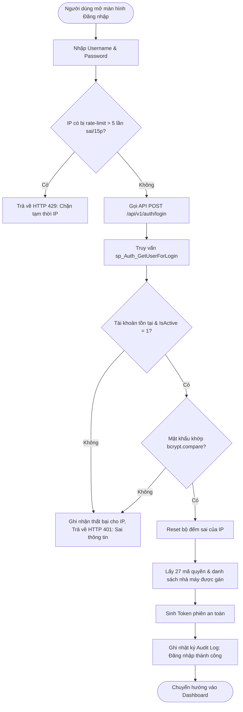

# ĐẶC TẢ CHI TIẾT MODULE F01: XÁC THỰC, TÀI KHOẢN & PHÂN QUYỀN ĐỘNG

> **Mã phân hệ:** F01 (Bao gồm F01a, F01b, F01c)  
> **Tên module:** Authentication, User Management & Dynamic RBAC  
> **Mức độ ưu tiên:** Must Have (M)  
> **Tiêu chuẩn kỹ thuật:** NestJS Guard, BCrypt Hash, MS SQL Server 2019 Stored Procedures, Clean Architecture

---

## 1. Mục tiêu & Phạm vi Nghiệp vụ

### 1.1. Mục tiêu
- Cung cấp cơ chế xác thực danh tính an toàn cho người dùng nội bộ doanh nghiệp.
- Quản lý vòng đời tài khoản người dùng, gán vai trò và gán phạm vi nhà máy phụ trách.
- Triển khai mô hình phân quyền động dựa trên vai trò (Role-Based Access Control - RBAC) với 27 mã quyền chi tiết, cho phép Quản trị viên (ADMIN) cấu hình linh hoạt mà không cần can thiệp mã nguồn.
- Đảm bảo kiểm soát an ninh tối đa ở phía Server (Server-side Enforcement), bảo vệ chống tấn công Brute-force và rò rỉ dữ liệu nhạy cảm.

### 1.2. Phạm vi Chức năng
- **F01a: Xác thực người dùng:** Đăng nhập, Đăng xuất, Xem thông tin phiên làm việc (`/auth/me`), Đổi mật khẩu cá nhân.
- **F01b: Quản lý người dùng:** Danh sách tài khoản (phân trang, lọc, tìm kiếm), Tạo tài khoản mới, Cập nhật thông tin/trạng thái (khóa/mở khóa), Gán nhà máy phụ trách, Đặt lại mật khẩu (Reset Password), Xóa tài khoản (khi chưa có dữ liệu giao dịch).
- **F01c: Quản lý vai trò & Phân quyền động:** Danh sách vai trò, Tạo/Sửa/Xóa vai trò tùy biến, Cấu hình ma trận 27 quyền, Kiểm tra phạm vi nhà máy (`ALL` vs `ASSIGNED`).

---

## 2. Mô hình Phân quyền Động (Dynamic RBAC)

### 2.1. Bảng 4 Vai trò Khởi tạo Hệ thống (`sys_Role`)

| Mã vai trò (`RoleCode`) | Tên hiển thị | Phạm vi nhà máy (`FactoryScope`) | Mô tả vai trò | Đặc quyền |
|---|---|---|---|---|
| `ADMIN` | Quản trị hệ thống | `ALL` (Tất cả 6 nhà máy) | Toàn quyền cấu hình, quản trị người dùng, vai trò và nghiệp vụ. | Ma trận quyền cố định, không thể thu hồi quyền, không thể xóa. |
| `PLANNER` | Lập kế hoạch & Mua hàng | `ALL` (Tất cả 6 nhà máy) | Nạp file ERP, theo dõi vị thế, khóa hàng, lập kế hoạch giao hàng, tạo đề nghị mua. | Toàn quyền nghiệp vụ vận hành trên toàn bộ nhà máy. |
| `FACTORY` | Nhân viên nhà máy | `ASSIGNED` (Chỉ nhà máy được gán) | Theo dõi vị thế và kế hoạch giao của nhà máy mình; thực hiện khóa/mở khóa hàng tại chỗ. | Bị giới hạn dữ liệu nghiêm ngặt theo bảng `sys_User_Factory`. |
| `VIEWER` | Ban quản lý / Chỉ xem | `ALL` (Tất cả 6 nhà máy) | Xem báo cáo dashboard, vị thế tồn kho, kế hoạch giao của toàn bộ hệ thống. | Chỉ có quyền đọc (`*.view`), không có quyền ghi. |

### 2.2. Danh mục 27 Mã Quyền Chuẩn (9 Nhóm Quyền)

Mã quyền được định nghĩa dạng hằng số bất biến trong mã nguồn backend (`PermissionCode`). Cơ sở dữ liệu lưu trữ mối liên kết vai trò – quyền trong bảng `sys_Role_Permission`.

| STT | Nhóm quyền | Mã quyền (`PermissionCode`) | Hành động được phép | PLANNER | FACTORY | VIEWER |
|:---:|---|---|---|:---:|:---:|:---:|
| 1 | **Tổng quan** | `dashboard.view` | Xem màn hình Bảng điều khiển (Dashboard) | ✓ | ✓ | ✓ |
| 2 | **Vị thế** | `position.view` | Xem bảng vị thế tồn kho, chi tiết cặp, lịch sử sửa nhu cầu | ✓ | ✓ | ✓ |
| 3 | | `demand-override.edit` | Tạo mới hoặc bỏ nhu cầu tháng sửa tay | ✓ | | |
| 4 | **Nạp dữ liệu** | `import.view` | Xem lịch sử các lần nạp và danh sách cảnh báo kiểm chéo | ✓ | | |
| 5 | | `import.run` | Tải file lên, xem trước dữ liệu và xác nhận ghi vào CSDL | ✓ | | |
| 6 | **Danh mục** | `catalog.view` | Xem danh mục Nhà máy, Nguyên liệu, NCC, Cặp theo dõi | ✓ | ✓ | ✓ |
| 7 | | `material.edit` | Cập nhật người phụ trách (PIC) và số lẻ hiển thị của NL | | | |
| 8 | | `supplier.edit` | Cập nhật thời gian giao hàng (LeadTimeDays) của NCC | | | |
| 9 | | `factory-material.edit`| Bật/Tắt trạng thái theo dõi cặp NM–NL (`IsTracked`) | | | |
| 10 | | `threshold.edit` | Thiết lập hoặc xóa ngưỡng cảnh báo/định mức theo cặp | ✓ | | |
| 11 | | `system-config.edit` | Cập nhật tham số cấu hình chung hệ thống (`cfg_System`) | | | |
| 12 | **Tồn bị khóa** | `block.view` | Xem danh sách các lệnh khóa hàng (chặn tồn) | ✓ | ✓ | ✓ |
| 13 | | `block.create` | Tạo mới lệnh khóa tồn kho cho cặp NM–NL | ✓ | ✓ | |
| 14 | | `block.release` | Thực hiện giải phóng/mở khóa hàng | ✓ | ✓ | |
| 15 | **Kế hoạch giao**| `delivery-plan.view` | Xem bảng lưới kế hoạch giao hàng tuần | ✓ | ✓ | ✓ |
| 16 | | `delivery-plan.edit` | Chỉnh sửa, lưu lưới kế hoạch giao hàng tuần | ✓ | | |
| 17 | **Đề nghị mua** | `purchase-request.view` | Xem danh sách gợi ý và danh sách đề nghị mua hàng | ✓ | ✓ | |
| 18 | | `purchase-request.create`| Tạo mới phiếu đề nghị mua hàng (PR) | ✓ | | |
| 19 | | `purchase-request.status`| Thay đổi trạng thái PR (MATCHED, EXPIRED, CANCELLED) | ✓ | | |
| 20 | | `purchase-request.export`| Xuất dữ liệu đề nghị mua hàng ra file Excel | ✓ | | |
| 21 | **Người dùng** | `user.view` | Xem danh sách người dùng hệ thống | | | |
| 22 | | `user.create` | Tạo mới tài khoản người dùng | | | |
| 23 | | `user.update` | Sửa thông tin, gán vai trò, gán nhà máy, khóa, reset mật khẩu | | | |
| 24 | | `user.delete` | Xóa tài khoản (khi chưa phát sinh dữ liệu giao dịch) | | | |
| 25 | **Phân quyền** | `role.view` | Xem danh sách vai trò và danh mục mã quyền | | | |
| 26 | | `role.manage` | Tạo mới, chỉnh sửa ma trận quyền, xóa vai trò tùy biến | | | |
| 27 | **Hệ thống** | `api-docs.view` | Truy cập trang tài liệu API Swagger (`/api/docs`) | | | |

*(Ghi chú: Hành động Đổi mật khẩu của chính mình mở cho mọi người dùng đã đăng nhập hợp lệ, không cần gắn mã quyền riêng).*

---

## 3. Quy tắc Nghiệp vụ (Business Rules)

- **BR-29 (Bảo mật mật khẩu):** Mật khẩu người dùng bắt buộc được băm bằng thuật toán BCrypt (độ phức tạp Salt Rounds $\ge 10$). Hệ thống tuyệt đối không lưu trữ, không hiển thị và không trả về mật khẩu thô hoặc hash ra API, log hay thông báo lỗi. Mật khẩu mới bắt buộc có độ dài $\ge 8$ ký tự.
- **BR-RateLimit (Chống Brute-force):** Nếu một địa chỉ IP thực hiện đăng nhập sai quá **5 lần trong vòng 15 phút**, hệ thống tự động khóa tạm quyền đăng nhập từ IP đó trong 15 phút.
- **BR-GenericError (Thông báo an ninh):** Khi đăng nhập thất bại (do sai username, sai password, hoặc tài khoản bị vô hiệu hóa), API chỉ trả về một thông báo lỗi chung: *"Tên đăng nhập hoặc mật khẩu không chính xác"*, nhằm ngăn chặn kỹ thuật dò quét tài khoản (User Enumeration).
- **D1 & A4 (Bảo toàn Quyền Quản trị):** Vai trò `ADMIN` luôn có đầy đủ 27 quyền hệ thống (tính toán cứng trong Guard code), phạm vi nhà máy luôn là `ALL`. Giao diện vô hiệu hóa việc sửa quyền hoặc xóa vai trò `ADMIN`. ADMIN không được phép tự khóa tài khoản hoặc tự hạ vai trò của chính mình để tránh hệ thống bị mất quyền quản trị tối cao.
- **D3 & A4 (Ràng buộc xóa thực thể):** 
  - Chỉ cho phép xóa cứng người dùng (`sys_User`) khi tài khoản đó chưa từng tạo dữ liệu giao dịch (chưa từng tạo lệnh khóa, đề nghị mua, nạp file, override nhu cầu). Nếu đã có dữ liệu liên kết, hệ thống từ chối xóa (HTTP 409) và yêu cầu Quản trị viên thực hiện vô hiệu hóa (`IsActive = 0`).
  - Chỉ cho phép xóa vai trò tùy biến khi không còn người dùng nào đang được gán vai trò đó. Nếu còn, trả về HTTP 409 kèm số lượng tài khoản đang liên kết.
- **A2 & A3 (Quy tắc Vai trò):** `RoleCode` là khóa chính bất biến (chuỗi in hoa, chữ số và gạch dưới, độ dài 2–30 ký tự). Phạm vi `FactoryScope` chỉ nhận một trong hai giá trị: `ALL` hoặc `ASSIGNED`.
- **A5 (API Danh mục dùng chung):** Các API tra cứu dữ liệu cơ bản (danh sách nhà máy, nguyên liệu, NCC) được mở cho mọi người dùng đã đăng nhập hợp lệ để phục vụ nạp dropdown trên giao diện. Quyền `catalog.view` chỉ quyết định việc người dùng có nhìn thấy mục menu "Danh mục" hay không.
- **A6 (Cập nhật quyền tức thì):** Quyền và trạng thái tài khoản được đọc lại trực tiếp từ CSDL ở mỗi request thông qua JWT/Session Guard. Khi Quản trị viên thay đổi quyền hoặc khóa tài khoản, hiệu lực áp dụng ngay lập tức ở request tiếp theo mà người dùng không cần đăng nhập lại.
- **Factory Scope Enforcement:** Với tài khoản có vai trò phạm vi `ASSIGNED`, Guard tại server tự động kiểm tra tham số `factoryId` trong request. Nếu người dùng gọi API với nhà máy nằm ngoài danh sách được gán tại `sys_User_Factory`, trả về lỗi HTTP 403 Forbidden. Các API lấy danh sách tự động gắn bộ lọc chỉ lấy các nhà máy hợp lệ của người dùng.

---

## 4. User Stories & Tiêu chí Chấp nhận (AC - Given-When-Then)

### 4.1. User Stories

1. **US-01 (Đăng nhập):** Là một *Người dùng hệ thống*, tôi muốn đăng nhập bằng tên đăng nhập và mật khẩu, để tôi có thể truy cập các tính năng phù hợp với vai trò của mình.
2. **US-02 (Đổi mật khẩu):** Là một *Người dùng hệ thống*, tôi muốn tự thay đổi mật khẩu tài khoản của mình, để nâng cao tính bảo mật cá nhân định kỳ.
3. **US-03 (Quản trị tài khoản):** Là *Quản trị viên (ADMIN)*, tôi muốn xem danh sách người dùng có phân trang, tạo tài khoản mới và gán nhà máy phụ trách, để cấp quyền cho nhân sự các đơn vị vận hành.
4. **US-04 (Đặt lại mật khẩu):** Là *Quản trị viên (ADMIN)*, tôi muốn đặt lại mật khẩu tạm cho người dùng khi họ quên, để hỗ trợ họ khôi phục quyền truy cập nhanh chóng.
5. **US-05 (Cấu hình phân quyền động):** Là *Quản trị viên (ADMIN)*, tôi muốn tạo vai trò mới và tick chọn các quyền cụ thể trên ma trận, để phân tách trách nhiệm linh hoạt theo yêu cầu quản lý thực tế.

### 4.2. Acceptance Criteria (Given - When - Then)

- **AC-01.01 (Đăng nhập thành công):**
  - **Given:** Tài khoản `planner01` tồn tại, `IsActive = 1`, mật khẩu `Pass@1234`.
  - **When:** Người dùng gửi request `POST /api/v1/auth/login` với thông tin hợp lệ.
  - **Then:** Hệ thống trả về HTTP 200, cấp token phiên hợp lệ, trả thông tin profile kèm danh sách mã quyền; body trả về tuyệt đối không chứa password hash hoặc secret key.

- **AC-01.02 (Đăng nhập thất bại do sai thông tin):**
  - **Given:** Người dùng nhập sai mật khẩu cho tài khoản `admin`.
  - **When:** Gửi request `POST /api/v1/auth/login`.
  - **Then:** Hệ thống trả về HTTP 401 kèm message chung: *"Tên đăng nhập hoặc mật khẩu không chính xác"*.

- **AC-01.03 (Chặn Brute-force quá 5 lần sai):**
  - **Given:** Địa chỉ IP `192.168.1.50` đã đăng nhập sai 5 lần liên tiếp trong 10 phút qua.
  - **When:** Người dùng gửi tiếp lần đăng nhập thứ 6 từ IP này.
  - **Then:** Hệ thống trả về HTTP 429 Too Many Requests kèm thông báo tạm khóa và thời gian mở lại.

- **AC-01.04 (Kiểm soát phạm vi nhà máy - Factory Guard):**
  - **Given:** Người dùng `user_bd` thuộc vai trò `FACTORY`, chỉ được gán nhà máy `BD` (ID = 2).
  - **When:** Người dùng cố tình gọi API vị thế `GET /api/v1/positions?factoryId=1` (Nhà máy `DN`).
  - **Then:** Hệ thống trả về HTTP 403 Forbidden; không có dữ liệu nào của nhà máy DN bị lộ.

- **AC-01.05 (Tạo tài khoản FACTORY thiếu nhà máy):**
  - **Given:** ADMIN tạo tài khoản mới có vai trò `FACTORY` (phạm vi `ASSIGNED`).
  - **When:** Danh sách `factoryIds` gửi lên bị rỗng.
  - **Then:** Hệ thống từ chối với HTTP 400 Bad Request, báo lỗi rõ ràng: *"Vai trò phạm vi ASSIGNED bắt buộc phải gán ít nhất một nhà máy"*.

- **AC-01.06 (ADMIN không thể tự khóa chính mình):**
  - **Given:** ADMIN đang đăng nhập với tài khoản `admin` (ID = 1).
  - **When:** Gửi request cập nhật `PATCH /api/v1/users/1` với `isActive: false`.
  - **Then:** Hệ thống từ chối với HTTP 403 Forbidden: *"Không thể tự khóa tài khoản quản trị của chính mình"*.

---

## 5. Đặc tả Xử lý Chi tiết (Input - Processing - Output) & Luồng Xử lý

### 5.1. Bảng Chi tiết I-P-O

| Chức năng | Input (Đầu vào) | Processing (Quy trình xử lý) | Output (Đầu ra / Phản hồi) |
|---|---|---|---|
| **Đăng nhập** | `username`, `password` | 1. Kiểm tra rate limit IP qua cache.<br>2. Gọi `sp_Auth_GetUserForLogin`.<br>3. Kiểm tra tồn tại và `IsActive = 1`.<br>4. So khớp `bcrypt.compare(password, passwordHash)`.<br>5. Lấy danh sách quyền từ `sys_Role_Permission`.<br>6. Sinh JWT/Session token, ghi nhật ký đăng nhập. | **200 OK:** Token, User Info, List Permissions, Assigned Factories.<br>**401 Unauthorized:** Thông báo lỗi chung.<br>**429 Too Many Requests:** Báo chặn IP. |
| **Đổi mật khẩu** | `currentPassword`, `newPassword` | 1. Xác thực mật khẩu cũ bằng BCrypt.<br>2. Kiểm tra mật khẩu mới $\ge 8$ ký tự, khác mật khẩu cũ.<br>3. Tạo hash mới.<br>4. Gọi `sp_User_SetPassword`. | **200 OK:** Cập nhật thành công.<br>**400 Bad Request:** Mật khẩu cũ không đúng hoặc mật khẩu mới không hợp lệ. |
| **Xem hồ sơ (`me`)** | Bearer Token / Session Cookie | 1. Extract `userId` từ token.<br>2. Gọi `sp_Auth_GetCurrentUser`.<br>3. Kiểm tra trạng thái tài khoản (nếu bị khóa thì hủy phiên). | **200 OK:** Thông tin tài khoản, vai trò, quyền, phạm vi nhà máy, múi giờ ứng dụng. |
| **Tạo người dùng** | `username`, `fullName`, `email`, `roleCode`, `factoryIds`, `tempPassword` | 1. Kiểm tra quyền `user.create`.<br>2. Validate định dạng dữ liệu.<br>3. Nếu vai trò là `ASSIGNED` mà `factoryIds` rỗng $\rightarrow$ dừng.<br>4. Băm mật khẩu tạm.<br>5. Chạy `sp_User_Create` trong transaction (chèn `sys_User` và `sys_User_Factory`). | **201 Created:** Thông tin người dùng mới (không trả password).<br>**400 Bad Request:** Thiếu trường bắt buộc / thiếu nhà máy.<br>**409 Conflict:** Username đã tồn tại. |
| **Đặt lại mật khẩu** | `userId`, `newTempPassword` | 1. Quyền `user.update`.<br>2. Validate mật khẩu $\ge 8$ ký tự.<br>3. Băm BCrypt.<br>4. Gọi `sp_User_SetPassword`. Ghi audit log. | **200 OK:** Đặt lại mật khẩu thành công. |
| **Cấu hình vai trò & quyền** | `roleCode`, `roleName`, `description`, `factoryScope`, `permissionCodes[]` | 1. Quyền `role.manage`.<br>2. Chặn sửa mã hoặc quyền của role `ADMIN`.<br>3. Validate danh sách `permissionCodes` nằm trong 27 mã chuẩn.<br>4. Gọi `sp_Role_SetPermissions` (sử dụng TVP trong transaction). | **200 OK:** Cập nhật ma trận quyền thành công.<br>**400 Bad Request:** Chứa mã quyền lạ không hợp lệ. |

### 5.2. Sơ đồ Luồng Đăng nhập & Xác thực (User Flow)



---

## 6. Thiết kế Cơ sở Dữ liệu & Stored Procedures Chi tiết

### 6.1. Cấu trúc Bảng CSDL

#### 1. Bảng `sys_Role` (Vai trò)
```sql
CREATE TABLE dbo.sys_Role (
    RoleCode VARCHAR(30) NOT NULL,
    RoleName NVARCHAR(100) NOT NULL,
    Description NVARCHAR(255) NULL,
    FactoryScope VARCHAR(10) NOT NULL DEFAULT 'ALL', -- 'ALL' hoặc 'ASSIGNED'
    IsSystem BIT NOT NULL DEFAULT 0, -- 1: Vai trò hệ thống (ADMIN) không được sửa/xóa
    CreatedAt DATETIME2(0) NOT NULL DEFAULT SYSUTCDATETIME(),
    UpdatedAt DATETIME2(0) NOT NULL DEFAULT SYSUTCDATETIME(),
    CONSTRAINT PK_sys_Role PRIMARY KEY CLUSTERED (RoleCode),
    CONSTRAINT CK_sys_Role_Scope CHECK (FactoryScope IN ('ALL', 'ASSIGNED'))
);
```

#### 2. Bảng `sys_Role_Permission` (Ma trận quyền)
```sql
CREATE TABLE dbo.sys_Role_Permission (
    RoleCode VARCHAR(30) NOT NULL,
    PermissionCode VARCHAR(50) NOT NULL,
    CreatedAt DATETIME2(0) NOT NULL DEFAULT SYSUTCDATETIME(),
    CONSTRAINT PK_sys_Role_Permission PRIMARY KEY CLUSTERED (RoleCode, PermissionCode),
    CONSTRAINT FK_RolePermission_Role FOREIGN KEY (RoleCode) REFERENCES dbo.sys_Role(RoleCode) ON DELETE CASCADE
);
```

#### 3. Bảng `sys_User` (Tài khoản)
```sql
CREATE TABLE dbo.sys_User (
    UserID INT IDENTITY(1,1) NOT NULL,
    Username NVARCHAR(50) NOT NULL,
    PasswordHash NVARCHAR(255) NOT NULL,
    FullName NVARCHAR(100) NOT NULL,
    Email NVARCHAR(100) NULL,
    RoleCode VARCHAR(30) NOT NULL,
    IsActive BIT NOT NULL DEFAULT 1,
    CreatedAt DATETIME2(0) NOT NULL DEFAULT SYSUTCDATETIME(),
    UpdatedAt DATETIME2(0) NOT NULL DEFAULT SYSUTCDATETIME(),
    CONSTRAINT PK_sys_User PRIMARY KEY CLUSTERED (UserID),
    CONSTRAINT UQ_sys_User_Username UNIQUE (Username),
    CONSTRAINT FK_sys_User_Role FOREIGN KEY (RoleCode) REFERENCES dbo.sys_Role(RoleCode)
);
```

#### 4. Bảng `sys_User_Factory` (Phạm vi nhà máy được gán)
```sql
CREATE TABLE dbo.sys_User_Factory (
    UserID INT NOT NULL,
    FactoryID INT NOT NULL,
    CreatedAt DATETIME2(0) NOT NULL DEFAULT SYSUTCDATETIME(),
    CONSTRAINT PK_sys_User_Factory PRIMARY KEY CLUSTERED (UserID, FactoryID),
    CONSTRAINT FK_UserFactory_User FOREIGN KEY (UserID) REFERENCES dbo.sys_User(UserID) ON DELETE CASCADE,
    CONSTRAINT FK_UserFactory_Factory FOREIGN KEY (FactoryID) REFERENCES dbo.dim_Factory(FactoryID)
);
```

### 6.2. Kiểu Bảng Tham số (TVP - Table-Valued Parameter)
```sql
CREATE TYPE dbo.tvp_IdList AS TABLE (
    ID INT NOT NULL PRIMARY KEY
);

CREATE TYPE dbo.tvp_CodeList AS TABLE (
    Code VARCHAR(50) NOT NULL PRIMARY KEY
);
```

### 6.3. Stored Procedures Chuẩn (Bắt buộc TRY/CATCH & Transaction)

#### 1. `sp_Auth_GetUserForLogin`
```sql
CREATE OR ALTER PROCEDURE dbo.sp_Auth_GetUserForLogin
    @Username NVARCHAR(50)
AS
BEGIN
    SET NOCOUNT ON;
    SELECT 
        u.UserID,
        u.Username,
        u.PasswordHash,
        u.FullName,
        u.Email,
        u.RoleCode,
        u.IsActive,
        r.FactoryScope
    FROM dbo.sys_User u
    INNER JOIN dbo.sys_Role r ON u.RoleCode = r.RoleCode
    WHERE u.Username = @Username;
END;
```

#### 2. `sp_Auth_GetCurrentUser`
```sql
CREATE OR ALTER PROCEDURE dbo.sp_Auth_GetCurrentUser
    @UserID INT
AS
BEGIN
    SET NOCOUNT ON;
    -- Result 1: Thông tin người dùng
    SELECT 
        u.UserID,
        u.Username,
        u.FullName,
        u.Email,
        u.RoleCode,
        r.RoleName,
        r.FactoryScope,
        u.IsActive
    FROM dbo.sys_User u
    INNER JOIN dbo.sys_Role r ON u.RoleCode = r.RoleCode
    WHERE u.UserID = @UserID;

    -- Result 2: Danh sách mã quyền
    SELECT rp.PermissionCode
    FROM dbo.sys_User u
    INNER JOIN dbo.sys_Role_Permission rp ON u.RoleCode = rp.RoleCode
    WHERE u.UserID = @UserID;

    -- Result 3: Danh sách nhà máy được gán (nếu scope = ASSIGNED)
    SELECT uf.FactoryID, f.FactoryCode, f.FactoryName
    FROM dbo.sys_User_Factory uf
    INNER JOIN dbo.dim_Factory f ON uf.FactoryID = f.FactoryID
    WHERE uf.UserID = @UserID;
END;
```

#### 3. `sp_User_List` (Hỗ trợ phân trang, sắp xếp, lọc, tìm kiếm)
```sql
CREATE OR ALTER PROCEDURE dbo.sp_User_List
    @Search NVARCHAR(100) = NULL,
    @RoleCode VARCHAR(30) = NULL,
    @IsActive BIT = NULL,
    @FactoryID INT = NULL,
    @Page INT = 1,
    @PageSize INT = 20, -- Nếu @PageSize = 0 hoặc NULL thì lấy ALL
    @SortBy NVARCHAR(50) = 'CreatedAt',
    @SortOrder NVARCHAR(4) = 'DESC'
AS
BEGIN
    SET NOCOUNT ON;

    DECLARE @Offset INT = CASE WHEN @PageSize > 0 THEN (@Page - 1) * @PageSize ELSE 0 END;
    DECLARE @FetchRows INT = CASE WHEN @PageSize > 0 THEN @PageSize ELSE 2147483647 END;

    WITH FilteredUsers AS (
        SELECT 
            u.UserID,
            u.Username,
            u.FullName,
            u.Email,
            u.RoleCode,
            r.RoleName,
            r.FactoryScope,
            u.IsActive,
            u.CreatedAt,
            u.UpdatedAt,
            COUNT(*) OVER() AS TotalCount
        FROM dbo.sys_User u
        INNER JOIN dbo.sys_Role r ON u.RoleCode = r.RoleCode
        WHERE (@Search IS NULL OR u.Username LIKE '%' + @Search + '%' OR u.FullName LIKE '%' + @Search + '%')
          AND (@RoleCode IS NULL OR u.RoleCode = @RoleCode)
          AND (@IsActive IS NULL OR u.IsActive = @IsActive)
          AND (@FactoryID IS NULL OR EXISTS (
                SELECT 1 FROM dbo.sys_User_Factory uf WHERE uf.UserID = u.UserID AND uf.FactoryID = @FactoryID
              ) OR r.FactoryScope = 'ALL')
    )
    SELECT *
    FROM FilteredUsers
    ORDER BY 
        CASE WHEN @SortOrder = 'ASC' AND @SortBy = 'Username' THEN Username END ASC,
        CASE WHEN @SortOrder = 'DESC' AND @SortBy = 'Username' THEN Username END DESC,
        CASE WHEN @SortOrder = 'ASC' AND @SortBy = 'FullName' THEN FullName END ASC,
        CASE WHEN @SortOrder = 'DESC' AND @SortBy = 'FullName' THEN FullName END DESC,
        CASE WHEN @SortOrder = 'ASC' AND @SortBy = 'CreatedAt' THEN CreatedAt END ASC,
        CASE WHEN @SortOrder = 'DESC' AND @SortBy = 'CreatedAt' THEN CreatedAt END DESC
    OFFSET @Offset ROWS FETCH NEXT @FetchRows ROWS ONLY;
END;
```

#### 4. `sp_User_Create` (Có Transaction & Kiểm tra trùng lặp)
```sql
CREATE OR ALTER PROCEDURE dbo.sp_User_Create
    @Username NVARCHAR(50),
    @PasswordHash NVARCHAR(255),
    @FullName NVARCHAR(100),
    @Email NVARCHAR(100) = NULL,
    @RoleCode VARCHAR(30),
    @FactoryIds dbo.tvp_IdList READONLY,
    @CreatedBy NVARCHAR(50),
    @NewUserID INT OUTPUT
AS
BEGIN
    SET NOCOUNT ON;
    SET XACT_ABORT ON;

    BEGIN TRY
        BEGIN TRANSACTION;

        -- 1. Kiểm tra tồn tại username
        IF EXISTS (SELECT 1 FROM dbo.sys_User WITH (UPDLOCK, HOLDLOCK) WHERE Username = @Username)
        BEGIN
            RAISERROR(N'Tên đăng nhập đã tồn tại trong hệ thống', 16, 1);
            RETURN;
        END

        -- 2. Kiểm tra vai trò
        DECLARE @Scope VARCHAR(10);
        SELECT @Scope = FactoryScope FROM dbo.sys_Role WHERE RoleCode = @RoleCode;
        IF @Scope IS NULL
        BEGIN
            RAISERROR(N'Vai trò không hợp lệ', 16, 1);
            RETURN;
        END

        -- 3. Kiểm tra nhà máy với scope ASSIGNED
        IF @Scope = 'ASSIGNED' AND NOT EXISTS (SELECT 1 FROM @FactoryIds)
        BEGIN
            RAISERROR(N'Vai trò phạm vi ASSIGNED bắt buộc phải gán ít nhất một nhà máy', 16, 1);
            RETURN;
        END

        -- 4. Chèn người dùng
        INSERT INTO dbo.sys_User (Username, PasswordHash, FullName, Email, RoleCode, IsActive, CreatedAt, UpdatedAt)
        VALUES (@Username, @PasswordHash, @FullName, @Email, @RoleCode, 1, SYSUTCDATETIME(), SYSUTCDATETIME());

        SET @NewUserID = SCOPE_IDENTITY();

        -- 5. Gán nhà máy
        IF @Scope = 'ASSIGNED'
        BEGIN
            INSERT INTO dbo.sys_User_Factory (UserID, FactoryID)
            SELECT @NewUserID, ID FROM @FactoryIds;
        END

        COMMIT TRANSACTION;
    END TRY
    BEGIN CATCH
        IF @@TRANCOUNT > 0 ROLLBACK TRANSACTION;
        THROW;
    END CATCH
END;
```

#### 5. `sp_User_Delete` (Kiểm tra dữ liệu phát sinh trước khi xóa)
```sql
CREATE OR ALTER PROCEDURE dbo.sp_User_Delete
    @UserID INT
AS
BEGIN
    SET NOCOUNT ON;
    SET XACT_ABORT ON;

    BEGIN TRY
        BEGIN TRANSACTION;

        -- Kiểm tra tồn tại
        DECLARE @Username NVARCHAR(50);
        SELECT @Username = Username FROM dbo.sys_User WITH (UPDLOCK, HOLDLOCK) WHERE UserID = @UserID;
        IF @Username IS NULL
        BEGIN
            RAISERROR(N'Người dùng không tồn tại', 16, 1);
            RETURN;
        END

        -- Kiểm tra xem tài khoản có dữ liệu phát sinh hay chưa
        IF EXISTS (SELECT 1 FROM dbo.fact_Inventory_Block WHERE CreatedBy = @Username)
           OR EXISTS (SELECT 1 FROM dbo.fact_Purchase_Request WHERE CreatedBy = @Username)
           OR EXISTS (SELECT 1 FROM dbo.fact_Demand_Override WHERE CreatedBy = @Username)
           OR EXISTS (SELECT 1 FROM dbo.sys_Import_Batch WHERE ImportedBy = @Username)
        BEGIN
            RAISERROR(N'Tài khoản đã phát sinh dữ liệu giao dịch, không thể xóa. Hãy thực hiện vô hiệu hóa (IsActive = 0).', 16, 2);
            RETURN;
        END

        -- Xóa phân công nhà máy và người dùng
        DELETE FROM dbo.sys_User_Factory WHERE UserID = @UserID;
        DELETE FROM dbo.sys_User WHERE UserID = @UserID;

        COMMIT TRANSACTION;
    END TRY
    BEGIN CATCH
        IF @@TRANCOUNT > 0 ROLLBACK TRANSACTION;
        THROW;
    END CATCH
END;
```

#### 6. `sp_Role_SetPermissions` (Cập nhật ma trận quyền qua TVP)
```sql
CREATE OR ALTER PROCEDURE dbo.sp_Role_SetPermissions
    @RoleCode VARCHAR(30),
    @Permissions dbo.tvp_CodeList READONLY
AS
BEGIN
    SET NOCOUNT ON;
    SET XACT_ABORT ON;

    BEGIN TRY
        BEGIN TRANSACTION;

        -- Không cho phép can thiệp quyền của role ADMIN
        IF @RoleCode = 'ADMIN'
        BEGIN
            RAISERROR(N'Không được phép tùy biến quyền của vai trò ADMIN hệ thống', 16, 1);
            RETURN;
        END

        -- Xóa quyền cũ
        DELETE FROM dbo.sys_Role_Permission WHERE RoleCode = @RoleCode;

        -- Thêm quyền mới
        INSERT INTO dbo.sys_Role_Permission (RoleCode, PermissionCode)
        SELECT @RoleCode, Code FROM @Permissions;

        COMMIT TRANSACTION;
    END TRY
    BEGIN CATCH
        IF @@TRANCOUNT > 0 ROLLBACK TRANSACTION;
        THROW;
    END CATCH
END;
```

---

## 7. Đặc tả API RESTful

### 7.1. Danh sách Endpoints

| Phương thức | Đường dẫn API | Mã quyền yêu cầu | Mô tả |
|---|---|---|---|
| `POST` | `/api/v1/auth/login` | Public | Đăng nhập hệ thống, trả token và quyền |
| `POST` | `/api/v1/auth/logout` | Đã đăng nhập | Hủy phiên làm việc hiện tại |
| `GET` | `/api/v1/auth/me` | Đã đăng nhập | Lấy thông tin tài khoản hiện tại kèm quyền |
| `POST` | `/api/v1/auth/change-password` | Đã đăng nhập | Người dùng tự đổi mật khẩu cá nhân |
| `GET` | `/api/v1/users` | `user.view` | Lấy danh sách tài khoản (phân trang, lọc, tìm kiếm) |
| `POST` | `/api/v1/users` | `user.create` | Tạo mới tài khoản người dùng |
| `GET` | `/api/v1/users/:id` | `user.view` | Chi tiết tài khoản |
| `PATCH`| `/api/v1/users/:id` | `user.update` | Sửa thông tin, khóa/mở khóa tài khoản |
| `PUT`  | `/api/v1/users/:id/factories` | `user.update` | Cập nhật danh sách nhà máy được gán |
| `POST` | `/api/v1/users/:id/reset-password` | `user.update` | ADMIN đặt lại mật khẩu tạm cho người dùng |
| `DELETE`| `/api/v1/users/:id`| `user.delete` | Xóa tài khoản (khi chưa có dữ liệu giao dịch) |
| `GET` | `/api/v1/roles` | `role.view` | Danh sách vai trò |
| `POST` | `/api/v1/roles` | `role.manage` | Tạo mới vai trò tùy biến |
| `PUT`  | `/api/v1/roles/:code` | `role.manage` | Cập nhật tên, mô tả, phạm vi nhà máy của vai trò |
| `DELETE`| `/api/v1/roles/:code` | `role.manage` | Xóa vai trò tùy biến (khi không còn ai dùng) |
| `GET` | `/api/v1/roles/permissions` | `role.view` | Lấy danh mục 27 mã quyền chuẩn |
| `PUT`  | `/api/v1/roles/:code/permissions` | `role.manage` | Cập nhật ma trận quyền cho vai trò |

### 7.2. Data Transfer Objects (DTO) Mẫu

#### 1. LoginDto
```typescript
export class LoginDto {
  @IsNotEmpty({ message: 'Tên đăng nhập không được để trống' })
  @IsString()
  username: string;

  @IsNotEmpty({ message: 'Mật khẩu không được để trống' })
  @IsString()
  password: string;
}
```

#### 2. CreateUserDto
```typescript
export class CreateUserDto {
  @IsNotEmpty({ message: 'Tên đăng nhập không được để trống' })
  @Length(3, 50, { message: 'Tên đăng nhập từ 3 đến 50 ký tự' })
  @Matches(/^[a-zA-Z0-9_]+$/, { message: 'Tên đăng nhập chỉ chứa chữ cái, số và dấu gạch dưới' })
  username: string;

  @IsNotEmpty({ message: 'Họ và tên không được để trống' })
  @Length(2, 100)
  fullName: string;

  @IsOptional()
  @IsEmail({}, { message: 'Định dạng email không hợp lệ' })
  email?: string;

  @IsNotEmpty({ message: 'Vai trò không được để trống' })
  roleCode: string;

  @IsArray()
  @IsOptional()
  factoryIds?: number[];

  @IsNotEmpty({ message: 'Mật khẩu tạm không được để trống' })
  @MinLength(8, { message: 'Mật khẩu tạm phải có ít nhất 8 ký tự' })
  tempPassword: string;
}
```

---

## 8. Đặc tả Giao diện Người dùng (UI/UX)

- **Màn hình Đăng nhập (`/login`):**
  - Form căn giữa, hỗ trợ ghi nhớ trạng thái theme sáng/tối.
  - Thông báo lỗi tập trung, không tiết lộ tài khoản có tồn tại hay không.
  - Khóa form và đếm ngược thời gian nếu bị rate limit.
- **Màn hình Quản lý Người dùng (`/admin/users`):**
  - Bảng danh sách tiêu chuẩn với thanh công cụ: Thanh tìm kiếm (Username, FullName), Dropdown lọc Vai trò, Dropdown lọc Trạng thái (Đang hoạt động / Đã khóa), Dropdown lọc Nhà máy.
  - Phân trang dưới chân bảng: Chọn số dòng trên trang (`10`, `20`, `50`, `Tất cả`).
  - Cột hành động: Nút Sửa thông tin, Đặt lại mật khẩu (Modal xác nhận nhập mật khẩu tạm $\ge 8$ ký tự), Khóa/Mở khóa, Xóa (kèm xác nhận 2 bước).
- **Màn hình Phân quyền Vai trò (`/admin/roles`):**
  - Danh sách vai trò bên trái, Ma trận 27 quyền nhóm thành 9 Accordion bên phải.
  - Checkbox chọn quyền trực quan, có nút "Chọn tất cả" cho từng nhóm quyền.
  - Vai trò `ADMIN` bị khóa toàn bộ checkbox (luôn checked).

---

## 9. Kiểm toán & Nhật ký (Audit Log)

Mọi hành vi trọng yếu của module F01 được ghi nhận tự động vào bảng `sys_Audit_Log`:
1. `AUTH_LOGIN_SUCCESS`: Ghi nhận người dùng, địa chỉ IP, thời điểm đăng nhập thành công.
2. `AUTH_LOGIN_FAILED`: Ghi nhận IP và username thử đăng nhập thất bại.
3. `USER_CHANGE_PASSWORD`: Người dùng đổi mật khẩu thành công.
4. `USER_CREATE`: ADMIN tạo tài khoản mới.
5. `USER_UPDATE_STATUS`: Khóa hoặc mở khóa tài khoản.
6. `USER_RESET_PASSWORD`: ADMIN đặt lại mật khẩu tạm.
7. `ROLE_UPDATE_PERMISSIONS`: Thay đổi ma trận quyền của một vai trò.

---

## 10. Kịch bản Kiểm thử & Test Fixtures

- **Test 1: Đăng nhập thành công:** Đăng nhập `admin` / `Admin@1234` $\rightarrow$ Nhận mã 200, JWT token có hiệu lực, danh sách 27 quyền đầy đủ.
- **Test 2: Sai mật khẩu:** Đăng nhập `admin` / `SaiPass` $\rightarrow$ Nhận mã 401, không cấp token.
- **Test 3: Rate limiting:** Gọi sai liên tục 6 lần từ một IP $\rightarrow$ Lần 6 nhận mã 429.
- **Test 4: FACTORY truy cập trái phép:** User nhà máy BD gọi vị thế nhà máy DN $\rightarrow$ Nhận mã 403 Forbidden.
- **Test 5: Xóa user đã có dữ liệu:** Xóa user đã có trong `sys_Import_Batch` $\rightarrow$ Nhận mã 409 Conflict, dữ liệu không bị xóa.
