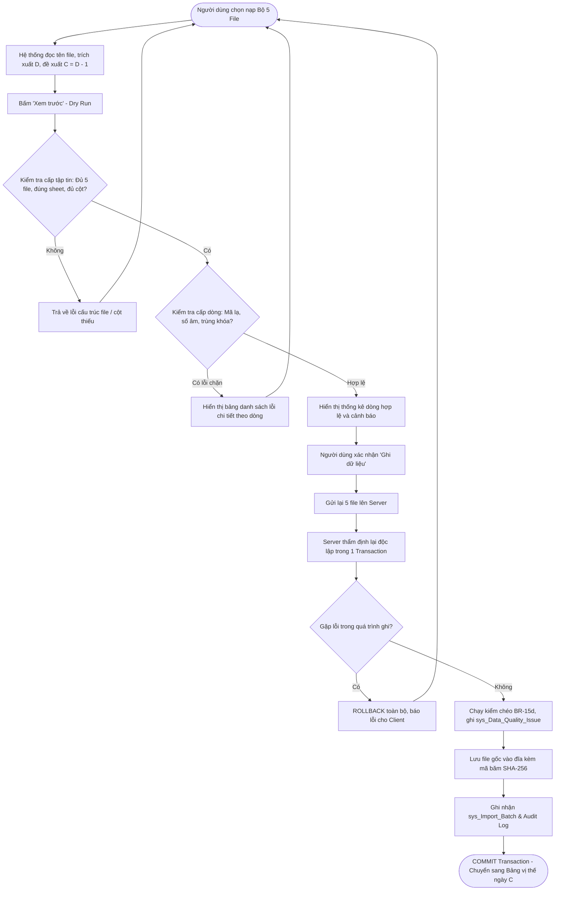

# ĐẶC TẢ CHI TIẾT MODULE F03: NẠP DỮ LIỆU & KIỂM SOÁT CHẤT LƯỢNG

> **Mã phân hệ:** F03  
> **Tên module:** Data Ingestion & Quality Control (ERP D365 & Forecast)  
> **Mức độ ưu tiên:** Must Have (M)  
> **Tiêu chuẩn kỹ thuật:** Stream Excel Parser, Single Atomic Transaction, Table-Valued Parameters (TVP), Audit & Data Quality Trail

---

## 1. Mục tiêu & Phạm vi Nghiệp vụ

### 1.1. Mục tiêu
- Tiếp nhận, thẩm định và nạp dữ liệu định kỳ từ các file Excel kết xuất từ ERP Microsoft Dynamics 365 (D365) và file dự báo nhu cầu (Forecast).
- Đảm bảo tính toàn vẹn và nhất quán tuyệt đối giữa các bảng giao dịch liên quan (đặc biệt là giữa PO Pending và PO Receipt).
- Tự động kiểm tra chất lượng dữ liệu ở cấp độ tập tin (File-level), dòng dữ liệu (Row-level) và kiểm tra chéo logic nghiệp vụ (Cross-check logic), ghi nhận cảnh báo chi tiết giúp người dùng phát hiện sai lệch dữ liệu từ ERP.

### 1.2. Phạm vi Chức năng
- **Nạp Master Data (`Master Data.xlsx`):** Cập nhật danh mục 5 sheet (Plants, Items, Plant Items, Vendors, Vendor Items).
- **Nạp Bộ 5 File Ngày Chốt (Snapshot Ingestion):** Nạp đồng thời 5 file giao dịch ERP của cùng một ngày cut-off trong một transaction duy nhất:
  1. On Hand (`SOH`)
  2. Inventory Movement Report (`INV46`)
  3. PO Pending (`FINISH PENDING`)
  4. PO Receipt (`POR`)
  5. Transfer Order (`Sheet1`)
- **Nạp Dự báo Nhu cầu (Forecast Ingestion):** Nạp ma trận nhu cầu nguyên liệu theo tháng/version từ file "RM Usage".
- **Xem trước Dữ liệu (Dry-run / Preview):** Đọc và thẩm định lỗi cú pháp, cấu trúc cột, khóa trùng lặp trước khi ghi vào CSDL.
- **Quản lý Lịch sử & Cảnh báo Chất lượng:** Tra cứu các lần nạp (`sys_Import_Batch`) và danh sách vấn đề chất lượng (`sys_Data_Quality_Issue`).

---

## 2. Ma trận Phân quyền Module F03

| Mã quyền (`PermissionCode`) | Hành động được phép | ADMIN | PLANNER | FACTORY | VIEWER |
|---|---|:---:|:---:|:---:|:---:|
| `import.view` | Xem lịch sử nạp, chi tiết lần nạp và danh sách cảnh báo kiểm chéo | ✓ | ✓ | | |
| `import.run` | Tải file lên, chạy chế độ xem trước (preview) và xác nhận ghi CSDL | ✓ | ✓ | | |

---

## 3. Quy tắc Nghiệp vụ Chi tiết (Business Rules)

### 3.1. Quy tắc Xác định Ngày Chốt & Xử lý File
- **BR-15e (Quy tắc Xác định Ngày Chốt C):** Các file giao dịch ERP có tiêu đề "Cut off 06h D" thể hiện số liệu tính đến hết ngày $D - 1$.
  - Ngày chốt tính toán chính thức: $C = D - 1$.
  - Hệ thống tự động trích xuất ngày $D$ từ tên file, đề xuất ngày chốt $C = D - 1$ và lưu trữ cả hai mốc ngày trong `sys_Import_Batch`. Mọi phép tính toán vị thế, DOI và cảnh báo sau này đều lấy mốc $C$ làm chuẩn.
- **BR-17 (Tính Nguyên tử của Bộ 5 File):** File PO Receipt (POR) và PO Pending bắt buộc phải nạp cùng nhau tại cùng ngày chốt để tránh mất cân đối hàng đang về. Hệ thống bắt buộc nạp trọn bộ 5 file trong **MỘT TRANSACTION CƠ SỞ DỮ LIỆU DUY NHẤT**. Nếu thiếu bất kỳ file nào trong 5 file, hoặc phát sinh lỗi trong quá trình ghi bất kỳ file nào, toàn bộ quá trình sẽ bị ROLLBACK và không có dữ liệu nào được lưu.
- **BR-22 (Thẩm định Cột Bắt buộc):** Hệ thống dò tìm dòng tiêu đề và tên cột cố định theo danh sách chuẩn (hỗ trợ `trim` khoảng trắng hai đầu). Nếu thiếu sheet bắt buộc hoặc thiếu bất kỳ cột bắt buộc nào, toàn bộ file bị từ chối với thông báo lỗi cụ thể tên cột bị thiếu. Tuyệt đối không sử dụng cơ chế tự đoán cột.

### 3.2. Quy tắc Xử lý Từng File Giao dịch
- **BR-15c (Xử lý On Hand):**
  - Chỉ lọc lấy các dòng có `SUB INV = 'RAW'` để ghi nhận vào tồn kho thực tế (`fact_Inventory_SOH`).
  - Các dòng có `SUB INV = 'TRANSIT'` không được cộng vào SOH RAW (chỉ được dùng để đối chiếu kiểm chéo điều chuyển).
  - Bỏ qua các dòng có số lượng tồn bằng 0. Nếu một cặp NM–NL có trong danh sách theo dõi (`Plant Items`) nhưng không xuất hiện dòng nào trong file On Hand, hệ thống tự động hiểu SOH tại $C$ bằng 0.
- **BR-15a (Xử lý Inventory Movement - INV46):**
  - Số liệu trong file là lũy kế từ ngày 1 của tháng đến ngày chốt $C$ (MTD).
  - Lượng xuất sản xuất (Wip Issue) phát sinh trong một ngày = $\text{MTD}(C) - \text{MTD}(C-1)$ (với $C-1$ là ngày chốt liền trước trong cùng tháng). Nếu là ngày chốt đầu tiên của tháng, phát sinh chính là số MTD.
- **BR-19 & BR-19b (Xử lý PO Pending):**
  - Lượng còn lại chưa giao lấy nguyên bản từ cột "Deliver remainder".
  - Ngày trên dòng (`DeliveryDate`) thực chất là **ngày tạo PO** trong D365 (được dùng để tính tuổi PO theo BR-19c).
  - Các dòng hợp đồng khung (`PAG`) được tính gộp chung như đơn mua hàng (`PO`), không bóc tách riêng.
- **BR-18 & BR-18a (Xử lý PO Receipt - POR):**
  - Tên file POR quy định khoảng ngày nhận hàng (ví dụ: `PO receipt 011026-061026` tương ứng từ 01/10/2026 đến 06/10/2026).
  - Khi nạp, hệ thống chỉ xóa và ghi đè các phiếu có `Date Delivery` nằm trong khoảng ngày quy định của tên file; các phiếu ngoài khoảng ngày đó được giữ nguyên.
  - Lượng nhận lấy từ cột `Quantity`, đơn vị bắt buộc kiểm tra là `kg`.
- **BR-19a (Xử lý Transfer Order Inquiry):**
  - Lệnh điều chuyển được cập nhật theo cơ chế khóa `(TransferNumber, MaterialID)` và giữ bản ghi mới nhất. Chỉ ghi đè khi ngày chốt của lần nạp mới $\ge$ ngày chốt đã ghi dòng đó; file nạp cũ hơn chỉ được phép thêm các dòng chưa từng tồn tại.
- **BR-15b (Xử lý Forecast - RM Usage):**
  - Mỗi file Forecast tương ứng với một phiên bản (`VersionDate` = ngày/giờ lập ghi ở dòng đầu của sheet).
  - Nhu cầu thể hiện dưới dạng ma trận: Dòng = Nguyên liệu, Cột = Nhà máy. Ô rỗng thể hiện không có nhu cầu. Nếu nạp lại cùng một `VersionDate` cho cùng một tháng, hệ thống ghi đè phiên bản cũ.

### 3.3. Quy tắc Ràng buộc Toàn vẹn & Kiểm chéo (Quality Checks)
- **BR-21 (Chặn Mã Lạ):** Không tự ý tạo Nhà máy hoặc Nguyên liệu mới từ các file giao dịch. Nếu xuất hiện mã NM hoặc NL không tồn tại trong Master Data, dòng đó bị đánh dấu lỗi và chặn ghi. Riêng Nhà cung cấp (NCC), nếu xuất hiện NCC mới trong file PO Pending (có trường Group), hệ thống tự động bổ sung vào `dim_Supplier`.
- **BR-21a (Cảnh báo Cặp ngoài Master):** Nếu mã NM và NL đều hợp lệ trong Master Data nhưng cặp này không nằm trong `Plant Items`, hệ thống vẫn cho phép nạp và tự động ghi nhận cảnh báo chất lượng `PAIR_NOT_IN_MASTER`.
- **BR-22a (Lỗi Dòng Dữ liệu):** Các dòng có số lượng âm, ngày tháng sai định dạng, đơn vị tính khác 'kg', hoặc trùng lặp khóa nghiệp vụ trong cùng một file sẽ bị coi là lỗi dòng và chặn quá trình ghi.
- **BR-15d (Kiểm chéo Nghiệp vụ - Quality Issues):** Sau khi ghi dữ liệu thành công, hệ thống tự động chạy 5 bài kiểm tra chéo và ghi các vi phạm vào `sys_Data_Quality_Issue` (chỉ tạo cảnh báo, **không chặn nạp**):
  1. $\text{Begin} + \text{Receive} + \text{Transfer In} - \text{Wip Issue} - \text{Transfer Out} + \text{Adjust} = \text{Closed Onhand}$ (trên file Movement).
  2. $\text{Closed Onhand (Movement)} = \text{SOH RAW (On Hand)}$.
  3. $\sum \text{POR Quantity trong ngày} = \text{Qty Receive (Movement) của ngày đó}$.
  4. $\text{SOH TRANSIT của kho} = \sum \text{Shipped Qty của các TO đang ở trạng thái Shipped xuất từ kho đó}$.
  5. Đối với nguyên liệu đóng bao (`BagKg` $> 0$), số lượng đặt trên PO và số lượng nhận trên POR phải là bội số của khối lượng bao.

---

## 4. Đặc tả Định dạng 7 File Excel Nguồn

| Tập tin | Tên Sheet | Vị trí tiêu đề | Các cột bắt buộc sử dụng | Khóa nghiệp vụ | Ghi chú bộ đọc |
|---|---|---|---|---|---|
| **Master Data.xlsx** | `Plants` | Dòng 1 | Mã nhà máy, Tên, Region, Type, Org codes | Mã nhà máy | Tra cứu mã kho từ cột Org codes |
| | `Items` | Dòng 1 | Item code, Item name, Category, Nhóm, Quy cách, Bao (kg), UOM, Item type | Item code | Chuỗi mã NL giữ số 0 đầu; `Bao (kg)` rỗng là hàng xá |
| | `Plant Items`| Dòng 1 | OU, Org code, Item code | (Org code, Item code) | Danh sách cặp theo dõi |
| | `Vendors` | Dòng 1 | Vendor account, Vendor name, Group, Country | Vendor account | Group: `LOC_*` (nội địa), `FOR_*` (ngoại) |
| | `Vendor Items`| Dòng 1 | Item code, Vendor account | (Item code, Vendor) | Bỏ qua các cột đơn giá |
| **On Hand** | `SOH` | Khoảng dòng 10 | WAREHOUSE, ORG CODE, SUB INV, ITEM CODE, SOH | (C, ORG CODE, SUB INV, ITEM CODE) | Có dòng tổng ở trên; chỉ lấy `SUB INV = 'RAW'`. Bỏ dòng tồn = 0 |
| **Inventory Movement** | `INV46` | Dòng 2 | OU, Org Code, Item code, Begin Onhand, Qty Receive, Wip Issue, Transfer In, Transfer Out, Adjust, Closed Onhand | (C, Org Code, Item code) | Dòng 1 là dòng tổng; tên cột có khoảng trắng $\rightarrow$ `trim()` |
| **PO Pending** | `FINISH PENDING`| Dòng 1 | Site, Warehouse, Vendor account, Purchase order/PAG, Item number, Unit, Quantity, Received/Release, Deliver remainder, Delivery date, Line status | (C, PO/PAG, Item, Delivery date) | Lấy `Deliver remainder`; `Delivery date` là ngày tạo đơn |
| **PO Receipt** | `POR` | Dòng 1 | Site, WH, Code Vendor, PO Number, POR, Date Delivery, Code RM, Unit, Quantity, PAG, Truck number | (POR, Code RM) | Không có số dòng PO; chỉ lấy đơn vị 'kg' |
| **Transfer Order** | `Sheet1` | Dòng 1 | Transfer Number, Item No, From Warehouse, To Warehouse, Transfer status, Shipped Date, Received Date, Shipped Qty, Posted Qty to onhand | (Transfer Number, Item No) | Trạng thái: Created, Shipped, Received |
| **Forecast (RM Usage)** | `RM Usage` | Dòng 5–8 | Dòng 1–4: Ngày lập; Dòng 5–8: Tên NM; Cột A: Mã NL; Cột B: Tên NL; Cột C...: Lượng theo NM | (VersionDate, Month, NM, NL) | Xoay ma trận; số kiểu châu Âu (`1.234,5` $\rightarrow$ `1234.5`); kiểm tổng cột Total |

---

## 5. Quy trình Xử lý & Luồng Người dùng (User Flow)



---

## 6. Thiết kế Cơ sở Dữ liệu & Stored Procedures

### 6.1. Bảng `sys_Import_Batch` & `sys_Data_Quality_Issue`

```sql
CREATE TABLE dbo.sys_Import_Batch (
    BatchID INT IDENTITY(1,1) NOT NULL,
    BatchType VARCHAR(20) NOT NULL, -- 'MASTER', 'DAILY_SET', 'FORECAST'
    SnapshotDate DATE NULL,         -- Ngày chốt C (cho DAILY_SET)
    CutoffDate DATE NULL,           -- Ngày D trên tên file
    PeriodMonth DATE NULL,          -- Tháng nhu cầu (cho FORECAST)
    VersionDate DATETIME2(0) NULL,  -- Ngày lập forecast
    OriginalFileName NVARCHAR(255) NOT NULL,
    FileHash VARCHAR(64) NOT NULL,  -- SHA-256
    TotalRows INT NOT NULL DEFAULT 0,
    ValidRows INT NOT NULL DEFAULT 0,
    ErrorRows INT NOT NULL DEFAULT 0,
    Status VARCHAR(20) NOT NULL DEFAULT 'COMPLETED', -- 'COMPLETED', 'FAILED'
    ImportedAt DATETIME2(0) NOT NULL DEFAULT SYSUTCDATETIME(),
    ImportedBy NVARCHAR(50) NOT NULL,
    CONSTRAINT PK_sys_Import_Batch PRIMARY KEY CLUSTERED (BatchID)
);

CREATE TABLE dbo.sys_Data_Quality_Issue (
    IssueID INT IDENTITY(1,1) NOT NULL,
    BatchID INT NOT NULL,
    SnapshotDate DATE NOT NULL,
    FactoryID INT NULL,
    MaterialID INT NULL,
    IssueType VARCHAR(50) NOT NULL, -- 'MOVEMENT_EQUATION_MISMATCH', 'CLOSED_SOH_MISMATCH', etc.
    Severity VARCHAR(10) NOT NULL DEFAULT 'WARNING', -- 'WARNING', 'INFO'
    Description NVARCHAR(500) NOT NULL,
    CreatedAt DATETIME2(0) NOT NULL DEFAULT SYSUTCDATETIME(),
    CONSTRAINT PK_sys_Data_Quality_Issue PRIMARY KEY CLUSTERED (IssueID),
    CONSTRAINT FK_QualityIssue_Batch FOREIGN KEY (BatchID) REFERENCES dbo.sys_Import_Batch(BatchID)
);
```

### 6.2. Kiểu Bảng TVP Dùng để Nạp Dữ liệu

```sql
CREATE TYPE dbo.tvp_InventorySoh AS TABLE (
    WarehouseCode NVARCHAR(50) NOT NULL,
    MaterialCode VARCHAR(50) NOT NULL,
    SubInventory VARCHAR(20) NOT NULL,
    QuantityKg DECIMAL(18,0) NOT NULL
);

CREATE TYPE dbo.tvp_InventoryMovement AS TABLE (
    WarehouseCode NVARCHAR(50) NOT NULL,
    MaterialCode VARCHAR(50) NOT NULL,
    BeginOnhandKg DECIMAL(18,0) NOT NULL,
    QtyReceiveKg DECIMAL(18,0) NOT NULL,
    WipIssueKg DECIMAL(18,0) NOT NULL,
    TransferInKg DECIMAL(18,0) NOT NULL,
    TransferOutKg DECIMAL(18,0) NOT NULL,
    AdjustKg DECIMAL(18,0) NOT NULL,
    ClosedOnhandKg DECIMAL(18,0) NOT NULL
);
```

### 6.3. Stored Procedure Nạp Dữ liệu Mẫu: `sp_Import_OnHand`

```sql
CREATE OR ALTER PROCEDURE dbo.sp_Import_OnHand
    @BatchID INT,
    @SnapshotDate DATE,
    @TvData dbo.tvp_InventorySoh READONLY
AS
BEGIN
    SET NOCOUNT ON;
    SET XACT_ABORT ON;

    BEGIN TRY
        -- 1. Xóa dữ liệu cũ của ngày chốt tương ứng (Idempotency)
        DELETE FROM dbo.fact_Inventory_SOH
        WHERE SnapshotDate = @SnapshotDate;

        -- 2. Chèn dữ liệu mới (chỉ lấy SUB INV = 'RAW')
        INSERT INTO dbo.fact_Inventory_SOH (
            SnapshotDate,
            FactoryID,
            MaterialID,
            SohQtyKg,
            BatchID
        )
        SELECT 
            @SnapshotDate,
            f.FactoryID,
            m.MaterialID,
            SUM(tv.QuantityKg),
            @BatchID
        FROM @TvData tv
        INNER JOIN dbo.dim_Factory f ON tv.WarehouseCode = f.WarehouseCode
        INNER JOIN dbo.dim_Material m ON tv.MaterialCode = m.MaterialCode
        WHERE tv.SubInventory = 'RAW'
        GROUP BY f.FactoryID, m.MaterialID;

    END TRY
    BEGIN CATCH
        THROW;
    END CATCH
END;
```

---

## 7. Đặc tả API RESTful Module F03

| Phương thức | Đường dẫn API | Quyền | Mô tả |
|---|---|---|---|
| `POST` | `/api/v1/imports/preview/daily-set` | `import.run` | Tải lên 5 file để kiểm tra cấu trúc và lỗi dòng (không ghi CSDL) |
| `POST` | `/api/v1/imports/execute/daily-set` | `import.run` | Xác nhận nạp bộ 5 file trong 1 transaction |
| `POST` | `/api/v1/imports/master-data` | `import.run` | Nạp file Master Data (5 sheets) |
| `POST` | `/api/v1/imports/forecast` | `import.run` | Nạp file Forecast RM Usage theo tháng/version |
| `GET`  | `/api/v1/imports/batches` | `import.view` | Danh sách lịch sử các lần nạp (phân trang, lọc, tìm kiếm) |
| `GET`  | `/api/v1/imports/batches/:id/issues` | `import.view` | Danh sách cảnh báo chất lượng của một lần nạp |

---

## 8. Đặc tả Giao diện Người dùng (UI/UX)

- **Màn hình Nạp Dữ liệu (`/import`):**
  - Giao diện dạng Tab:
    1. **Tab 1: Bộ 5 file ngày chốt (Chính):** 5 vùng kéo thả file tương ứng: On Hand, Movement, PO Pending, PO Receipt, Transfer Order. Có ô chọn ngày chốt (tự động điền theo tên file).
    2. **Tab 2: Master Data:** Vùng tải lên `Master Data.xlsx`.
    3. **Tab 3: Forecast:** Vùng tải lên file RM Usage kèm ô chọn tháng nhu cầu.
    4. **Tab 4: Lịch sử nạp & Cảnh báo:** Bảng lịch sử các lần nạp có phân trang (10, 20, 50, Tất cả), lọc theo loại file, ngày chốt, người nạp.
  - **Khung Xem trước (Preview Modal):**
    - Hiển thị badge tổng quan: Số file hợp lệ (5/5), Số dòng đọc được, Số dòng cảnh báo, Số dòng lỗi.
    - Nếu có lỗi chặn: Bảng chi tiết lỗi theo dòng (Tên file, Sheet, Dòng số, Cột, Mã lỗi, Mô tả chi tiết). Nút "Xác nhận ghi" bị vô hiệu hóa.
    - Nếu hợp lệ: Nút "Xác nhận ghi" sáng lên để người dùng thực hiện ghi chính thức.

---

## 9. Kiểm toán & Nhật ký (Audit Log)

1. `IMPORT_DAILY_SET_SUCCESS`: Nạp thành công bộ 5 file cho ngày chốt C (ghi kèm số dòng và mã batch).
2. `IMPORT_DAILY_SET_FAILED`: Nạp thất bại bộ 5 file (ghi kèm nguyên nhân lỗi và rollback).
3. `IMPORT_MASTER_DATA`: Cập nhật Master Data (số lượng nhà máy, nguyên liệu, NCC cập nhật/thêm mới).
4. `IMPORT_FORECAST`: Nạp phiên bản dự báo mới cho tháng.
