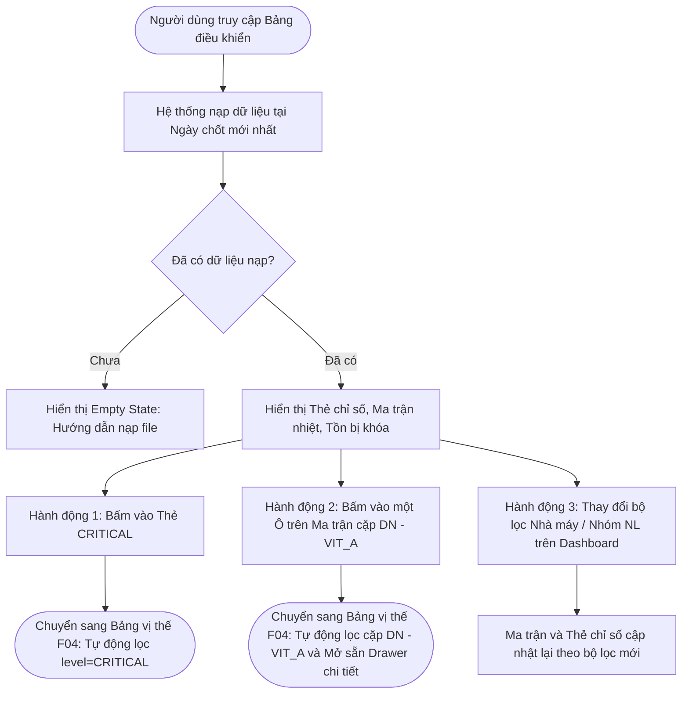

# ĐẶC TẢ CHI TIẾT MODULE F05: BẢNG ĐIỀU KHIỂN TỔNG QUAN (DASHBOARD)

> **Mã phân hệ:** F05  
> **Tên module:** Executive Dashboard & Operational Overview  
> **Mức độ ưu tiên:** Must Have (M)  
> **Tiêu chuẩn kỹ thuật:** Clean Architecture, Tái sử dụng kết quả Domain Engine (F04), Dynamic Heatmap Matrix

---

## 1. Mục tiêu & Phạm vi Nghiệp vụ

### 1.1. Mục tiêu
- Cung cấp giao diện trung tâm trực quan, tổng hợp toàn cảnh tình trạng tồn kho của tất cả 72 cặp Nhà máy – Nguyên liệu tại ngày chốt mới nhất.
- Giúp người điều hành (Ban giám đốc, Trưởng bộ phận kế hoạch) và nhân sự vận hành nhận diện ngay lập tức các điểm nóng: Cặp thiếu hụt nguy cấp (CRITICAL), Cặp sắp thiếu hụt (WARNING), Lượng hàng đang bị khóa, và các bất thường về dữ liệu.
- Đóng vai trò là bàn đạp điều hướng: Nhấp chuột vào bất kỳ ô chỉ số nào sẽ dẫn trực tiếp sang màn hình chi tiết tương ứng với bộ lọc đã được thiết lập sẵn.

### 1.2. Phạm vi Chức năng
- **Thẻ Chỉ số 5 Mức Cảnh báo (Level Metric Cards):** Thống kê số lượng cặp theo từng mức: CRITICAL, WARNING, BALANCED, OVERSTOCK, NO_DEMAND.
- **Ma trận Nhiệt Nguyên liệu × Nhà máy (Heatmap Matrix):** Lưới ma trận trực quan (Dòng: 26 Nguyên liệu; Cột: 6 Nhà máy).
- **Thống kê Tồn bị Khóa (Blocked Stock Summary):** Tổng số cặp và tổng khối lượng kg đang bị tạm khóa.
- **Thống kê Cờ Dữ liệu Bất thường (Quality Flags Summary):** Số lượng cặp gặp cảnh báo theo từng loại cờ.
- **Thông tin Lần nạp Mới nhất & Cảnh báo Dữ liệu Cũ:** Hiển thị thông tin phiên nạp file gần nhất và thanh cảnh báo nếu số liệu bị trễ quá 2 ngày (BR-40).

---

## 2. Ma trận Phân quyền Module F05

| Mã quyền (`PermissionCode`) | Hành động được phép | ADMIN | PLANNER | FACTORY | VIEWER |
|---|---|:---:|:---:|:---:|:---:|
| `dashboard.view` | Xem toàn bộ Bảng điều khiển tổng quan | ✓ | ✓ | ✓ | ✓ |

*(Lưu ý về phạm vi hiển thị: Người dùng có vai trò `FACTORY` chỉ nhìn thấy dữ liệu và cột của nhà máy được phân công; các cột nhà máy khác sẽ bị ẩn).*

---

## 3. Quy tắc Nghiệp vụ & Phương pháp Tổng hợp (Business Rules)

### 3.1. Quy tắc Tính toán Chỉ số Tổng hợp (Không tính lại DOI)
- **Kế thừa 100% từ Module F04 (DEC-04):** Bảng điều khiển **tuyệt đối không** tự tính toán lại DOI hay Mức cảnh báo. Hệ thống gọi Module F04 tính toán vị thế của toàn bộ 72 cặp tại ngày chốt $C$, sau đó áp dụng hàm tổng hợp `summarizeByLevel()` tại Domain Layer để trích xuất các chỉ số.
- **Bảo toàn Số lượng:** Tổng số cặp trên 5 thẻ chỉ số mức cảnh báo bắt buộc bằng đúng tổng số cặp đang được theo dõi nằm trong phạm vi bộ lọc đang chọn:
  $$\text{Total} = N_{\text{CRITICAL}} + N_{\text{WARNING}} + N_{\text{BALANCED}} + N_{\text{OVERSTOCK}} + N_{\text{NO\_DEMAND}}$$

### 3.2. Cấu trúc Ma trận Nhiệt (Heatmap Matrix)
- **Trục Tọa độ:**
  - Dòng (Rows): 26 Nguyên liệu (sắp xếp ưu tiên: Nguyên liệu có mức cảnh báo nghiêm trọng nhất được đưa lên đầu bảng theo thứ tự CRITICAL $\rightarrow$ WARNING $\rightarrow$ BALANCED $\rightarrow$ OVERSTOCK $\rightarrow$ NO_DEMAND).
  - Cột (Columns): 6 Nhà máy (DN, BD, VL2, HG, BD1, BD2).
- **Quy cách Thể hiện từng Ô (Cell):**
  - **Màu nền & Biểu tượng:** Tương ứng với Mức cảnh báo của cặp.
  - **Số liệu hiển thị:** Số ngày tồn kho DOI (1 số lẻ, ví dụ: `6.5d`).
  - **Ô rỗng / Gạch chéo:** Cặp không nằm trong danh sách theo dõi (`Plant Items`) hoặc đã bị tắt theo dõi (`IsTracked = 0`).
  - **Dấu chấm vàng cảnh báo (Warning Dot):** Hiển thị ở góc trên của ô nếu cặp đó có ít nhất một cờ cảnh báo bất thường (ngoại trừ cờ thông tin `DEMAND_OVERRIDE`).

### 3.3. Thông tin Nạp Dữ liệu & Cảnh báo Dữ liệu Cũ (BR-40)
- Hệ thống trích xuất thời điểm nạp gần nhất từ `sys_Import_Batch` (Loại file, Ngày chốt, Người nạp, Thời gian thực hiện).
- **Thanh cảnh báo Dữ liệu cũ (Stale Data Alert):** Nếu mốc thời gian thực tế hiện tại (theo múi giờ `APP_TIMEZONE`) trừ đi Ngày chốt mới nhất $C > \text{StaleDataDays}$ (mặc định 2 ngày do cuối tuần không có file ERP):
  - Hiển thị thanh thông báo màu cam nổi bật trên cùng Dashboard: *"Dữ liệu đang xem là số liệu chốt ngày DD/MM/YYYY, đã cũ hơn 2 ngày. Hãy nạp bộ file mới từ D365."*
- **Trạng thái Trống (Empty State):** Nếu cơ sở dữ liệu chưa có bất kỳ lần nạp nào, hệ thống hiển thị màn hình hướng dẫn người dùng bấm sang trang Nạp dữ liệu (F03).

---

## 4. Đặc tả Luồng Tương tác & Điều hướng (User Flow)



---

## 5. Thiết kế Dữ liệu & Stored Procedures

Dashboard sử dụng lại Stored Procedure `sp_Position_LoadSnapshot` của Module F04 để lấy dữ liệu tính toán và bổ sung Stored Procedure truy vấn thông tin nạp mới nhất:

```sql
CREATE OR ALTER PROCEDURE dbo.sp_Import_GetLatestInfo
AS
BEGIN
    SET NOCOUNT ON;
    
    -- Lấy thông tin lần nạp mới nhất
    SELECT TOP 1
        BatchID,
        BatchType,
        SnapshotDate,
        CutoffDate,
        ImportedAt,
        ImportedBy,
        TotalRows,
        Status
    FROM dbo.sys_Import_Batch
    WHERE Status = 'COMPLETED'
    ORDER BY ImportedAt DESC;
    
    -- Lấy tổng hợp tồn bị khóa hiện tại
    SELECT 
        COUNT(DISTINCT FactoryID) AS FactoryCount,
        COUNT(DISTINCT MaterialID) AS MaterialCount,
        COUNT(*) AS TotalBlockOrders,
        ISNULL(SUM(BlockedKg), 0) AS TotalBlockedKg
    FROM dbo.fact_Inventory_Block
    WHERE EndDate IS NULL OR EndDate > CAST(SYSUTCDATETIME() AS DATE);
END;
```

---

## 6. Đặc tả API RESTful Module F05

| Phương thức | Đường dẫn API | Quyền | Mô tả chức năng |
|---|---|---|---|
| `GET` | `/api/v1/dashboard/summary` | `dashboard.view` | Lấy dữ liệu tổng hợp Dashboard (Thẻ mức, Thống kê khóa, Lần nạp mới nhất) |
| `GET` | `/api/v1/dashboard/matrix` | `dashboard.view` | Lấy cấu trúc dữ liệu Ma trận nhiệt 26 NL × 6 NM |

### Response DTO Mẫu của `GET /api/v1/dashboard/summary`:
```json
{
  "success": true,
  "message": "Thao tác thành công",
  "data": {
    "snapshotDate": "2026-10-05",
    "isStale": false,
    "lastImport": {
      "batchType": "DAILY_SET",
      "importedAt": "2026-10-06T01:15:00Z",
      "importedBy": "planner01",
      "cutoffDate": "2026-10-06"
    },
    "levelCounts": {
      "critical": 12,
      "warning": 7,
      "balanced": 39,
      "overstock": 8,
      "noDemand": 6,
      "total": 72
    },
    "blockedStock": {
      "pairCount": 5,
      "totalKg": 45000
    },
    "flagCounts": {
      "poLateReceipt": 4,
      "reorderNeeded": 9,
      "usageDeviation": 3,
      "unusedStock": 2
    }
  }
}
```

---

## 7. Đặc tả Giao diện Người dùng (UI/UX)

- **Khu vực 1: Header Dashboard:**
  - Tiêu đề "Bảng điều khiển Vị thế Tồn kho Premix".
  - Thanh chọn ngày chốt dữ liệu (mặc định ngày mới nhất) + Nút Làm mới (Refresh).
  - Thanh cảnh báo Dữ liệu cũ (nếu có).
  - Bộ lọc nhanh: Dropdown Nhà máy, Dropdown Category, Dropdown Phân nhóm.
- **Khu vực 2: Hàng Thẻ Chỉ số (KPI Cards):**
  - 5 thẻ màu tương ứng 5 mức:
    - **CRITICAL:** Nền đỏ nhạt, viền đỏ đậm, số lượng cặp in đậm lớn, nhấp vào lọc bảng vị thế.
    - **WARNING:** Nền vàng nhạt, viền vàng đậm.
    - **BALANCED:** Nền xanh lá nhạt, viền xanh lá.
    - **OVERSTOCK:** Nền tím nhạt, viền tím đậm.
    - **NO_DEMAND:** Nền xám nhạt, viền xám.
  - Thẻ phụ: "Tồn đang khóa" (hiển thị số tấn và số lệnh) và "Cảnh báo dữ liệu" (tổng số cờ).
- **Khu vực 3: Ma trận Nhiệt Tổng thể (Heatmap Table):**
  - Thanh tìm kiếm nhanh nguyên liệu trên ma trận.
  - Bảng cuộn mượt: Cột tên Nguyên liệu cố định bên trái, 6 cột Nhà máy bên phải.
  - Mỗi ô hiển thị DOI to rõ, màu nền theo mức cảnh báo, hover hiển thị tooltip tóm tắt: Tồn khả dụng, Tiêu hao ngày, Ngày dự kiến hết hàng.
  - Nhấp vào bất kỳ ô nào sẽ tự động điều hướng sang Bảng vị thế và mở Drawer chi tiết của cặp đó.
