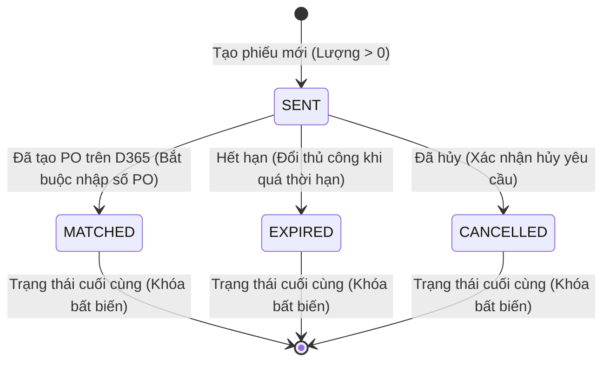

# ĐẶC TẢ CHI TIẾT MODULE F08: QUẢN LÝ ĐỀ NGHỊ MUA HÀNG (PURCHASE REQUEST)

> **Mã phân hệ:** F08  
> **Tên module:** Purchase Request Management & Purchase Suggestion  
> **Mức độ ưu tiên:** Must Have (M)  
> **Tiêu chuẩn kỹ thuật:** Clean Architecture, Domain Suggestion Algorithm, Code Generation with Locking, Excel Export

---

## 1. Mục tiêu & Phạm vi Nghiệp vụ

### 1.1. Mục tiêu
- Tự động hóa quá trình nhận diện nhu cầu mua sắm nguyên liệu premix: Phân tích số ngày tồn kho (DOI) và tốc độ tiêu hao ngày ($d$) để tính toán lượng cần mua bù đắp cho các cặp đang ở mức Nguy cấp hoặc Cảnh báo.
- Khấu trừ lượng hàng đã đặt nhưng chưa về (PO Pending) và các đề nghị mua đã phát hành trước đó nhưng chưa tạo PO (đang ở trạng thái `SENT`), tránh tình trạng mua trùng lặp gây tồn dư ứ đọng.
- Quản lý vòng đời chặt chẽ của các phiếu đề nghị mua hàng (Purchase Request - PR) và kết xuất danh sách sang file Excel chuẩn để gửi sang bộ phận Mua sắm (Procurement) tiến hành tạo đơn hàng PO trên hệ thống ERP D365.

### 1.2. Phạm vi Chức năng
- **F08a: Thuật toán Gợi ý Mua hàng (Purchase Suggestions):** Tự động lọc và hiển thị danh sách các cặp NM–NL có nhu cầu cần đặt mua kèm số lượng gợi ý, số ngày tiêu hao, PO đang về và đề nghị đang mở.
- **F08b: Tạo Phiếu Đề nghị Mua hàng (PR Creation):** Cho phép Planner chọn từ danh sách gợi ý, điều chỉnh số lượng mua, chọn nhà cung cấp và ngày cần hàng. Hệ thống tự động sinh mã PR duy nhất.
- **F08c: Quản lý Vòng đời & Trạng thái PR:** Theo dõi danh sách PR, hỗ trợ cập nhật trạng thái (`SENT` $\rightarrow$ `MATCHED`, `EXPIRED`, `CANCELLED`). Khớp số PO khi D365 tạo đơn.
- **F08d: Kết xuất File Excel Đề nghị Mua:** Cho phép chọn nhiều PR để xuất file bảng tính chuẩn gửi cho bộ phận mua hàng.

---

## 2. Ma trận Phân quyền Module F08

| Mã quyền (`PermissionCode`) | Hành động được phép | ADMIN | PLANNER | FACTORY | VIEWER |
|---|---|:---:|:---:|:---:|:---:|
| `purchase-request.view` | Xem danh sách gợi ý mua và danh sách phiếu đề nghị | ✓ | ✓ | | |
| `purchase-request.create` | Tạo mới phiếu đề nghị mua hàng từ danh sách gợi ý | ✓ | ✓ | | |
| `purchase-request.status` | Cập nhật trạng thái PR (khớp số PO, hủy, hết hạn) | ✓ | ✓ | | |
| `purchase-request.export` | Xuất dữ liệu các phiếu đề nghị ra file Excel | ✓ | ✓ | | |

*(Lưu ý: Nhân viên nhà máy `FACTORY` và người chỉ xem `VIEWER` không có quyền truy cập tính năng mua hàng).*

---

## 3. Thuật toán Gợi ý & Quy tắc Nghiệp vụ (Business Rules)

### 3.1. Thuật toán Gợi ý Mua hàng (BR-25, BR-25a)

Được cài đặt trong hàm thuần `suggestPurchaseQty()` tại Domain Layer:

#### 1. Định mức gợi ý thô theo DOI (BR-25)
- Áp dụng cho các cặp có tiêu hao ngày $d > 0$:
  $$\text{Lượng thô (BR-25)} = \begin{cases} 10 \times d & \text{nếu } \text{doi} < \text{CriticalDays (7)} \\ 8 \times d & \text{nếu } \text{CriticalDays (7)} \le \text{doi} \le \text{WarningDays (15)} \\ 0 & \text{nếu } \text{doi} > 15 \text{ hoặc } \text{NO\_DEMAND} \end{cases}$$
  - *Ghi chú quan trọng:* Ngưỡng so sánh (7 ngày và 15 ngày) lấy từ tham số `CriticalDays` và `WarningDays` **cấu hình chung** trong `cfg_System`, không phụ thuộc vào ngưỡng ghi đè riêng của từng cặp.
  - Phép so sánh thực hiện trên giá trị `doi` nguyên bản (chưa làm tròn).

#### 2. Khấu trừ nguồn hàng đang mở (BR-25a)
$$\text{Lượng gợi ý ròng} = \max(0, \text{Lượng thô} - \text{PO đang về}(C) - \sum \text{PR đang SENT})$$
- Trong đó:
  - $\text{PO đang về}(C)$: Tổng lượng còn lại của các dòng PO Pending của cặp tại ngày chốt $C$.
  - $\sum \text{PR đang SENT}$: Tổng số lượng kg của các phiếu đề nghị mua hàng của cặp đang ở trạng thái `SENT` trong hệ thống.
- **Quy tắc hiển thị:** Chỉ những cặp có $\text{Lượng gợi ý ròng} > 0$ mới xuất hiện trong danh sách Gợi ý mua hàng. Nếu sau khi khấu trừ mà kết quả $= 0$, cặp đó được ẩn khỏi bảng gợi ý.

---

### 3.2. Vòng đời Trạng thái Phiếu Đề nghị Mua hàng (BR-27, BR-27a)

Phiếu đề nghị mua hàng trải qua 4 trạng thái định danh:



- **Quy tắc chuyển dịch trạng thái (BR-27a):**
  - Trạng thái ban đầu mặc định khi tạo là `SENT` (Đã gửi).
  - Chỉ duy nhất trạng thái `SENT` mới được phép đổi sang các trạng thái khác.
  - Ba trạng thái `MATCHED`, `EXPIRED`, `CANCELLED` là các **trạng thái kết thúc (Terminal States)**. Bất kỳ yêu cầu thay đổi trạng thái nào từ 3 trạng thái này sẽ bị từ chối với mã lỗi HTTP 409 Conflict.
  - Việc chuyển trạng thái hoàn toàn do người dùng thao tác thủ công, hệ thống không tự động chuyển sang `EXPIRED`.
- **Ràng buộc khi chuyển sang MATCHED (BR-27):**
  - Khi đổi sang `MATCHED`, người dùng **bắt buộc phải nhập Số PO (PONumber)** đã được tạo trên hệ thống D365. Nếu thiếu số PO $\rightarrow$ Trả về HTTP 400 Bad Request.
- **Quy tắc Mã đề nghị mua (`RequestCode`):**
  - Hệ thống tự động sinh mã định danh duy nhất theo cú pháp: `PR-YYYYMMDD-XXXX` (trong đó `XXXX` là số thứ tự tự tăng trong ngày, ví dụ: `PR-20261012-0001`).
  - Mã này được Planner sao chép và nhập vào trường Ghi chú đơn hàng (PO Notes) trên ERP D365 để phục vụ việc truy vết chéo.

---

## 4. User Stories & Tiêu chí Chấp nhận (AC)

### 4.1. User Stories
1. **US-17 (Xem gợi ý mua hàng):** Là một *Planner*, tôi muốn hệ thống tự động lọc ra các nguyên liệu sắp hết kèm khối lượng mua gợi ý, để tôi không phải tính toán thủ công từng cặp.
2. **US-18 (Tạo phiếu đề nghị mua):** Là một *Planner*, tôi muốn chọn các dòng gợi ý và xuất thành phiếu đề nghị mua chính thức, để gửi cho bộ phận mua sắm.
3. **US-19 (Cập nhật số PO):** Là một *Planner*, tôi muốn cập nhật số PO sau khi bộ phận mua sắm đã lên đơn trên D365, để hệ thống nhận diện yêu cầu đã hoàn tất.
4. **US-20 (Xuất danh sách mua ra Excel):** Là một *Planner*, tôi muốn tải danh sách các đề nghị mua đã chọn về máy dưới dạng file Excel, để gửi email trực tiếp cho phòng mua sắm.

### 4.2. Acceptance Criteria (Given - When - Then)

- **AC-08.01 (Tính gợi ý mức Nguy cấp):**
  - **Given:** Cặp (NM DN, NL VIT_A) có $\text{DOI} = 6.9$ ngày (mức CRITICAL), tiêu hao ngày $d = 100\text{ kg/ngày}$, không có PO Pending và không có PR nào đang SENT.
  - **When:** Hệ thống tính toán gợi ý mua.
  - **Then:** Khối lượng gợi ý là $10 \times 100 = 1.000\text{ kg}$.

- **AC-08.02 (Biên xét duyệt ngưỡng 15 ngày):**
  - **Given:** Tiêu hao ngày $d = 100\text{ kg/ngày}$, không có PO Pending.
  - **When:** 
    - Cặp A có $\text{DOI} = 14.9$ ngày $\rightarrow$ Gợi ý $8 \times 100 = 800\text{ kg}$.
    - Cặp B có $\text{DOI} = 15.0$ ngày $\rightarrow$ Gợi ý $8 \times 100 = 800\text{ kg}$.
    - Cặp C có $\text{DOI} = 15.1$ ngày $\rightarrow$ Gợi ý $0\text{ kg}$ (Không xuất hiện trong danh sách).
  - **Then:** Hệ thống phân loại đúng biên theo BR-25.

- **AC-08.03 (Khấu trừ PR đang mở):**
  - **Given:** Cặp có lượng gợi ý thô là $1.000\text{ kg}$, nhưng đã có 1 phiếu PR trước đó đang ở trạng thái `SENT` với số lượng $400\text{ kg}$.
  - **When:** Xem danh sách gợi ý.
  - **Then:** Lượng gợi ý ròng hiển thị là $1.000 - 400 = 600\text{ kg}$.

- **AC-08.04 (Bắt buộc số PO khi chuyển MATCHED):**
  - **Given:** Phiếu PR `PR-20261012-0001` đang ở trạng thái `SENT`.
  - **When:** Người dùng gửi request chuyển trạng thái sang `MATCHED` nhưng trường `poNumber` để trống.
  - **Then:** Hệ thống từ chối với HTTP 400: *"Chuyển sang trạng thái MATCHED bắt buộc phải cung cấp số PO"*.

- **AC-08.05 (Khóa trạng thái cuối):**
  - **Given:** Phiếu PR đã ở trạng thái `CANCELLED` hoặc `MATCHED`.
  - **When:** Người dùng gửi request chuyển sang `SENT`.
  - **Then:** Hệ thống từ chối với HTTP 409 Conflict: *"Phiếu đề nghị đã ở trạng thái kết thúc, không thể thay đổi trạng thái"*.

---

## 5. Thiết kế Cơ sở Dữ liệu & Stored Procedures

### 5.1. Bảng `fact_Purchase_Request`

```sql
CREATE TABLE dbo.fact_Purchase_Request (
    RequestID INT IDENTITY(1,1) NOT NULL,
    RequestCode VARCHAR(30) NOT NULL,    -- 'PR-YYYYMMDD-XXXX'
    FactoryID INT NOT NULL,
    MaterialID INT NOT NULL,
    SupplierID INT NOT NULL,
    RequestedQtyKg DECIMAL(18,0) NOT NULL,
    NeedByDate DATE NOT NULL,            -- Ngày cần hàng về nhà máy
    Status VARCHAR(20) NOT NULL DEFAULT 'SENT', -- 'SENT', 'MATCHED', 'EXPIRED', 'CANCELLED'
    PONumber NVARCHAR(50) NULL,          -- Cập nhật khi status = MATCHED
    Note NVARCHAR(250) NULL,
    CreatedAt DATETIME2(0) NOT NULL DEFAULT SYSUTCDATETIME(),
    CreatedBy NVARCHAR(50) NOT NULL,
    UpdatedAt DATETIME2(0) NOT NULL DEFAULT SYSUTCDATETIME(),
    UpdatedBy NVARCHAR(50) NOT NULL,
    CONSTRAINT PK_fact_Purchase_Request PRIMARY KEY CLUSTERED (RequestID),
    CONSTRAINT UQ_PurchaseRequest_Code UNIQUE (RequestCode),
    CONSTRAINT FK_PurchaseRequest_Factory FOREIGN KEY (FactoryID) REFERENCES dbo.dim_Factory(FactoryID),
    CONSTRAINT FK_PurchaseRequest_Material FOREIGN KEY (MaterialID) REFERENCES dbo.dim_Material(MaterialID),
    CONSTRAINT FK_PurchaseRequest_Supplier FOREIGN KEY (SupplierID) REFERENCES dbo.dim_Supplier(SupplierID),
    CONSTRAINT CK_PurchaseRequest_Qty CHECK (RequestedQtyKg > 0),
    CONSTRAINT CK_PurchaseRequest_Status CHECK (Status IN ('SENT', 'MATCHED', 'EXPIRED', 'CANCELLED'))
);
```

### 5.2. Stored Procedures Chuẩn

#### 1. `sp_PurchaseRequest_Create` (Sinh mã PR có khóa đồng thời)
```sql
CREATE OR ALTER PROCEDURE dbo.sp_PurchaseRequest_Create
    @FactoryID INT,
    @MaterialID INT,
    @SupplierID INT,
    @RequestedQtyKg DECIMAL(18,0),
    @NeedByDate DATE,
    @Note NVARCHAR(250) = NULL,
    @CreatedBy NVARCHAR(50),
    @NewRequestCode VARCHAR(30) OUTPUT
AS
BEGIN
    SET NOCOUNT ON;
    SET XACT_ABORT ON;

    DECLARE @TodayStr VARCHAR(8) = CONVERT(VARCHAR(8), SYSUTCDATETIME(), 112); -- 'YYYYMMDD'
    DECLARE @Prefix VARCHAR(12) = 'PR-' + @TodayStr + '-';

    BEGIN TRY
        BEGIN TRANSACTION;

        -- 1. Tìm số thứ tự lớn nhất trong ngày với khóa độc quyền
        DECLARE @MaxSeq INT = 0;
        SELECT @MaxSeq = ISNULL(MAX(CAST(RIGHT(RequestCode, 4) AS INT)), 0)
        FROM dbo.fact_Purchase_Request WITH (UPDLOCK, HOLDLOCK)
        WHERE RequestCode LIKE @Prefix + '%';

        -- 2. Sinh mã mới định dạng 4 chữ số
        SET @NewRequestCode = @Prefix + RIGHT('0000' + CAST(@MaxSeq + 1 AS VARCHAR(4)), 4);

        -- 3. Chèn bản ghi mới
        INSERT INTO dbo.fact_Purchase_Request (
            RequestCode, FactoryID, MaterialID, SupplierID, RequestedQtyKg, NeedByDate,
            Status, PONumber, Note, CreatedAt, CreatedBy, UpdatedAt, UpdatedBy
        )
        VALUES (
            @NewRequestCode, @FactoryID, @MaterialID, @SupplierID, @RequestedQtyKg, @NeedByDate,
            'SENT', NULL, @Note, SYSUTCDATETIME(), @CreatedBy, SYSUTCDATETIME(), @CreatedBy
        );

        COMMIT TRANSACTION;
    END TRY
    BEGIN CATCH
        IF @@TRANCOUNT > 0 ROLLBACK TRANSACTION;
        THROW;
    END CATCH
END;
```

#### 2. `sp_PurchaseRequest_ChangeStatus` (Kiểm soát chuyển dịch trạng thái)
```sql
CREATE OR ALTER PROCEDURE dbo.sp_PurchaseRequest_ChangeStatus
    @RequestID INT,
    @NewStatus VARCHAR(20),
    @PONumber NVARCHAR(50) = NULL,
    @UpdatedBy NVARCHAR(50)
AS
BEGIN
    SET NOCOUNT ON;
    SET XACT_ABORT ON;

    BEGIN TRY
        BEGIN TRANSACTION;

        DECLARE @CurrentStatus VARCHAR(20);
        SELECT @CurrentStatus = Status 
        FROM dbo.fact_Purchase_Request WITH (UPDLOCK, HOLDLOCK)
        WHERE RequestID = @RequestID;

        IF @CurrentStatus IS NULL
        BEGIN
            RAISERROR(N'Phiếu đề nghị mua hàng không tồn tại.', 16, 1);
            RETURN;
        END

        -- Kiểm tra trạng thái hiện tại phải là SENT
        IF @CurrentStatus <> 'SENT'
        BEGIN
            RAISERROR(N'Phiếu đề nghị đã ở trạng thái kết thúc (%s), không thể thay đổi trạng thái.', 16, 2, @CurrentStatus);
            RETURN;
        END

        -- Ràng buộc khi chuyển sang MATCHED
        IF @NewStatus = 'MATCHED' AND (@PONumber IS NULL OR LTRIM(RTRIM(@PONumber)) = '')
        BEGIN
            RAISERROR(N'Chuyển sang trạng thái MATCHED bắt buộc phải cung cấp số PO.', 16, 3);
            RETURN;
        END

        UPDATE dbo.fact_Purchase_Request
        SET Status = @NewStatus,
            PONumber = CASE WHEN @NewStatus = 'MATCHED' THEN @PONumber ELSE PONumber END,
            UpdatedAt = SYSUTCDATETIME(),
            UpdatedBy = @UpdatedBy
        WHERE RequestID = @RequestID;

        COMMIT TRANSACTION;
    END TRY
    BEGIN CATCH
        IF @@TRANCOUNT > 0 ROLLBACK TRANSACTION;
        THROW;
    END CATCH
END;
```

#### 3. `sp_PurchaseRequest_List` (Phân trang, lọc, tìm kiếm)
```sql
CREATE OR ALTER PROCEDURE dbo.sp_PurchaseRequest_List
    @Search NVARCHAR(100) = NULL,
    @FactoryID INT = NULL,
    @Status VARCHAR(20) = NULL,
    @FromDate DATE = NULL,
    @ToDate DATE = NULL,
    @Page INT = 1,
    @PageSize INT = 20,
    @SortBy NVARCHAR(50) = 'CreatedAt',
    @SortOrder NVARCHAR(4) = 'DESC'
AS
BEGIN
    SET NOCOUNT ON;

    DECLARE @Offset INT = CASE WHEN @PageSize > 0 THEN (@Page - 1) * @PageSize ELSE 0 END;
    DECLARE @FetchRows INT = CASE WHEN @PageSize > 0 THEN @PageSize ELSE 2147483647 END;

    WITH FilteredRequests AS (
        SELECT 
            pr.RequestID,
            pr.RequestCode,
            pr.FactoryID,
            f.FactoryCode,
            f.FactoryName,
            pr.MaterialID,
            m.MaterialCode,
            m.MaterialName,
            pr.SupplierID,
            s.SupplierCode,
            s.SupplierName,
            pr.RequestedQtyKg,
            pr.NeedByDate,
            pr.Status,
            pr.PONumber,
            pr.Note,
            pr.CreatedAt,
            pr.CreatedBy,
            pr.UpdatedAt,
            pr.UpdatedBy,
            COUNT(*) OVER() AS TotalCount
        FROM dbo.fact_Purchase_Request pr
        INNER JOIN dbo.dim_Factory f ON pr.FactoryID = f.FactoryID
        INNER JOIN dbo.dim_Material m ON pr.MaterialID = m.MaterialID
        INNER JOIN dbo.dim_Supplier s ON pr.SupplierID = s.SupplierID
        WHERE (@Search IS NULL OR pr.RequestCode LIKE '%' + @Search + '%' OR m.MaterialCode LIKE '%' + @Search + '%' OR m.MaterialName LIKE '%' + @Search + '%' OR pr.PONumber LIKE '%' + @Search + '%')
          AND (@FactoryID IS NULL OR pr.FactoryID = @FactoryID)
          AND (@Status IS NULL OR pr.Status = @Status)
          AND (@FromDate IS NULL OR pr.NeedByDate >= @FromDate)
          AND (@ToDate IS NULL OR pr.NeedByDate <= @ToDate)
    )
    SELECT *
    FROM FilteredRequests
    ORDER BY 
        CASE WHEN @SortOrder = 'ASC' AND @SortBy = 'CreatedAt' THEN CreatedAt END ASC,
        CASE WHEN @SortOrder = 'DESC' AND @SortBy = 'CreatedAt' THEN CreatedAt END DESC,
        CASE WHEN @SortOrder = 'ASC' AND @SortBy = 'RequestedQtyKg' THEN RequestedQtyKg END ASC,
        CASE WHEN @SortOrder = 'DESC' AND @SortBy = 'RequestedQtyKg' THEN RequestedQtyKg END DESC
    OFFSET @Offset ROWS FETCH NEXT @FetchRows ROWS ONLY;
END;
```

---

## 6. Đặc tả API RESTful Module F08

| Phương thức | Đường dẫn API | Quyền | Mô tả |
|---|---|---|---|
| `GET` | `/api/v1/purchase-requests/suggestions` | `purchase-request.view` | Lấy danh sách cặp có gợi ý mua tại ngày chốt |
| `POST`| `/api/v1/purchase-requests` | `purchase-request.create` | Tạo mới phiếu đề nghị mua hàng |
| `GET` | `/api/v1/purchase-requests` | `purchase-request.view` | Danh sách phiếu đề nghị (phân trang, lọc, tìm kiếm) |
| `PATCH`| `/api/v1/purchase-requests/:id/status`| `purchase-request.status` | Đổi trạng thái (MATCHED, EXPIRED, CANCELLED) |
| `POST`| `/api/v1/purchase-requests/export` | `purchase-request.export` | Xuất danh sách các PR đã chọn ra file Excel |

---

## 7. Đặc tả Giao diện Người dùng (UI/UX)

- **Màn hình Đề nghị Mua hàng (`/purchase-requests`):**
  - Giao diện chia 2 Tab chính:
    1. **Tab 1: Gợi ý mua hàng (Suggestions):**
       - Bảng danh sách các cặp cần mua hàng: Mã NM, Tên Nguyên liệu, Mức cảnh báo, DOI hiện tại, Tiêu hao/ngày, Lượng PO đang về, Đề nghị đang mở, **Lượng gợi ý (kg)**.
       - Cột checkbox chọn nhiều dòng để tạo nhanh hàng loạt đề nghị mua.
       - Cột hành động: Nút "Tạo đề nghị" mở Modal tạo đơn.
    2. **Tab 2: Danh sách Phiếu đề nghị (Request List):**
       - Bộ lọc đa năng: Dropdown Nhà máy, Dropdown Trạng thái (SENT, MATCHED, EXPIRED, CANCELLED), Lọc theo khoảng ngày cần hàng, Ô tìm kiếm từ khóa (Mã PR, Tên nguyên liệu, Số PO).
       - Bảng dữ liệu phân trang: `10`, `20`, `50`, `Tất cả`.
       - Nút "Xuất Excel": Kích hoạt tải về file bảng tính các dòng được chọn.
  - **Modal Tạo Đề nghị Mua hàng:**
    - Cặp NM–NL (hiển thị thông tin mức và DOI).
    - Ô chọn Nhà cung cấp (tự động chọn NCC gần nhất của cặp).
    - Ô nhập Số lượng kg (điền sẵn số lượng gợi ý, cho phép sửa $> 0$).
    - Ô chọn Ngày cần hàng (điền sẵn ngày hết hàng dự kiến, $\ge$ hôm nay).
    - Ô nhập Ghi chú.
  - **Modal Khớp số PO (Cập nhật MATCHED):**
    - Hiển thị mã PR.
    - Ô nhập bắt buộc: Số chứng từ PO từ ERP D365.

---

## 8. Kiểm toán & Nhật ký (Audit Log)

1. `PURCHASE_REQUEST_CREATE`: Ghi nhận tạo mới PR (Mã PR, Cặp NM–NL, NCC, số lượng kg, ngày cần).
2. `PURCHASE_REQUEST_STATUS_CHANGE`: Thay đổi trạng thái PR (Mã PR, trạng thái cũ $\rightarrow$ mới, số PO đính kèm nếu có).
3. `PURCHASE_REQUEST_EXPORT`: Người dùng xuất file Excel các đề nghị mua.
