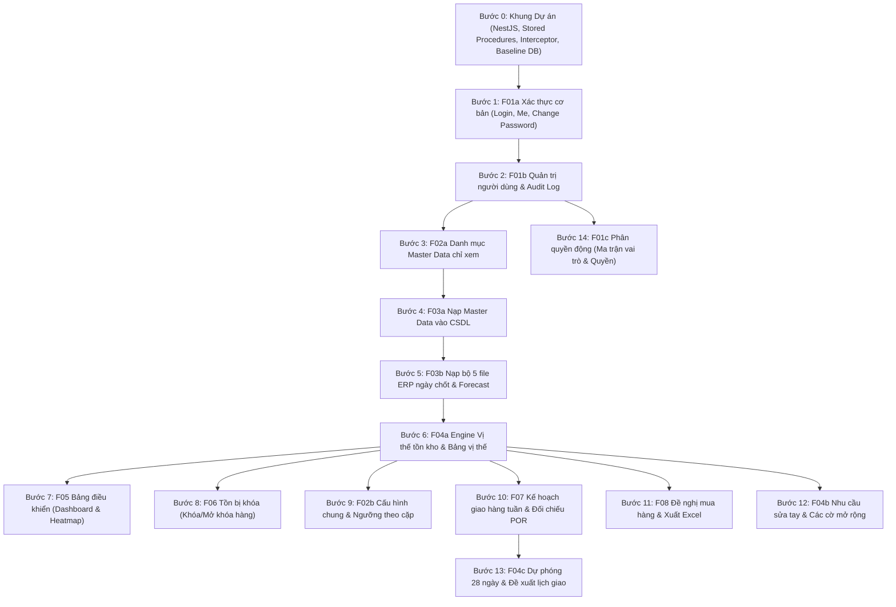

# HỆ THỐNG TÀI LIỆU ĐẶC TẢ CHI TIẾT TỪNG MODULE PREMIXTRACK

> **Phân hệ tài liệu:** Đặc tả Phân tích Hệ thống (System Analysis Specification)  
> **Dự án:** PremixTrack – Hệ thống theo dõi tồn kho và đặt hàng nguyên liệu premix cho thức ăn gia súc  
> **Phiên bản:** 1.0 · **Ngày hoàn thiện:** 12/10/2026  
> **Nguồn chuyển giao:** `docs/DAC-TA-NGHIEP-VU-PREMIXTRACK.md`  
> **Tiêu chuẩn kỹ thuật áp dụng:** `.skill/Architechture.md`, `.skill/skill.md`

---

## 1. Giới thiệu Cấu trúc Bộ Tài liệu

Bộ tài liệu đặc tả này được phân rã chi tiết từ file đặc tả tổng hợp gốc `DAC-TA-NGHIEP-VU-PREMIXTRACK.md` thành từng module nghiệp vụ độc lập, chuyên sâu theo đúng chuẩn của **Chuyên gia Phân tích Hệ thống (Senior System Analyst)**.

Mỗi module đều được thiết kế toàn diện với 10 phần cấu thành chuẩn:
1. **Mục tiêu & Phạm vi nghiệp vụ**
2. **Actors & Ma trận phân quyền chi tiết**
3. **Quy tắc nghiệp vụ cốt lõi (Business Rules - `BR-xx`)**
4. **User Stories & Tiêu chí nghiệm thu (Given - When - Then)**
5. **Mô hình xử lý chức năng I-P-O & Sơ đồ luồng (Mermaid Flowchart)**
6. **Mô hình dữ liệu & Stored Procedures chi tiết (Bắt buộc `TRY/CATCH`, `TRANSACTION`, `TVP`)**
7. **Đặc tả API RESTful (Endpoints, Request DTOs, Response Envelope, Lọc/Phân trang)**
8. **Đặc tả Giao diện Người dùng (UI/UX, Danh sách phân trang 10/20/50/all, Bộ lọc, Modal)**
9. **Kiểm toán & Nhật ký thao tác (Audit Log Trail)**
10. **Kịch bản kiểm thử & Dữ liệu mẫu (Test Cases & Edge Cases)**

---

## 2. Danh mục Các File Module Chi tiết

| STT | Tập tin tài liệu | Mã phân hệ | Tên module & Nội dung trọng tâm | Độ ưu tiên |
|:---:|---|:---:|---|:---:|
| 0 | [00-TONG-QUAN-HE-THONG.md](file:///c:/Premix_GE/docs/modules/00-TONG-QUAN-HE-THONG.md) | **SYS** | **Tổng quan Kiến trúc & Quy chuẩn Kỹ thuật Dùng chung:** Kiến trúc Clean Architecture với NestJS, Chuẩn Stored Procedures SQL Server 2019, Mô hình 24 bảng CSDL toàn cục, Chuẩn API và Gói phản hồi `{ success, message, data, meta }`. | **Must** |
| 1 | [F01-XAC-THUC-TAI-KHOAN-PHAN-QUYEN.md](file:///c:/Premix_GE/docs/modules/F01-XAC-THUC-TAI-KHOAN-PHAN-QUYEN.md) | **F01** | **Xác thực, Tài khoản & Phân quyền Động (RBAC):** Đăng nhập/Đăng xuất/Đổi mật khẩu, Quản lý tài khoản người dùng, Gán phạm vi nhà máy (`ALL` vs `ASSIGNED`), Ma trận 27 mã quyền động, Chống brute-force 5 lần/15 phút. | **Must** |
| 2 | [F02-DANH-MUC-VA-CAU-HINH.md](file:///c:/Premix_GE/docs/modules/F02-DANH-MUC-VA-CAU-HINH.md) | **F02** | **Danh mục Master Data & Cấu hình Hệ thống:** Danh mục 6 NM, 26 NL, 14 NCC, 72 cặp (chỉ đọc trên web); Bảng cấu hình chung 16 tham số (`cfg_System`); Ghi đè ngưỡng tồn kho theo cặp (`cfg_Stock_Threshold`), Ràng buộc thứ tự ngưỡng BR-12, BR-12a, BR-12b. | **Must / Should** |
| 3 | [F03-NAP-DU-LIEU-ERP-FORECAST.md](file:///c:/Premix_GE/docs/modules/F03-NAP-DU-LIEU-ERP-FORECAST.md) | **F03** | **Nạp Dữ liệu ERP & Kiểm soát Chất lượng:** Nạp bộ 5 file ngày chốt (On Hand RAW, Movement MTD, PO Pending, POR, Transfer Order) trong 1 Transaction duy nhất; Nạp Forecast RM Usage; Kiểm tra cấp dòng/file và kiểm chéo BR-15d (`sys_Data_Quality_Issue`). | **Must** |
| 4 | [F04-VI-THE-TON-KHO-VA-CANH-BAO.md](file:///c:/Premix_GE/docs/modules/F04-VI-THE-TON-KHO-VA-CANH-BAO.md) | **F04** | **Vị thế Tồn kho, Dự phóng 28 ngày & Cảnh báo (LÕI HỆ THỐNG):** Thuật toán tính tồn khả dụng, Tiêu hao chuẩn/thực tế/dùng cảnh báo ($d$), DOI (làm tròn 12 chữ số), 4 mức cảnh báo, Nhu cầu tháng sửa tay (Demand Override), PO trễ hạn nhận, Dự phóng 28 ngày (2 tầng) & Đề xuất lịch giao. | **Must (Lõi)** |
| 5 | [F05-BANG-DIEU-KHIEN-TONG-QUAN.md](file:///c:/Premix_GE/docs/modules/F05-BANG-DIEU-KHIEN-TONG-QUAN.md) | **F05** | **Bảng Điều khiển Tổng quan (Executive Dashboard):** Thẻ thống kê 5 mức cảnh báo, Ma trận nhiệt Heatmap 26 NL × 6 NM, Thống kê tồn bị khóa, Thông tin lần nạp mới nhất, Thanh cảnh báo dữ liệu cũ (BR-40) và điều hướng thông minh. | **Must** |
| 6 | [F06-QUAN-LY-TON-BI-KHOA.md](file:///c:/Premix_GE/docs/modules/F06-QUAN-LY-TON-BI-KHOA.md) | **F06** | **Quản lý Tồn bị khóa (Chặn tồn Thủ công):** Tạo lệnh khóa hàng (kiểm tra hạn mức không vượt SOH mới nhất với khóa `UPDLOCK, HOLDLOCK`), Mở khóa hàng, Danh sách lệnh khóa phân trang và bộ lọc. | **Should** |
| 7 | [F07-KE-HOACH-GIAO-HANG.md](file:///c:/Premix_GE/docs/modules/F07-KE-HOACH-GIAO-HANG.md) | **F07** | **Kế hoạch Giao hàng Tuần (Weekly Delivery Planning):** Lưới giao hàng Thứ 2 đến Chủ nhật, Nhập theo TẤN (tối đa 3 số lẻ, lưu kg), Đối chiếu thực nhận từ phiếu POR (BR-26b), Cảnh báo kế hoạch vượt PO, Nút "Đề xuất lịch giao" nháp lên lưới. | **Must** |
| 8 | [F08-DE-NGHI-MUA-HANG.md](file:///c:/Premix_GE/docs/modules/F08-DE-NGHI-MUA-HANG.md) | **F08** | **Quản lý Đề nghị Mua hàng (Purchase Request):** Thuật toán gợi ý lượng mua theo DOI và tiêu hao ngày (BR-25, BR-25a), Khấu trừ PO Pending và PR đang mở, Vòng đời trạng thái (SENT $\rightarrow$ MATCHED / EXPIRED / CANCELLED), Xuất file Excel mua hàng. | **Must** |
| 9 | [F09-HE-THONG-KIEM-TOAN-VA-VAN-HANH.md](file:///c:/Premix_GE/docs/modules/F09-HE-THONG-KIEM-TOAN-VA-VAN-HANH.md) | **F09 / SYS** | **Hệ thống, Kiểm toán & Vận hành:** Cơ chế ghi nhận và tra cứu `sys_Audit_Log`, API Swagger OpenAPI 3.0.3 tại `/api/docs`, Endpoint giám sát sức khỏe `/api/v1/health`, Quy chuẩn múi giờ UTC / `APP_TIMEZONE` và kế hoạch sao lưu CSDL. | **Should** |

---

## 3. Ma trận Truy vết Nghiệp vụ (Traceability Matrix)

Bảng ánh xạ toàn bộ các Quy tắc nghiệp vụ (`BR-xx`), Quyết định kỹ thuật (`DEC-xx`), và Câu hỏi đã duyệt (`Q-xxx`) từ tài liệu gốc sang các file module chi tiết:

| Mã quy tắc / Quyết định | Nội dung quy tắc | Module chi tiết phụ trách |
|---|---|:---:|
| `BR-01`, `BR-01a` | Đơn vị tính và lưu bằng kg nguyên; không lưu và hiển thị giá tiền | [00-TONG-QUAN-HE-THONG.md](file:///c:/Premix_GE/docs/modules/00-TONG-QUAN-HE-THONG.md), [F04](file:///c:/Premix_GE/docs/modules/F04-VI-THE-TON-KHO-VA-CANH-BAO.md) |
| `BR-02` | Phạm vi 6 nhà máy theo Master Data; tra cứu qua WarehouseCode | [F02](file:///c:/Premix_GE/docs/modules/F02-DANH-MUC-VA-CAU-HINH.md), [F03](file:///c:/Premix_GE/docs/modules/F03-NAP-DU-LIEU-ERP-FORECAST.md) |
| `BR-03`, `BR-04`, `BR-04a` | Tồn khả dụng = SOH − Khóa hiệu lực; xử lý khóa vượt tồn | [F04](file:///c:/Premix_GE/docs/modules/F04-VI-THE-TON-KHO-VA-CANH-BAO.md), [F06](file:///c:/Premix_GE/docs/modules/F06-QUAN-LY-TON-BI-KHOA.md) |
| `BR-05`, `BR-05a`, `BR-05b` | Tiêu hao chuẩn (nhu cầu tháng ÷ 28); Nhu cầu tháng sửa tay | [F04](file:///c:/Premix_GE/docs/modules/F04-VI-THE-TON-KHO-VA-CANH-BAO.md) |
| `BR-06`, `BR-06b`, `BR-07` | Tiêu hao thực tế (MTD ÷ ngày chạy); mượn nhịp tháng trước | [F04](file:///c:/Premix_GE/docs/modules/F04-VI-THE-TON-KHO-VA-CANH-BAO.md) |
| `BR-08` | Tiêu hao dùng để cảnh báo $d = \max(\text{chuẩn}, \text{thực tế})$ | [F04](file:///c:/Premix_GE/docs/modules/F04-VI-THE-TON-KHO-VA-CANH-BAO.md) |
| `BR-09`, `BR-09a` | DOI = Khả dụng ÷ $d$; làm tròn 12 chữ số có nghĩa; ngày hết hàng | [F04](file:///c:/Premix_GE/docs/modules/F04-VI-THE-TON-KHO-VA-CANH-BAO.md) |
| `BR-10`, `BR-11` | 4 Mức cảnh báo (CRITICAL, WARNING, BALANCED, OVERSTOCK, NO_DEMAND); Nguyên liệu dùng ít | [F04](file:///c:/Premix_GE/docs/modules/F04-VI-THE-TON-KHO-VA-CANH-BAO.md) |
| `BR-12`, `BR-12a`, `BR-12b` | Thứ tự ràng buộc ngưỡng chung và ngưỡng ghi đè theo cặp | [F02](file:///c:/Premix_GE/docs/modules/F02-DANH-MUC-VA-CAU-HINH.md) |
| `BR-13` | Tuyệt đối không lưu giá trị tính toán (DOI, Mức) vào CSDL | [00-TONG-QUAN-HE-THONG.md](file:///c:/Premix_GE/docs/modules/00-TONG-QUAN-HE-THONG.md), [F04](file:///c:/Premix_GE/docs/modules/F04-VI-THE-TON-KHO-VA-CANH-BAO.md) |
| `BR-14` | Dự báo áp dụng là bản ghi mới nhất có $\text{VersionDate} \le C$ | [F03](file:///c:/Premix_GE/docs/modules/F03-NAP-DU-LIEU-ERP-FORECAST.md), [F04](file:///c:/Premix_GE/docs/modules/F04-VI-THE-TON-KHO-VA-CANH-BAO.md) |
| `BR-15`, `BR-15a` $\rightarrow$ `e` | Nguồn 5 file ERP; Cut-off 06h ngày $D \rightarrow C = D - 1$; Kiểm chéo | [F03](file:///c:/Premix_GE/docs/modules/F03-NAP-DU-LIEU-ERP-FORECAST.md) |
| `BR-16`, `BR-16a` | Xem ngày cũ: PO bản $C$, phiếu nhận sau $C$; Số ngày bảo vệ | [F04](file:///c:/Premix_GE/docs/modules/F04-VI-THE-TON-KHO-VA-CANH-BAO.md) |
| `BR-17` | Nạp đồng thời bộ 5 file trong 1 Transaction nguyên tử | [F03](file:///c:/Premix_GE/docs/modules/F03-NAP-DU-LIEU-ERP-FORECAST.md) |
| `BR-18`, `BR-18a` | POR thay thế theo khoảng ngày của tên file; lượng nhận cột Quantity | [F03](file:///c:/Premix_GE/docs/modules/F03-NAP-DU-LIEU-ERP-FORECAST.md) |
| `BR-19`, `BR-19a` $\rightarrow$ `c` | PO Pending lấy Deliver remainder; PAG như PO; Tuổi PO trễ hạn | [F03](file:///c:/Premix_GE/docs/modules/F03-NAP-DU-LIEU-ERP-FORECAST.md), [F04](file:///c:/Premix_GE/docs/modules/F04-VI-THE-TON-KHO-VA-CANH-BAO.md) |
| `BR-20`, `BR-20a` | Hàng đi đường điều chuyển (TO khác Created, đã Shipped chưa Received) | [F04](file:///c:/Premix_GE/docs/modules/F04-VI-THE-TON-KHO-VA-CANH-BAO.md) |
| `BR-21`, `BR-21a` | Chặn mã lạ ngoài Master; Cảnh báo cặp ngoài `Plant Items` | [F03](file:///c:/Premix_GE/docs/modules/F03-NAP-DU-LIEU-ERP-FORECAST.md) |
| `BR-22`, `BR-22a` | Kiểm tra tên cột bắt buộc cố định; Báo lỗi dòng | [F03](file:///c:/Premix_GE/docs/modules/F03-NAP-DU-LIEU-ERP-FORECAST.md) |
| `BR-25`, `BR-25a` | Thuật toán gợi ý mua hàng ròng (khấu trừ PO và PR đang mở) | [F08](file:///c:/Premix_GE/docs/modules/F08-DE-NGHI-MUA-HANG.md) |
| `BR-26`, `BR-26a` $\rightarrow$ `d` | Kế hoạch giao lưu theo ngày; Đối chiếu POR; Nhập TẤN; Cảnh báo vượt PO | [F07](file:///c:/Premix_GE/docs/modules/F07-KE-HOACH-GIAO-HANG.md) |
| `BR-27`, `BR-27a` | Vòng đời 4 trạng thái PR; Bắt buộc số PO khi chuyển MATCHED | [F08](file:///c:/Premix_GE/docs/modules/F08-DE-NGHI-MUA-HANG.md) |
| `BR-28`, `BR-28a` | Khóa hàng; Kiểm tra hạn mức không vượt SOH mới nhất | [F06](file:///c:/Premix_GE/docs/modules/F06-QUAN-LY-TON-BI-KHOA.md) |
| `BR-29` | Bảo mật mật khẩu bằng BCrypt; Không trả hash ra ngoài | [F01](file:///c:/Premix_GE/docs/modules/F01-XAC-THUC-TAI-KHOAN-PHAN-QUYEN.md) |
| `BR-31`, `BR-31a` | Master Data chỉ đọc; Đánh dấu ngưng dùng khi mã vắng mặt | [F02](file:///c:/Premix_GE/docs/modules/F02-DANH-MUC-VA-CAU-HINH.md) |
| `BR-32` | Hai trục phân loại nguyên liệu: Category và Phân nhóm | [F02](file:///c:/Premix_GE/docs/modules/F02-DANH-MUC-VA-CAU-HINH.md) |
| `BR-33` | Lưới kế hoạch giao xem và nhập TẤN, các màn hình khác xem KG | [F07](file:///c:/Premix_GE/docs/modules/F07-KE-HOACH-GIAO-HANG.md) |
| `BR-34`, `BR-34a` | Dự phóng tồn 28 ngày (2 tầng); 3 mốc (Hết hàng, Cần hàng, Đặt muộn nhất) | [F04](file:///c:/Premix_GE/docs/modules/F04-VI-THE-TON-KHO-VA-CANH-BAO.md) |
| `BR-35` | Số ngày an toàn của cặp = SafetyDays hoặc CriticalDays chung | [F04](file:///c:/Premix_GE/docs/modules/F04-VI-THE-TON-KHO-VA-CANH-BAO.md) |
| `BR-36`, `BR-36a` $\rightarrow$ `c` | Thuật toán đề xuất lịch giao; Định mức chuyến; Nút đề xuất trên lưới | [F04](file:///c:/Premix_GE/docs/modules/F04-VI-THE-TON-KHO-VA-CANH-BAO.md), [F07](file:///c:/Premix_GE/docs/modules/F07-KE-HOACH-GIAO-HANG.md) |
| `BR-37` $\rightarrow$ `BR-40` | Các cờ dữ liệu mới: `UNUSED_STOCK`, `REORDER_NEEDED`, `USAGE_DEVIATION`, `STALE_DATA` | [F04](file:///c:/Premix_GE/docs/modules/F04-VI-THE-TON-KHO-VA-CANH-BAO.md), [F05](file:///c:/Premix_GE/docs/modules/F05-BANG-DIEU-KHIEN-TONG-QUAN.md) |
| `DEC-04` | Công thức tính toán vị thế là hàm thuần ở Domain (một nơi duy nhất) | [00-TONG-QUAN-HE-THONG.md](file:///c:/Premix_GE/docs/modules/00-TONG-QUAN-HE-THONG.md), [F04](file:///c:/Premix_GE/docs/modules/F04-VI-THE-TON-KHO-VA-CANH-BAO.md) |
| `D1` $\rightarrow$ `D4`, `A1` $\rightarrow$ `A6` | Mô hình phân quyền động 27 mã quyền; ADMIN cố định; Cập nhật quyền tức thì | [F01](file:///c:/Premix_GE/docs/modules/F01-XAC-THUC-TAI-KHOAN-PHAN-QUYEN.md) |

---

## 4. Kế hoạch Triển khai Đề xuất (14 Bước Lát cắt Thực thi - Slice Plan)

Thứ tự thực hiện từng lát cắt nhỏ, đảm bảo hệ thống có thể chạy thử và kiểm chứng (End-to-End Testable) sau mỗi bước:

---

## 5. Quy chuẩn Đảm bảo Chất lượng khi Triển khai từng Module (DoD)

Mỗi module khi chuyển sang giai đoạn lập trình bắt buộc thỏa mãn 8 tiêu chí hoàn thành (Definition of Done - DoD):

1. **User Stories & Acceptance Criteria:** Đầy đủ 3–5 User Stories mỗi Actor kèm các AC Given-When-Then (ít nhất 1 luồng thành công và 1 luồng ngoại lệ/lỗi).
2. **Cơ sở dữ liệu Stored Procedure:** Toàn bộ lệnh ghi/đọc nghiệp vụ viết bằng Stored Procedure có cấu trúc `BEGIN TRY ... BEGIN TRAN ... COMMIT ... CATCH ... ROLLBACK`. Tuyệt đối không viết câu lệnh SQL thô nối chuỗi.
3. **Controller & DTO:** Kiểm tra toàn bộ tham số đầu vào bằng `ValidationPipe` (class-validator); bắt lỗi sớm tại tầng Presentation.
4. **Phân quyền Server-side:** Mọi API nghiệp vụ đều được gắn Guard kiểm tra quyền theo mã (`PermissionCode`) và Guard kiểm tra phạm vi nhà máy (`FactoryScopeGuard`).
5. **Gói phản hồi chuẩn:** Trả về Envelope thống nhất `{ success, message, data, meta }` thông qua NestJS Interceptor.
6. **Chuẩn danh sách UI & API:** Bắt buộc hỗ trợ phân trang (Tất cả / 50 / 20 / 10), sắp xếp các cột chính, lọc theo các tiêu chí nghiệp vụ và tìm kiếm từ khóa.
7. **Nhật ký kiểm toán (Audit Trail):** Mọi hành vi tạo, sửa, xóa đều được ghi nhận vết kiểm toán vào bảng `sys_Audit_Log`.
8. **Tài liệu Swagger:** Cập nhật đầy đủ mô tả endpoint, tham số và mã lỗi HTTP trên Swagger UI `/api/docs`.
