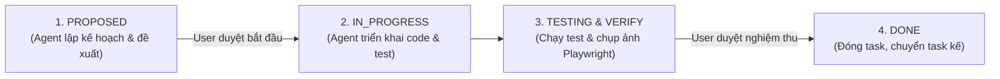

# THEO DÕI TIẾN ĐỘ TRIỂN KHAI DỰ ÁN PREMIXTRACK

> **Tài liệu quản lý tiến độ:** `tien-do.md`  
> **Dự án:** PremixTrack – Hệ thống theo dõi tồn kho và đặt hàng nguyên liệu premix cho thức ăn gia súc  
> **Cơ chế kiểm soát:** Human-in-the-Loop (Phê duyệt 2 bước: Trước khi làm & Sau khi kiểm thử)  
> **Cập nhật lần cuối:** 13/10/2026 00:20 (UTC+7)

---

## 1. Quy Trình Quản Lý & Phê Duyệt Task (Workflow Rules)

Mỗi nhiệm vụ (Task) trong dự án bắt buộc trải qua 4 bước theo đúng yêu cầu:

1. **Bước 1 (Đề xuất - `PROPOSED`):** Trước khi bắt đầu bất kỳ task nào, Agent cập nhật mục tiêu, phạm vi và tiêu chí nghiệm thu (AC) vào file này với trạng thái `PROPOSED`, sau đó **hỏi Người dùng để xin phê duyệt (Approve)**.
2. **Bước 2 (Thực hiện - `IN_PROGRESS`):** Khi Người dùng đồng ý, chuyển trạng thái sang `IN_PROGRESS` và tiến hành code theo Clean Architecture.
3. **Bước 3 (Kiểm thử & Báo cáo):** Hoàn thành code, chạy kiểm thử tự động (Unit Test, API Test, Playwright MCP chụp ảnh/bắt request). Agent báo cáo kết quả và bằng chứng kiểm thử, **hỏi Người dùng phê duyệt nghiệm thu**.
4. **Bước 4 (Hoàn thành - `DONE`):** Khi Người dùng xác nhận đạt, Agent chuyển trạng thái sang `DONE`, ghi nhận ngày hoàn thành và tiếp tục đề xuất task tiếp theo (`PROPOSED`).

---

## 2. Bảng Tổng Hợp Tiến Độ Toàn Dự Án

| Mã Task | Phân hệ | Tên nhiệm vụ chi tiết | Trọng số | Trạng thái | Ngày bắt đầu | Ngày hoàn thành |
|:---:|:---:|---|:---:|:---:|:---:|:---:|
| **TASK-00** | **SYS** | **Khởi tạo Khung Dự án NestJS & CSDL Baseline 24 bảng** | **Must** | **`DONE`** | 12/10/2026 | 13/10/2026 |
| **TASK-01** | **F01a** | **Xác thực cơ bản (Đăng nhập, Profile /auth/me, Đổi mật khẩu)** | **Must** | **`DONE`** | 13/10/2026 | 13/10/2026 |
| **TASK-02** | **F01b** | **Quản trị người dùng, gán phạm vi nhà máy & Audit Log** | **Must** | **`DONE`** | 13/10/2026 | 13/10/2026 |
| **TASK-03** | **F02a** | **Danh mục Master Data chỉ xem (phân trang, lọc, tìm kiếm)** | **Must** | **`DONE`** | 13/10/2026 | 13/10/2026 |
| **TASK-04** | **F03a** | **Nạp file Master Data (5 sheet) vào Cơ sở dữ liệu** | **Must** | **`DONE`** | 13/10/2026 | 13/10/2026 |
| **TASK-05** | **F03b** | **Nạp bộ 5 file ERP ngày chốt & Forecast trong 1 Transaction** | **Must** | **`DONE`** | 13/10/2026 | 13/10/2026 |
| **TASK-06** | **F04a** | **Engine tính Vị thế tồn kho (Domain calculatePosition) & Bảng vị thế** | **Must (Lõi)** | **`DONE`** | 13/10/2026 | 13/10/2026 |
| **TASK-07** | **F05** | **Bảng điều khiển tổng quan (Dashboard KPI, Ma trận nhiệt Heatmap)** | **Must** | **`DONE`** | 13/10/2026 | 13/10/2026 |
| **TASK-08** | **F06** | **Quản lý tồn bị khóa (Chặn tồn thủ công & Kiểm tra hạn mức)** | **Should** | **`DONE`** | 13/10/2026 | 13/10/2026 |
| **TASK-09** | **F02b** | **Cấu hình chung hệ thống & Ngưỡng tồn kho theo cặp (BR-12)** | **Must/Should**| **`DONE`** | 13/10/2026 | 13/10/2026 |
| **TASK-10** | **F07** | **Kế hoạch giao hàng tuần & Đối chiếu thực nhận từ POR (BR-26b)** | **Must** | **`DONE`** | 13/10/2026 | 13/10/2026 |
| **TASK-11** | **F08** | **Quản lý Đề nghị mua hàng (PR) & Thuật toán gợi ý mua (BR-25)** | **Must** | **`DONE`** | 13/10/2026 | 13/10/2026 |
| **TASK-UI** | **UI/UX**| **Giao diện Người dùng Hiện đại (React 19, TS, Vite, Tailwind v4, TanStack)** | **Must** | **`DONE`** | 13/10/2026 | 13/10/2026 |
| **TASK-12** | **F04b** | **Nhu cầu tháng sửa tay (Demand Override) & Các cờ dữ liệu mở rộng** | **Must/Should**| **`DONE`** | 13/10/2026 | 13/10/2026 |
| **TASK-13** | **F04c** | **Dự phóng tồn 28 ngày (2 tầng) & Thuật toán đề xuất lịch giao (BR-36)** | **Must/Should**| **`DONE`** | 13/10/2026 | 13/10/2026 |
| **TASK-14** | **F01c** | **Phân quyền động (Quản lý vai trò & Ma trận 27 mã quyền)** | **Must** | **`DONE`** | 14/10/2026 | 14/10/2026 |
| **TASK-15** | **F07b** | **Thuật toán Ghép Chuyến Xe Tải JRP & Truckload Consolidation (BR-36b)** | **Must** | **`DONE`** | 14/10/2026 | 14/10/2026 |
| **TASK-16** | **F07c** | **Thuật toán San Phẳng Tải Tiếp Nhận Hố Dỡ (Heijunka - BR-36c)** | **Must/Should**| `PENDING` | — | — |
| **TASK-17** | **F08b** | **Động Cơ Đề Xuất Mua Hàng Tự Động Khép Kín (Auto PR Engine - BR-25b)** | **Must** | `PENDING` | — | — |

**Tiến độ tổng thể:** **17 / 19 Task (Phase 1 Baseline Hoàn tất 100% | Phase 2 Hoàn thành TASK-15, đạt 89.5%)**

---

## 3. Chi Tiết Từng Nhiệm Vụ & Nhật Ký Kiểm Thử

---

### [DONE] TASK-00: Khởi tạo Khung Dự án NestJS & CSDL Baseline 24 Bảng
- **Mục tiêu:** Tạo nền tảng kỹ thuật vững chắc theo Clean Architecture và SQL Server 2019 theo `.skill/Architechture.md` và `.skill/skill.md`.
- **Nội dung đã hoàn thành:**
  - [x] Tạo CSDL `PremixTrack_DB` trên SQL Server 2022 (Compatibility Level 150 - SQL 2019, Collation `Vietnamese_100_CI_AS_SC_UTF8`, RCSI ON).
  - [x] Tạo đủ 24 bảng CSDL baseline (`database/schema/00_baseline_schema.sql`).
  - [x] Nạp dữ liệu ban đầu: `cfg_System`, 4 vai trò, 27 quyền, admin user (`database/seed/01_initial_seed.sql`).
  - [x] Tạo Stored Procedures `dbo.usp_Audit_Write` và `dbo.usp_Audit_List` có TRY/CATCH.
  - [x] Tạo user kết nối DB `premixtrack_user` / `PremixTrack@2026` trên port 14333.
  - [x] Khởi tạo backend NestJS (`server/`), cấu hình TypeORM kết nối SQL Server với `synchronize: false`.
  - [x] Thiết lập `ProcedureService` gọi Stored Procedures an toàn, `ResponseTransformInterceptor`, `HttpExceptionFilter`, `LoggingInterceptor`, `PaginationQueryDto`.
  - [x] Tạo endpoint kiểm tra sức khỏe `GET /api/v1/health` và Swagger OpenAPI 3.0.3 tại `/api/docs`.
- **Bằng chứng kiểm thử:**
  - `GET /api/v1/health` phản hồi HTTP 200, status `UP`, database `CONNECTED` trong 5ms.
  - Playwright MCP chụp ảnh màn hình Swagger UI thành công tại `.playwright-mcp/page-2026-10-12T17-14-28-085Z.png`.
- **Người phê duyệt:** Người dùng đã xác nhận hoàn thành Bước 0.

---

### [DONE] TASK-01: F01a - Xác Thực Cơ Bản (Đăng nhập, Profile /auth/me, Đổi mật khẩu)
- **Mã phân hệ:** F01a  
- **Mức độ ưu tiên:** Must Have (M)  
- **Tài liệu đặc tả chi tiết:** [docs/modules/F01-XAC-THUC-TAI-KHOAN-PHAN-QUYEN.md](file:///c:/Premix_GE/docs/modules/F01-XAC-THUC-TAI-KHOAN-PHAN-QUYEN.md)  
- **Mục tiêu triển khai:**
  - [x] Tạo Stored Procedure `dbo.usp_Auth_GetUserForLogin` và `dbo.usp_Auth_GetCurrentUser` và `dbo.usp_Auth_UpdatePassword` có TRY/CATCH.
  - [x] Nâng cấp `ProcedureService` sử dụng driver mssql native request pool, hỗ trợ đầy đủ thủ tục đa tập kết quả (Multi-dataset) và đơn tập.
  - [x] Cấu hình JWT Service (thời hạn 8h), BCrypt hash salt round 10, cấu hình múi giờ chuẩn `Asia/Ho_Chi_Minh`.
  - [x] Xây dựng bộ điều khiển `AuthController` & `AuthService` với đầy đủ 4 endpoint:
    - `POST /api/v1/auth/login`: Xác thực tài khoản, kiểm tra IP rate limit, trả token & danh sách 27 quyền.
    - `GET /api/v1/auth/me`: Kiểm tra token, đọc hồ sơ người dùng, danh sách nhà máy được gán & quyền.
    - `POST /api/v1/auth/change-password`: Đổi mật khẩu cá nhân, kiểm tra mật khẩu hiện tại, tối thiểu 8 ký tự, không trùng mật khẩu cũ.
    - `POST /api/v1/auth/logout`: Đăng xuất hệ thống, ghi log kiểm toán.
  - [x] Ghi nhận nhật ký kiểm toán tự động qua `dbo.usp_Audit_Write` vào bảng `sys_Audit_Log`.
- **Kết quả kiểm thử tự động (Test Runner `server/test/test-task-01.js`):**
  - ✅ **PASS [AC-01.01]:** Đăng nhập `admin` / `Admin@1234` $\rightarrow$ Trả về JWT token hợp lệ, user profile, đủ 27 quyền, không lộ hash/password.
  - ✅ **PASS [AC-01.02]:** Đăng nhập sai mật khẩu $\rightarrow$ HTTP 401 với thông điệp: *"Tên đăng nhập hoặc mật khẩu không chính xác"*.
  - ✅ **PASS [AC-01.04a]:** `GET /api/v1/auth/me` với Bearer token $\rightarrow$ HTTP 200 trả về hồ sơ admin, vai trò ADMIN, 27 quyền.
  - ✅ **PASS [AC-01.04b]:** `GET /api/v1/auth/me` không có token $\rightarrow$ HTTP 401 Unauthorized.
  - ✅ **PASS [AC-01.06a]:** Đổi mật khẩu sai mật khẩu cũ $\rightarrow$ HTTP 400 *"Mật khẩu hiện tại không chính xác"*.
  - ✅ **PASS [AC-01.06b]:** Đổi mật khẩu mới $< 8$ ký tự $\rightarrow$ HTTP 400 Class-Validator Validation Error.
  - ✅ **PASS [AC-01.06c]:** Chu trình đổi mật khẩu hợp lệ (round-trip): Đổi sang `NewAdmin@1234` thành công $\rightarrow$ Đăng nhập với MK mới thành công $\rightarrow$ Đổi lại về `Admin@1234` thành công.
  - ✅ **PASS [AC-01.07]:** Đăng xuất `POST /api/v1/auth/logout` có token $\rightarrow$ HTTP 200 *"Đăng xuất thành công"*.
  - ✅ **PASS [AC-01.03]:** Rate Limiting: Gửi 5 lần đăng nhập sai liên tiếp $\rightarrow$ Lần thứ 6 bị chặn với HTTP 429 Too Many Requests (*"IP tạm thời bị khóa do đăng nhập sai quá 5 lần. Vui lòng thử lại sau 900 giây"*).
- **Kiểm tra cơ sở dữ liệu `sys_Audit_Log`:**
  - Đã xác nhận ghi nhận đầy đủ các sự kiện: `AUTH_LOGIN_SUCCESS`, `AUTH_LOGIN_FAILED`, `USER_CHANGE_PASSWORD`, `AUTH_LOGOUT` kèm IP, Username, Timestamp, Status.
- **Bằng chứng giao diện Swagger:**
  - Playwright MCP chụp ảnh toàn bộ OpenAPI Docs tại: `.playwright-mcp\page-2026-10-12T17-35-43-938Z.png`.
- **Trạng thái:** **`DONE`** (Người dùng đã nghiệm thu và phê duyệt đóng ngày 13/10/2026).

---

### [DONE] TASK-02: F01b - Quản Trị Người Dùng, Gán Nhà Máy & Audit Log
- **Mã phân hệ:** F01b  
- **Mức độ ưu tiên:** Must Have (M)  
- **Tài liệu đặc tả chi tiết:** [docs/modules/F01-XAC-THUC-TAI-KHOAN-PHAN-QUYEN.md](file:///c:/Premix_GE/docs/modules/F01-XAC-THUC-TAI-KHOAN-PHAN-QUYEN.md)  
- **Nội dung đã hoàn thành:**
  - [x] Tạo 7 Stored Procedures quản trị người dùng (`database/stored_procedures/02_user_procedures.sql`):
    - `dbo.usp_User_List`: Phân trang 10/20/50/all, tìm kiếm username/fullname/email, lọc RoleCode, IsActive, FactoryID, nối chuỗi `AssignedFactoryCodes`.
    - `dbo.usp_User_GetById`: Đọc chi tiết user và danh sách nhà máy gán.
    - `dbo.usp_User_Create`: Tạo tài khoản mới, kiểm tra trùng lặp username/email, băm mật khẩu, bắt buộc gán ít nhất 1 nhà máy khi role là FACTORY (scope ASSIGNED - BR-02b).
    - `dbo.usp_User_Update`: Sửa tài khoản, gán nhà máy, bảo vệ tài khoản Admin tối cao không bị tự khóa hoặc hạ quyền (D1 & A4).
    - `dbo.usp_User_AssignFactories`: Cập nhật riêng danh sách nhà máy được gán.
    - `dbo.usp_User_ResetPassword`: Admin đặt lại mật khẩu cho user.
    - `dbo.usp_User_Delete`: Xóa cứng nếu chưa phát sinh dữ liệu, chặn xóa nếu đã có dữ liệu giao dịch (yêu cầu khóa - D3 & A4), chặn xóa Admin.
  - [x] Khởi tạo dữ liệu 6 nhà máy chuẩn (`dim_Factory`): DN, BD, VL2, HG, BD1, BD2 (`database/seed/02_factory_seed.sql`).
  - [x] Tạo Decorator `@RequirePermissions` và Guard `PermissionsGuard` kiểm tra quyền theo thời gian thực (A6), tự động bypass cho ADMIN (D1).
  - [x] Xây dựng `UsersModule` với đầy đủ 7 endpoint CRUD:
    - `GET /api/v1/users`: Danh sách phân trang, lọc, tìm kiếm (`user.view`).
    - `POST /api/v1/users`: Tạo tài khoản mới (`user.create`).
    - `GET /api/v1/users/:id`: Xem chi tiết (`user.view`).
    - `PUT /api/v1/users/:id`: Cập nhật tài khoản (`user.update`).
    - `PUT /api/v1/users/:id/factories`: Gán nhà máy (`user.update`).
    - `POST /api/v1/users/:id/reset-password`: Đặt lại mật khẩu (`user.update`).
    - `DELETE /api/v1/users/:id`: Xóa tài khoản (`user.delete`).
  - [x] Xây dựng `AuditModule` với endpoint `GET /api/v1/audit-logs`: Phân trang, lọc theo ActionCode, Username, khoảng ngày (`user.view`).
- **Kết quả kiểm thử tự động (Test Runner `server/test/test-task-02.js`):**
  - ✅ **PASS [AC-02.01]:** Lấy danh sách người dùng phân trang đúng kích thước, metadata chuẩn (`items`, `meta.totalItems`, `meta.totalPages`).
  - ✅ **PASS [AC-02.02a]:** Tạo tài khoản người dùng mới (vai trò PLANNER) $\rightarrow$ HTTP 201 thành công.
  - ✅ **PASS [AC-02.02b]:** Chặn trùng tên đăng nhập $\rightarrow$ HTTP 409 Conflict.
  - ✅ **PASS [AC-02.03a]:** Tạo tài khoản FACTORY thiếu nhà máy bị từ chối $\rightarrow$ HTTP 400 Bad Request (*"Vai trò phạm vi ASSIGNED bắt buộc phải gán ít nhất một nhà máy"* - BR-02b).
  - ✅ **PASS [AC-02.03b]:** Tạo tài khoản FACTORY có gán nhà máy [1, 2] thành công $\rightarrow$ Ghi nhận vào `sys_User_Factory` gồm 2 nhà máy (BD, DN).
  - ✅ **PASS [AC-02.03c]:** Gán lại danh sách nhà máy (thành 3 nhà máy) thành công.
  - ✅ **PASS [AC-02.04]:** Admin Reset mật khẩu $\rightarrow$ Đổi mật khẩu thành công, người dùng đăng nhập thành công bằng mật khẩu mới.
  - ✅ **PASS [AC-02.05]:** Khóa tài khoản (`isActive = false`) $\rightarrow$ Đăng nhập bằng tài khoản bị khóa lập tức bị từ chối với HTTP 401.
  - ✅ **PASS [AC-02.06a]:** Chặn Admin tự khóa chính mình hoặc tự hạ quyền $\rightarrow$ HTTP 403 Forbidden (*"Không thể tự khóa tài khoản quản trị của chính mình"*).
  - ✅ **PASS [AC-02.06b]:** Xóa tài khoản người dùng chưa phát sinh giao dịch $\rightarrow$ HTTP 200 thành công.
  - ✅ **PASS [AC-02.06c]:** Chặn xóa tài khoản Admin tối cao (ID = 1) $\rightarrow$ HTTP 403 Forbidden.
  - ✅ **PASS [AC-02.07]:** Truy vấn `GET /api/v1/audit-logs` $\rightarrow$ Trả về danh sách thao tác đầy đủ với các sự kiện vừa thực hiện (`USER_CREATE`, `USER_RESET_PASSWORD`, etc.) có phân trang và metadata chuẩn.
- **Bằng chứng giao diện Swagger:**
  - Playwright MCP chụp ảnh toàn bộ OpenAPI Docs với các cụm Users và Audit Logs tại: `.playwright-mcp\page-2026-10-12T18-11-03-563Z.png`.
- **Trạng thái:** **`DONE`** (Người dùng đã nghiệm thu và phê duyệt đóng ngày 13/10/2026).

---

### [DONE] TASK-03: F02a - Danh Mục Master Data Chỉ Xem (Phân Trang, Lọc, Tìm Kiếm, Sửa Thuộc Tính)
- **Mã phân hệ:** F02a  
- **Mức độ ưu tiên:** Must Have (M)  
- **Tài liệu đặc tả chi tiết:** [docs/modules/F02-DANH-MUC-VA-CAU-HINH.md](file:///c:/Premix_GE/docs/modules/F02-DANH-MUC-VA-CAU-HINH.md)  
- **Nội dung đã hoàn thành:**
  - [x] Tạo 8 Stored Procedures tra cứu và cập nhật Master Data (`database/stored_procedures/03_master_procedures.sql`):
    - `dbo.usp_Master_FactoryList`: Danh sách Nhà máy phân trang, tìm kiếm, lọc Region, IsActive.
    - `dbo.usp_Master_MaterialList`: Danh sách Nguyên liệu phân trang, lọc Category, ItemGroup, IsActive, tìm kiếm mã/tên.
    - `dbo.usp_Master_SupplierList`: Danh sách Nhà cung cấp phân trang, lọc VendorGroup (`LOC_*`, `FOR_*`), IsActive, tìm kiếm.
    - `dbo.usp_Master_PlantItemList`: Danh sách Cặp theo dõi Nhà máy - Nguyên liệu (`dim_Factory_Material`), lọc FactoryID, Category, IsTracked, IsActive.
    - `dbo.usp_Master_UpdateMaterial`: Cập nhật thuộc tính `PIC` và `DisplayDecimals` (giới hạn 0 - 4).
    - `dbo.usp_Master_UpdateSupplier`: Cập nhật thời gian giao hàng `LeadTimeDays` (giới hạn 0 - 365 ngày).
    - `dbo.usp_Master_UpdatePlantItem`: Bật/Tắt trạng thái theo dõi vị thế `IsTracked` của cặp.
    - `dbo.usp_Master_Dropdowns`: Truy vấn Multi-dataset lấy nhanh 4 danh mục rút gọn (Nhà máy, Nguyên liệu, NCC, Categories) cho dropdown toàn hệ thống.
  - [x] Nạp seed baseline mẫu (`dim_Material`, `dim_Supplier`, `dim_Factory_Material`) phục vụ kiểm thử phân hệ ([03_master_baseline_seed.sql](file:///c:/Premix_GE/database/seed/03_master_baseline_seed.sql)).
  - [x] Xây dựng `CatalogModule` trong NestJS gồm đầy đủ 8 endpoint:
    - `GET /api/v1/catalog/dropdowns`: Mở tự do cho mọi user đã login (A5).
    - `GET /api/v1/catalog/factories`: Xem danh sách nhà máy (`catalog.view`).
    - `GET /api/v1/catalog/materials`: Xem danh sách nguyên liệu (`catalog.view`).
    - `PUT /api/v1/catalog/materials/:id`: Sửa PIC, DisplayDecimals (`material.edit`).
    - `GET /api/v1/catalog/suppliers`: Xem danh sách nhà cung cấp (`catalog.view`).
    - `PUT /api/v1/catalog/suppliers/:id`: Sửa LeadTimeDays (`supplier.edit`).
    - `GET /api/v1/catalog/plant-items`: Xem danh sách cặp theo dõi (`catalog.view`).
    - `PUT /api/v1/catalog/plant-items/:id`: Bật/tắt theo dõi vị thế (`factory-material.edit`).
  - [x] Ghi nhận Audit Log tự động khi sửa thuộc tính Master Data (`MATERIAL_UPDATE`, `SUPPLIER_UPDATE`, `PLANT_ITEM_UPDATE`).
- **Kết quả kiểm thử tự động (Test Runner `server/test/test-task-03.js`):**
  - ✅ **PASS [AC-03.01]:** Dropdowns API trả về đầy đủ 6 nhà máy (`DN, BD, VL2, HG, BD1, BD2`), 4 nguyên liệu, 3 nhà cung cấp, danh mục categories.
  - ✅ **PASS [AC-03.02a]:** Danh sách Nhà máy phân trang chuẩn, đủ 6 nhà máy tiêu chuẩn.
  - ✅ **PASS [AC-03.02b]:** Danh sách Nguyên liệu lọc theo Category PREMIX hoạt động chính xác.
  - ✅ **PASS [AC-03.03a]:** Cập nhật PIC và DisplayDecimals của nguyên liệu thành công (`displayDecimals: 3`, `pic: "Nguyễn Kế Hoạch Trưởng"`).
  - ✅ **PASS [AC-03.03b]:** Cố tình sửa DisplayDecimals > 4 $\rightarrow$ Bị từ chối với HTTP 400 Validation Error.
  - ✅ **PASS [AC-03.04a]:** Cập nhật LeadTimeDays của nhà cung cấp thành công (21 ngày).
  - ✅ **PASS [AC-03.04b]:** Cố tình sửa LeadTimeDays > 365 ngày $\rightarrow$ Bị từ chối với HTTP 400 Validation Error.
  - ✅ **PASS [AC-03.05]:** Bật / Tắt trạng thái theo dõi vị thế cặp (`IsTracked: 0 -> 1`) thành công.
  - ✅ **PASS [AC-03.06]:** Kiểm tra `sys_Audit_Log` đã ghi nhận đầy đủ 3 loại sự kiện cập nhật Master Data (`MATERIAL_UPDATE`, `SUPPLIER_UPDATE`, `PLANT_ITEM_UPDATE`).
- **Bằng chứng giao diện Swagger:**
  - Playwright MCP chụp ảnh toàn bộ OpenAPI Docs với cụm Catalog tại: `.playwright-mcp\page-2026-10-12T18-22-25-736Z.png`.
- **Trạng thái:** **`DONE`** (Người dùng đã nghiệm thu và phê duyệt đóng ngày 13/10/2026).

---

### [DONE] TASK-04: F03a - Nạp File Master Data Vào CSDL
- **Mã phân hệ:** F03a  
- **Mức độ ưu tiên:** Must Have (M)  
- **Tài liệu đặc tả chi tiết:** [docs/modules/F03-NAP-DU-LIEU-ERP-FORECAST.md](file:///c:/Premix_GE/docs/modules/F03-NAP-DU-LIEU-ERP-FORECAST.md)  
- **Nội dung đã hoàn thành:**
  - [x] Xây dựng `ExcelParserService` đọc và phân tích file Excel `Master Data.xlsx` (5 sheets):
    - Sheet 1: `Plants` (Mã nhà máy, Tên, Region, Type, Org codes). Tra cứu mã kho từ cột Org codes.
    - Sheet 2: `Items` (Item code, Item name, Category, Nhóm, Quy cách, Bao (kg), UOM, Item type). Chuỗi mã NL giữ số 0 đầu (`0014`, `0025`,...); `Bao (kg)` rỗng/0 hiểu là hàng xá.
    - Sheet 3: `Plant Items` (OU, Org code, Item code). Cặp theo dõi Nhà máy - Nguyên liệu.
    - Sheet 4: `Vendors` (Vendor account, Vendor name, Group, Country). Phân nhóm `LOC_*`, `FOR_*`.
    - Sheet 5: `Vendor Items` / `Substitutions` (Mã NL, Mã NCC hoặc Cặp thay thế).
    - Kiểm tra cấu trúc bắt buộc theo BR-22 (tự động trim khoảng trắng, từ chối file nếu thiếu sheet hoặc cột).
  - [x] Xây dựng Stored Procedure nạp Master Data nguyên tử `dbo.usp_Import_MasterData` (`database/stored_procedures/04_import_procedures.sql`):
    - Sử dụng `OPENJSON` kết hợp `#Staging*` (áp dụng `COLLATE DATABASE_DEFAULT` chống xung đột bảng mã tempdb).
    - Toàn bộ 5 sheet thực thi trong 1 `BEGIN TRANSACTION / COMMIT` duy nhất.
    - Triển khai quy tắc **BR-31a (Q-037)**: Mã không xuất hiện trong file mới tự động đánh dấu ngừng dùng (`IsActive = 0`), không xóa cứng khỏi CSDL; nếu mã tái xuất hiện thì tự động kích hoạt lại (`IsActive = 1`). Bảo toàn `PIC`, `DisplayDecimals` và `LeadTimeDays` khi cập nhật.
    - Chế độ xem trước Dry-run (`@DryRun = 1`): Trả kết quả thống kê số dòng và rollback ngay lập tức.
    - Lưu nhật ký lô nạp vào `sys_Import_Batch` (mã băm SHA-256) và ghi nhận `sys_Audit_Log` (`IMPORT_MASTER_DATA`).
  - [x] Xây dựng Stored Procedure tra cứu lịch sử `dbo.usp_Import_History` và `dbo.usp_Import_GetBatchById`.
  - [x] Xây dựng `ImportModule` và `ImportController` trong NestJS:
    - `POST /api/v1/import/master-data`: Nhận file multipart/form-data tối đa 20MB, hỗ trợ query `dryRun=true` (`import.run`).
    - `GET /api/v1/import/history`: Tra cứu lịch sử lô nạp phân trang 10/20/50/all, lọc `batchType`, tìm kiếm (`import.view`).
    - `GET /api/v1/import/batches/:id`: Xem chi tiết lô nạp và danh sách cảnh báo kiểm chéo (`import.view`).
- **Kết quả kiểm thử tự động (Test Runner `server/test/test-task-04.js` - 34/34 Test Cases PASSED):**
  - ✅ **PASS [AC-04.04]:** Chế độ xem trước Dry-run (`dryRun=true`) $\rightarrow$ HTTP 200, `isDryRun: true`, `status: PREVIEW`, đếm đúng 6 nhà máy, 4 nguyên liệu, không ghi đè CSDL hay tạo batch.
  - ✅ **PASS [AC-04.01a]:** Nạp Master Data chính thức $\rightarrow$ HTTP 200, tạo BatchID `#9` hoàn thành `COMPLETED`, nạp đủ 6 nhà máy, 4 nguyên liệu, 3 NCC, 5 cặp theo dõi.
  - ✅ **PASS [AC-04.01b]:** Chuỗi mã nguyên liệu `0014` giữ nguyên số 0 đầu trong CSDL và có `IsActive = true`.
  - ✅ **PASS [AC-04.02a]:** Kiểm tra BR-31a: Nạp file mới v2 loại bỏ mã `0099` $\rightarrow$ Nguyên liệu `0099` vẫn tồn tại trong CSDL và chuyển thành `IsActive = false`.
  - ✅ **PASS [AC-04.02b]:** BR-31a Round-trip: Nạp lại file có mã `0099` $\rightarrow$ Tự động kích hoạt lại `IsActive = true`.
  - ✅ **PASS [AC-04.03a]:** Thiếu sheet bắt buộc (`Items`) $\rightarrow$ Bị từ chối với HTTP 400 (*"Thiếu sheet bắt buộc: Items"*).
  - ✅ **PASS [AC-04.03b]:** Thiếu cột bắt buộc (`Type` trong `Plants`) $\rightarrow$ Bị từ chối với HTTP 400 (*"Cột bắt buộc 'Type' không tồn tại trong sheet"*).
  - ✅ **PASS [AC-04.03c]:** File sai định dạng hoặc file rỗng $\rightarrow$ Bị từ chối với HTTP 400.
  - ✅ **PASS [AC-04.05a]:** `GET /api/v1/import/history` $\rightarrow$ HTTP 200 trả về danh sách lịch sử nạp có phân trang và metadata chuẩn.
  - ✅ **PASS [AC-04.05b]:** `GET /api/v1/import/batches/:id` $\rightarrow$ HTTP 200 trả về chi tiết batch và các issue liên quan.
  - ✅ **PASS [AC-04.06]:** Nhật ký kiểm toán `sys_Audit_Log` $\rightarrow$ Ghi nhận sự kiện `IMPORT_MASTER_DATA` trạng thái `SUCCESS`.
- **Bằng chứng giao diện Swagger:**
  - Playwright MCP chụp ảnh toàn bộ OpenAPI Docs với cụm Data Ingestion (Import) tại: `.playwright-mcp\page-2026-10-12T18-53-24-881Z.png`.
- **Trạng thái:** **`DONE`** (Người dùng đã nghiệm thu và phê duyệt đóng ngày 13/10/2026).

---

### [DONE] TASK-05: F03b - Nạp Bộ 5 File ERP Ngày Chốt & Forecast Trong 1 Transaction Nguyên Tử
- **Mã phân hệ:** F03b  
- **Mức độ ưu tiên:** Must Have (M)  
- **Tài liệu đặc tả chi tiết:** [docs/modules/F03-NAP-DU-LIEU-ERP-FORECAST.md](file:///c:/Premix_GE/docs/modules/F03-NAP-DU-LIEU-ERP-FORECAST.md)  
- **Nội dung đã hoàn thành:**
  - [x] Nâng cấp `ExcelParserService` ([excel-parser.service.ts](file:///c:/Premix_GE/server/src/modules/import/excel-parser.service.ts)):
    - Tự động dò dòng tiêu đề động (Dynamic Header Detection) trong 25 dòng đầu tiên để xử lý các dòng tổng hợp ở đầu sheet `SOH` và `INV46`.
    - Trích xuất ngày cắt $D$ từ tên file (`Cut off 06h DD.MM.YYYY`), tự động tính ngày chốt chính thức $C = D - 1$ (BR-15e).
    - Trích xuất khoảng ngày nhận hàng $[D_{\text{from}}, D_{\text{to}}]$ từ tên file `POR` (BR-18, BR-18a).
    - Phân tích đủ 5 file ERP (`SOH`, `INV46`, `FINISH PENDING`, `POR`, `Sheet1`) và xoay ma trận Forecast `RM Usage` (hỗ trợ cả định dạng số chuẩn và số kiểu Châu Âu `7.000,0` - BR-15b).
  - [x] Xây dựng Stored Procedures nạp ERP & Forecast nguyên tử ([05_import_erp_forecast_procedures.sql](file:///c:/Premix_GE/database/stored_procedures/05_import_erp_forecast_procedures.sql)):
    - `dbo.usp_Import_DailySet`: Nạp toàn bộ 5 file vào `fact_Inventory_SOH`, `fact_Inventory_Movement`, `fact_PO_Pending`, `fact_PO_Receipt`, `fact_Internal_Transfer` trong **1 TRANSACTION DUY NHẤT (BR-17)**.
    - Chặn mã Nhà máy / Nguyên liệu lạ chưa có trong Master Data và ROLLBACK toàn bộ 5 file (BR-21).
    - Tự động tạo Nhà cung cấp mới khi xuất hiện trên PO Pending có nhóm `LOC_*`/`FOR_*` (BR-21).
    - Tự động phát hiện cặp lạ và thực hiện đủ **5 bài kiểm tra chéo (BR-15d, BR-21a)** lưu vào `sys_Data_Quality_Issue`:
      1. `PAIR_NOT_IN_MASTER`
      2. `MOVEMENT_EQUATION_MISMATCH` ($\text{Begin} + \text{Receive} + \text{TransferIn} - \text{WipIssue} - \text{TransferOut} + \text{Adjust} \ne \text{Closed}$)
      3. `CLOSED_SOH_MISMATCH` ($\text{ClosedOnhand} \ne \text{SOH RAW}$)
      4. `POR_RECEIVE_MISMATCH` ($\sum \text{POR trong ngày} \ne \text{ReceiveKg}$)
      5. `TRANSIT_TO_MISMATCH` ($\text{SOH TRANSIT} \ne \sum \text{TO Shipped}$)
      6. `BAG_WEIGHT_MISMATCH` (Lượng PO/POR không chia hết cho quy cách `BagKg > 0`)
    - `dbo.usp_Import_Forecast`: Nạp ma trận nhu cầu dự báo vào `fact_Demand_Forecast` theo `PeriodMonth` và `VersionDate`, hỗ trợ Dry-run.
  - [x] Xây dựng 4 API Endpoints mới trong `ImportController` ([import.controller.ts](file:///c:/Premix_GE/server/src/modules/import/import.controller.ts)):
    - `POST /api/v1/import/preview/daily-set`: Xem trước bộ 5 file ERP (`dryRun = 1`, không ghi CSDL).
    - `POST /api/v1/import/execute/daily-set`: Nạp chính thức bộ 5 file ERP trong 1 transaction (`import.run`).
    - `POST /api/v1/import/forecast`: Nạp file Forecast RM Usage theo tháng (`import.run`).
    - `GET /api/v1/import/batches/:id/issues`: Truy vấn danh sách cảnh báo kiểm chéo của lô nạp (`import.view`).
- **Kết quả kiểm thử tự động (Test Runner `server/test/test-task-05.js` - 37/37 Test Cases PASSED):**
  - ✅ **PASS [AC-05.01a]:** Trích xuất ngày cắt $D = \text{2026-10-12}$ từ tên file `"Cut off 06h 12.10.2026"` $\rightarrow$ Tự động suy ra ngày chốt $C = \text{2026-10-11}$ (BR-15e).
  - ✅ **PASS [AC-05.01b]:** Xem trước `POST /api/v1/import/preview/daily-set` $\rightarrow$ HTTP 200, `isDryRun: true`, lọc bỏ dòng tồn = 0 và khác kho `RAW`, phát hiện trước các cảnh báo kiểm chéo mà không ghi vào DB.
  - ✅ **PASS [AC-05.01c]:** Nạp chính thức `POST /api/v1/import/execute/daily-set` $\rightarrow$ HTTP 200, tạo Batch hoàn tất `COMPLETED`, ghi nhận chính xác vào cả 5 bảng fact và tự động bổ sung NCC mới `V_AUTO_99` từ PO Pending (BR-21).
  - ✅ **PASS [AC-05.02a]:** Gửi thiếu 1 trong 5 file ERP $\rightarrow$ Bị từ chối ngay với HTTP 400 (*"Bắt buộc phải tải lên đủ bộ 5 file ERP trong một lần nạp (BR-17)"*).
  - ✅ **PASS [AC-05.02b]:** File chứa mã nguyên liệu lạ `9999_UNKNOWN` $\rightarrow$ Transaction tự động ROLLBACK toàn bộ 5 file, trả lỗi HTTP 400 ghi rõ mã lạ, dữ liệu cũ của ngày chốt được bảo toàn nguyên vẹn.
  - ✅ **PASS [AC-05.03]:** Kiểm tra `GET /api/v1/import/batches/:id/issues` $\rightarrow$ Ghi nhận đầy đủ cả 6 mã cảnh báo kiểm chéo (`PAIR_NOT_IN_MASTER`, `MOVEMENT_EQUATION_MISMATCH`, `CLOSED_SOH_MISMATCH`, `POR_RECEIVE_MISMATCH`, `TRANSIT_TO_MISMATCH`, `BAG_WEIGHT_MISMATCH`).
  - ✅ **PASS [AC-05.04a]:** Xem trước Forecast (`dryRun=true`) $\rightarrow$ Xoay ma trận thành công, đọc đúng số kiểu Châu Âu (`15.500,0` $\rightarrow$ `15500`), không ghi DB.
  - ✅ **PASS [AC-05.04b]:** Nạp chính thức `POST /api/v1/import/forecast` $\rightarrow$ HTTP 200, lưu đúng `PeriodMonth = 2026-10-01` và `VersionDate` vào `fact_Demand_Forecast`.
  - ✅ **PASS [AC-05.05]:** Kiểm tra `sys_Audit_Log` $\rightarrow$ Ghi nhận đầy đủ sự kiện `IMPORT_DAILY_SET` và `IMPORT_FORECAST`.
- **Bằng chứng giao diện Swagger:**
  - Playwright MCP chụp ảnh toàn bộ OpenAPI Docs với đầy đủ 7 endpoints trong cụm Data Ingestion (Import) tại: `.playwright-mcp\page-2026-10-12T23-44-31-514Z.png`.
- **Trạng thái:** **`DONE`** (Người dùng đã nghiệm thu và phê duyệt đóng ngày 13/10/2026).

---

### [DONE] TASK-06: F04a - Engine Tính Vị Thế Tồn Kho (Domain `calculatePosition`) & Bảng Vị Thế
- **Mã phân hệ:** F04a  
- **Mức độ ưu tiên:** Must Have (M - Trái tim tính toán của hệ thống)  
- **Tài liệu đặc tả chi tiết:** [docs/modules/F04-VI-THE-TON-KHO-VA-CANH-BAO.md](file:///c:/Premix_GE/docs/modules/F04-VI-THE-TON-KHO-VA-CANH-BAO.md)  
- **Nội dung đã hoàn thành:**
  - [x] Xây dựng 3 Stored Procedures nạp dữ liệu vị thế ([06_position_procedures.sql](file:///c:/Premix_GE/database/stored_procedures/06_position_procedures.sql)):
    - `dbo.usp_Position_GetSnapshotDates`: Danh sách ngày chốt $C$ đã có dữ liệu kèm `cutoffDate`, `pairCount`, `totalSohKg`, `ageDays`, `isStale`.
    - `dbo.usp_Position_LoadSnapshot`: Multi-result set trả về đồng thời 11 tập dữ liệu thô tại ngày chốt $C$ (Cấu hình chung `cfg_System`, Ngưỡng riêng `cfg_Stock_Threshold`, Danh mục cặp đang theo dõi `dim_Factory_Material`, SOH, Block, Movement & ActiveDays tháng này / tháng trước / cửa sổ 60 ngày, Forecast mới nhất $\le C$, Demand Override hiệu lực $\le C$, PO Pending kèm đếm PO trễ, TO đang đi đường, Data Quality Issues). Tự động kiểm tra và lọc phạm vi nhà máy cho vai trò `FACTORY` (`FactoryScope = 'ASSIGNED'`).
    - `dbo.usp_Position_GetPairDetail`: Chi tiết chuyên sâu của 1 cặp `(FactoryID, MaterialID)` tại ngày chốt $C$ (chi tiết từng dòng PO Pending kèm tuổi PO & cờ trễ, TO đang đi đường, phiếu nhận POR trong tháng, các lệnh khóa hàng đang hiệu lực, lịch sử Movement và lịch sử Demand Override).
  - [x] Xây dựng Pure Domain Calculation Engine ([position-calculator.ts](file:///c:/Premix_GE/server/src/modules/positions/domain/position-calculator.ts) - DEC-04):
    - Cài đặt hàm thuần túy `calculatePosition(input)` và `normalizeDoi12(rawDoi)` độc lập hoàn toàn với DB/Framework.
    - Thực thi chính xác chuỗi 8 bước tính toán: $\text{AvailableKg} = \max(0, \text{SOH} - \text{BlockedKg})$ (BR-03, BR-04a), $\text{DemandMonthKg}$ (BR-05a, BR-14), $\text{StdDailyKg}$ (BR-05), $\text{ActualDailyKg}$ kèm cơ chế mượn nhịp tiêu hao tháng trước khi $\text{ActiveDays} < 3$ (BR-06, BR-07), $d = \max(\text{StdDailyKg}, \text{ActualDailyKg})$ (BR-08), chuẩn hóa 12 chữ số có nghĩa cho $\text{DOI}$ & $\text{CoverDOI}$ (BR-09a), tính $\text{StockoutDate} = C + \lfloor \text{DOI} \rfloor$ (BR-09), phân loại 5 mức cảnh báo tồn kho bao gồm quy tắc nguyên liệu dùng ít $\le 1.000\text{ kg/tháng}$ (BR-10, BR-11) và nhận diện đủ 12 cờ bất thường.
  - [x] Xây dựng `PositionsModule`, `PositionsService`, `PositionsController` ([positions.controller.ts](file:///c:/Premix_GE/server/src/modules/positions/positions.controller.ts)):
    - `GET /api/v1/positions/snapshot-dates` (`position.view`)
    - `GET /api/v1/positions` (`position.view`)
    - `GET /api/v1/positions/:factoryId/:materialId` (`position.view`)
- **Kết quả kiểm thử tự động (Test Runner `server/test/test-task-06.js` - 24/24 Test Cases PASSED):**
  - ✅ **PASS [AC-06.01a..d]:** `normalizeDoi12` khử triệt để sai số IEEE 754 quanh mốc `7.0`; `DOI = 7.0` phân loại `WARNING`, `DOI = 6.9` phân loại `CRITICAL`, ngày hết hàng dự kiến $C + \lfloor \text{DOI} \rfloor$ chính xác.
  - ✅ **PASS [AC-06.01e]:** Khi `BlockedKg > SohKg` $\rightarrow$ `availableKg = 0`, mức `CRITICAL` và bật cờ `BLOCKED_EXCEEDS_SOH` (BR-04a).
  - ✅ **PASS [AC-06.01f]:** Đầu tháng $\text{ActiveDays} = 2 < 3$ tự động mượn nhịp tiêu hao tháng trước và bật cờ `PREV_MONTH_USAGE` + `FEW_ACTIVE_DAYS` (BR-07).
  - ✅ **PASS [AC-06.01g..i]:** Nguyên liệu dùng ít ($\le 1.000\text{ kg/tháng}$) áp dụng ngưỡng Overstock 90 ngày (`DOI = 80` vẫn là `BALANCED`, `DOI = 95` là `OVERSTOCK`); nếu cặp có ghi đè `OverstockDays` riêng thì giá trị ghi đè thắng quy tắc dùng ít (BR-10).
  - ✅ **PASS [AC-06.01j..k]:** Khi $d = 0 \rightarrow$ `NO_DEMAND`, `doi = null`, `stockoutDate = null`; kích hoạt chính xác các cờ `DEMAND_OVERRIDE`, `FORECAST_NEWER_THAN_OVERRIDE`, `USAGE_DEVIATION`, `PO_LATE_RECEIPT`, `REORDER_NEEDED`, `UNUSED_STOCK`, `STALE_DATA`.
  - ✅ **PASS [AC-06.02a..g]:** API `GET /api/v1/positions/snapshot-dates` và `GET /api/v1/positions` trả về đúng ngày chốt `2026-10-06`, tính đúng vị thế cặp `(DN, 0014)`, lọc `factoryId`/`level`/`search`, sắp xếp `doi` và phân trang chuẩn.
  - ✅ **PASS [AC-06.03a..c]:** Tài khoản vai trò `FACTORY` chỉ thấy vị thế của nhà máy được gán (`DN`); cố tình truy vấn nhà máy khác bị chặn với `HTTP 403 Forbidden`.
  - ✅ **PASS [AC-06.04a..b]:** API `GET /api/v1/positions/:factoryId/:materialId` trả về đầy đủ chi tiết vị thế, PO Pending (kèm tuổi PO), POR, Movement, Ngưỡng áp dụng; cặp không tồn tại trả về `HTTP 404 Not Found`.
- **Bằng chứng giao diện Swagger:**
  - Playwright MCP chụp ảnh toàn bộ OpenAPI Docs với cụm Stock Positions & Warnings (F04) tại: `.playwright-mcp\page-2026-10-13T00-43-59-675Z.png`.
- **Trạng thái:** **`DONE`** (Người dùng đã nghiệm thu và phê duyệt đóng ngày 13/10/2026).

---

### [DONE] TASK-07: F05 - Bảng Điều Khiển Tổng Quan (Dashboard KPI & Ma Trận Nhiệt Heatmap)
- **Mã phân hệ:** F05  
- **Mức độ ưu tiên:** Must Have (M)  
- **Tài liệu đặc tả chi tiết:** [docs/modules/F05-BANG-DIEU-KHIEN-TONG-QUAN.md](file:///c:/Premix_GE/docs/modules/F05-BANG-DIEU-KHIEN-TONG-QUAN.md)  
- **Nội dung đã hoàn thành:**
  - [x] Xây dựng Stored Procedure bổ trợ Dashboard `dbo.usp_Dashboard_GetContextInfo` ([07_dashboard_procedures.sql](file:///c:/Premix_GE/database/stored_procedures/07_dashboard_procedures.sql)):
    - Lấy thông tin lô nạp thành công mới nhất từ `sys_Import_Batch` (`BatchID`, `BatchType`, `CompletedAt`).
    - Đếm số cặp và số lệnh khóa hàng đang có hiệu lực tại ngày chốt $C$ từ `fact_Inventory_Block` (`StartDate <= C AND (EndDate IS NULL OR EndDate > C)`).
    - Truy vấn danh mục Nhà máy đang hoạt động theo thứ tự chuẩn (`DN, BD, VL2, HG, BD1, BD2`) có giới hạn theo phạm vi quyền (`FactoryScope = 'ASSIGNED'`) và danh mục Nguyên liệu đang hoạt động để dựng trục tọa độ Ma trận nhiệt.
  - [x] Tái sử dụng 100% Domain Engine F04 (DEC-04) trong `DashboardService` ([dashboard.service.ts](file:///c:/Premix_GE/server/src/modules/dashboard/dashboard.service.ts)):
    - Gọi trực tiếp `PositionsService.loadSnapshotData` để lấy vị thế tồn kho đã chuẩn hóa 12 chữ số có nghĩa (BR-09a).
    - Tổng hợp 5 thẻ mức cảnh báo bảo toàn tuyệt đối tổng số cặp theo dõi:
      $$\text{Total} = N_{\text{CRITICAL}} + N_{\text{WARNING}} + N_{\text{BALANCED}} + N_{\text{OVERSTOCK}} + N_{\text{NO\_DEMAND}}$$
    - Tổng hợp thống kê tồn bị khóa (`pairCount`, `orderCount`, `totalBlockedKg`), thống kê số cặp theo từng cờ cảnh báo (`poLateReceipt`, `reorderNeeded`, `usageDeviation`, `unusedStock`, `blockedExceedsSoh`, `forecastNewerThanOverride`), và cờ cảnh báo dữ liệu cũ `isStale` kèm thông điệp cảnh báo (BR-40).
    - Dựng cấu trúc Ma trận nhiệt Nguyên liệu × Nhà máy (`columns`, `rows`, `cells`), tự động sắp xếp nguyên liệu có mức cảnh báo nguy cấp nhất lên đầu bảng (`CRITICAL` $\rightarrow$ `WARNING` $\rightarrow$ `OVERSTOCK` $\rightarrow$ `BALANCED` $\rightarrow$ `NO_DEMAND`), phân biệt rõ ô đang theo dõi (`isTracked: true` kèm `doiDisplay`, `warningLevel`, `hasWarningDot`) và ô không theo dõi (`isTracked: false`).
  - [x] Xây dựng `DashboardModule`, `DashboardController` ([dashboard.controller.ts](file:///c:/Premix_GE/server/src/modules/dashboard/dashboard.controller.ts)):
    - `GET /api/v1/dashboard/summary` (`dashboard.view`)
    - `GET /api/v1/dashboard/matrix` (`dashboard.view`)
- **Kết quả kiểm thử tự động (Test Runner `server/test/test-task-07.js` - 17/17 Test Cases PASSED):**
  - ✅ **PASS [AC-07.01a..f]:** `GET /api/v1/dashboard/summary` trả về HTTP 200, bảo toàn tổng số cặp $\text{total} = \text{critical} + \text{warning} + \text{balanced} + \text{overstock} + \text{noDemand}$, trả về đầy đủ `lastImport`, `isStale` (kèm `staleAlertMessage`), `blockedStock` và `flagCounts`.
  - ✅ **PASS [AC-07.02a..f]:** `GET /api/v1/dashboard/matrix` trả về đủ 6 cột nhà máy chuẩn (`DN, BD, VL2, HG, BD1, BD2`), sắp xếp dòng có mức `CRITICAL` (`0014`) lên đầu bảng, hiển thị đúng `doiDisplay: "6.0"`, `warningLevel: "CRITICAL"` cho ô `(DN, 0014)` và đánh dấu `isTracked: false` cho các ô không thuộc cặp theo dõi.
  - ✅ **PASS [AC-07.03a..b]:** Bộ lọc `factoryId=2` và `search=0014` cập nhật đồng bộ cả Summary và Matrix.
  - ✅ **PASS [AC-07.04a..c]:** Tài khoản vai trò `FACTORY` chỉ nhìn thấy đúng 1 cột nhà máy được phân công (`DN`) trên Ma trận nhiệt; truy vấn nhà máy ngoài phạm vi (`factoryId=1`) bị chặn với `HTTP 403 Forbidden`.
- **Bằng chứng giao diện Swagger:**
  - Playwright MCP chụp ảnh toàn bộ OpenAPI Docs với cụm Dashboard & Heatmap Matrix (F05) tại: `.playwright-mcp\page-2026-10-13T03-05-59-819Z.png`.
- **Trạng thái:** **`DONE`** (Người dùng đã nghiệm thu và phê duyệt đóng ngày 13/10/2026).

---

### [DONE] TASK-08: F06 - Quản Lý Tồn Bị Khóa (Chặn Tồn Thủ Công & Kiểm Tra Hạn Mức)
- **Mã phân hệ:** F06  
- **Mức độ ưu tiên:** Should Have (S)  
- **Tài liệu đặc tả chi tiết:** [docs/modules/F06-QUAN-LY-TON-BI-KHOA.md](file:///c:/Premix_GE/docs/modules/F06-QUAN-LY-TON-BI-KHOA.md)  
- **Nội dung đã hoàn thành:**
  - [x] Xây dựng bộ 3 Stored Procedures quản lý tồn bị khóa ([08_block_procedures.sql](file:///c:/Premix_GE/database/stored_procedures/08_block_procedures.sql)):
    - `dbo.usp_Block_List`: Danh sách phân trang (10/20/50/all) các lệnh khóa hàng trong `fact_Inventory_Block` kết hợp thông tin Nhà máy, Nguyên liệu, Tồn kho vật lý `SOH` mới nhất và **trạng thái hiệu lực suy diễn động theo BR-28** (`ACTIVE` nếu `EndDate IS NULL OR EndDate > @RefDate`, ngược lại `RELEASED`). Hỗ trợ lọc `factoryId`, `materialId`, `status`, tìm kiếm từ khóa và tự động giới hạn phạm vi nhà máy cho vai trò `FACTORY`.
    - `dbo.usp_Block_Create`: Tạo lệnh khóa hàng mới trong transaction với khóa dòng bi quan `WITH (UPDLOCK, HOLDLOCK)` trên `fact_Inventory_SOH` và `fact_Inventory_Block` để chống Race Condition và thực thi nghiêm ngặt **BR-28a**:
      $$\text{BlockedKg}_{\text{mới}} \le \text{SOH}_{\text{mới nhất}} - \sum \text{BlockedKg}_{\text{đang khóa}} = \text{AvailableToBlockKg}$$
      Ghi nhận nhật ký kiểm toán `INVENTORY_BLOCK_CREATE`.
    - `dbo.usp_Block_Release`: Mở khóa lệnh đang có hiệu lực (`EndDate >= StartDate`), cập nhật `ReleasedBy`, `ReleasedAt` và ghi nhận nhật ký kiểm toán `INVENTORY_BLOCK_RELEASE`.
  - [x] Xây dựng `BlocksModule`, `BlocksService`, `BlocksController` ([blocks.controller.ts](file:///c:/Premix_GE/server/src/modules/blocks/blocks.controller.ts), [blocks.service.ts](file:///c:/Premix_GE/server/src/modules/blocks/blocks.service.ts)):
    - `GET /api/v1/blocks` (`block.view`)
    - `POST /api/v1/blocks` (`block.create`)
    - `POST /api/v1/blocks/:id/release` (`block.release`)
- **Kết quả kiểm thử tự động (Test Runner `server/test/test-task-08.js` - 21/21 Test Cases PASSED):**
  - ✅ **PASS [AC-08.01a..e]:** Tạo lệnh khóa 2.000 kg tại cặp `(DN, 0014)` thành công (`HTTP 201`), trạng thái suy diễn `ACTIVE`, trả về `remainingAvailableKg = 3000 kg`; Vị thế F04 (`GET /api/v1/positions`) và Dashboard F05 (`GET /api/v1/dashboard/summary`) cập nhật tức thời `blockedKg = 2000 kg`, `availableKg = 3000 kg`, `doi = 3 ngày`.
  - ✅ **PASS [AC-08.02a..c]:** Cố tình khóa 4.000 kg khi chỉ còn khả dụng 3.000 kg bị chặn với `HTTP 400 Bad Request` kèm thông báo chi tiết hạn mức tối đa (`3,000 kg`); khóa tại cặp chưa có SOH (`SOH = 0 kg`) hoặc truyền `blockedKg <= 0` bị chặn với `HTTP 400`.
  - ✅ **PASS [AC-08.03a..d]:** Chặn mở khóa với `EndDate < StartDate` (`HTTP 400`); mở khóa hợp lệ chuyển trạng thái sang `RELEASED`, hoàn trả tức thời lượng tồn khả dụng trên Vị thế F04; chặn mở khóa lại lệnh đã `RELEASED` (`HTTP 400`).
  - ✅ **PASS [AC-08.04a..f]:** `GET /api/v1/blocks` lọc chính xác theo `status=ACTIVE` và `status=RELEASED`; tài khoản vai trò `FACTORY` chỉ nhìn thấy và thao tác được trên nhà máy được phân công (`HTTP 403 Forbidden` khi xem hoặc tạo lệnh khóa ở nhà máy khác).
  - ✅ **PASS [AC-08.05a..b]:** Nhật ký kiểm toán `sys_Audit_Log` ghi nhận đầy đủ cả 2 sự kiện `INVENTORY_BLOCK_CREATE` và `INVENTORY_BLOCK_RELEASE`.
- **Bằng chứng giao diện Swagger:**
  - Playwright MCP chụp ảnh toàn bộ OpenAPI Docs với cụm Blocked Inventory Management (F06) tại: `.playwright-mcp\page-2026-10-13T05-41-19-297Z.png`.
- **Trạng thái:** **`DONE`** (Người dùng đã nghiệm thu và phê duyệt đóng ngày 13/10/2026).

---

### [DONE] TASK-09: F02b - Cấu Hình Chung Hệ Thống & Ngưỡng Tồn Kho Theo Cặp (BR-12, BR-12a, BR-12b)
- **Mã phân hệ:** F02b  
- **Mức độ ưu tiên:** Must Have (Cấu hình chung) / Should Have (Ngưỡng theo cặp)  
- **Tài liệu đặc tả chi tiết:** [docs/modules/F02-DANH-MUC-VA-CAU-HINH.md](file:///c:/Premix_GE/docs/modules/F02-DANH-MUC-VA-CAU-HINH.md)  
- **Nội dung đã hoàn thành:**
  - [x] Xây dựng bộ 5 Stored Procedures quản lý Cấu hình chung & Ngưỡng theo cặp ([09_config_threshold_procedures.sql](file:///c:/Premix_GE/database/stored_procedures/09_config_threshold_procedures.sql)):
    - `dbo.usp_Config_Get`: Lấy toàn bộ 16 tham số cấu hình chung hệ thống từ `cfg_System` (`ConfigID = 1`).
    - `dbo.usp_Config_Update`: Cập nhật 16 tham số cấu hình chung trong `cfg_System` kèm kiểm tra:
      - **BR-12 (Thứ tự ngưỡng chung):** $\text{CriticalDays} < \text{WarningDays} < \text{OverstockDays} \le \text{OverstockDaysLowUsage}$.
      - **BR-12b (Kiểm tra xung đột với ngưỡng ghi đè theo cặp):** Nếu thay đổi cấu hình chung làm bất kỳ cặp nào trong `cfg_Stock_Threshold` vi phạm điều kiện $\text{CriticalDays}_{\text{mới}} < \text{EffWarningDays} < \text{EffOverstockDays}$, từ chối lưu (`HTTP 400`) và trả về danh sách chi tiết các cặp bị xung đột (`factoryCode`, `materialCode`, `warningDays`, `overstockDays`).
      - Ghi nhận Audit Log `SYSTEM_CONFIG_UPDATE` kèm giá trị trước và sau.
    - `dbo.usp_Threshold_List`: Danh sách phân trang (10/20/50/all) các ngưỡng ghi đè trong `cfg_Stock_Threshold` kết hợp ngưỡng mặc định từ `cfg_System` để trả về cả giá trị ghi đè và giá trị hiệu lực (`effectiveWarningDays`, `effectiveOverstockDays`), hỗ trợ lọc `factoryId`, `materialId`, `search`.
    - `dbo.usp_Threshold_Upsert`: Thiết lập hoặc cập nhật ngưỡng ghi đè cho cặp `(FactoryID, MaterialID)` với khóa dòng `WITH (UPDLOCK, HOLDLOCK)`:
      - Kiểm tra **BR-12a**: $\text{CriticalDays}_{\text{chung}} < \text{WarningDays}_{\text{hiệu lực}} < \text{OverstockDays}_{\text{hiệu lực}}$.
      - Kiểm tra miền giá trị độc lập của `SafetyDays` ($0 \le \text{SafetyDays} \le 365$), `DeliveryDays` ($1 \le \text{DeliveryDays} \le 365$), `DeliveryQtyKg` ($> 0$).
      - Ghi nhận Audit Log `THRESHOLD_UPSERT`.
    - `dbo.usp_Threshold_Delete`: Xóa ngưỡng ghi đè theo `ThresholdID` để cặp quay về sử dụng ngưỡng mặc định hệ thống, ghi nhận Audit Log `THRESHOLD_DELETE`.
  - [x] Xây dựng `ConfigThresholdController`, `ConfigThresholdService`, `config-threshold.dto.ts` ([config-threshold.controller.ts](file:///c:/Premix_GE/server/src/modules/catalog/config-threshold.controller.ts), [config-threshold.service.ts](file:///c:/Premix_GE/server/src/modules/catalog/config-threshold.service.ts)):
    - `GET /api/v1/system-config` (`catalog.view`)
    - `PUT /api/v1/system-config` (`system-config.edit`)
    - `GET /api/v1/thresholds` (`catalog.view`)
    - `POST /api/v1/thresholds` (`threshold.edit`)
    - `DELETE /api/v1/thresholds/:id` (`threshold.edit`)
- **Kết quả kiểm thử tự động (Test Runner `server/test/test-task-09.js` - 19/19 Test Cases PASSED):**
  - ✅ **PASS [AC-09.01a..e]:** `GET /api/v1/system-config` trả về đủ 16 tham số cấu hình chuẩn ($7 < 15 < 75 \le 90$); chặn các bộ ngưỡng vi phạm BR-12 ($\text{Critical} \ge \text{Warning}$, $\text{Warning} \ge \text{Overstock}$, $\text{Overstock} > \text{LowUsage}$) với `HTTP 400 Bad Request`; cập nhật hợp lệ tham số `reorderCoverDays` thành công.
  - ✅ **PASS [AC-09.02a..d]:** Chặn ghi đè ngưỡng vi phạm BR-12a ($\text{Warning} \le \text{Critical}_{\text{chung}}$ hoặc $\text{Warning} \ge \text{Overstock}$) với `HTTP 400`; `POST /api/v1/thresholds` lưu thành công ngưỡng riêng cho cặp `(DN, 0014)` (`warningDays = 10, overstockDays = 60, safetyDays = 8.5`); Vị thế F04 (`GET /api/v1/positions`) lập tức phản ánh `effectiveThresholds = { criticalDays: 7, warningDays: 10, overstockDays: 60, safetyDays: 8.5 }`.
  - ✅ **PASS [AC-09.03a]:** Kiểm tra BR-12b: Khi cặp `(DN, 0014)` đang có `warningDays = 10`, ADMIN cố tình tăng `criticalDays` chung lên `12` ($\ge 10$) $\rightarrow$ Hệ thống từ chối lưu với `HTTP 400 Bad Request`, mã lỗi `THRESHOLD_CONFLICT_BR12B` và trả về danh sách chi tiết cặp bị xung đột.
  - ✅ **PASS [AC-09.04a..e]:** `GET /api/v1/thresholds` phân trang chuẩn; vai trò `PLANNER` có quyền `threshold.edit` cập nhật ngưỡng thành công nhưng bị chặn `HTTP 403 Forbidden` khi cố tình sửa cấu hình chung; `DELETE /api/v1/thresholds/:id` xóa bản ghi ghi đè thành công và Vị thế F04 quay về ngưỡng mặc định hệ thống ($7 < 15 < 75$).
  - ✅ **PASS [AC-09.05a..c]:** Nhật ký kiểm toán `sys_Audit_Log` ghi nhận đầy đủ cả 3 sự kiện `SYSTEM_CONFIG_UPDATE`, `THRESHOLD_UPSERT`, `THRESHOLD_DELETE`.
- **Bằng chứng giao diện Swagger:**
  - Playwright MCP chụp ảnh toàn bộ OpenAPI Docs với cụm System Configuration & Pair Thresholds (F02b) tại: `.playwright-mcp\page-2026-10-13T07-49-01-171Z.png`.
- **Trạng thái:** **`DONE`** (Người dùng đã nghiệm thu và phê duyệt đóng ngày 13/10/2026).

---

### [DONE] TASK-10: F07 - Kế Hoạch Giao Hàng Tuần & Đối Chiếu Thực Nhận Từ POR (BR-26b)
- **Mã phân hệ:** F07  
- **Mức độ ưu tiên:** Must Have (M)  
- **Tài liệu đặc tả chi tiết:** [docs/modules/F07-KE-HOACH-GIAO-HANG.md](file:///c:/Premix_GE/docs/modules/F07-KE-HOACH-GIAO-HANG.md)  
- **Nội dung đã hoàn thành:**
  - [x] Xây dựng bộ Stored Procedures lưu & truy vấn kế hoạch tuần ([10_delivery_plan_procedures.sql](file:///c:/Premix_GE/database/stored_procedures/10_delivery_plan_procedures.sql)):
    - Khóa duy nhất lọc `UQ_fact_Delivery_Plan_Po` trên `(PlanDate, FactoryID, MaterialID, SupplierID, PONumber)` với `PONumber IS NOT NULL` (BR-26a).
    - `dbo.usp_DeliveryPlan_GetWeek`: Truy vấn đa tập kết quả (Multi-dataset: Kế hoạch tuần, Phiếu nhận POR thực tế trong tuần, Danh sách PO Pending còn mở tại ngày chốt mới nhất). Tự động kiểm tra phạm vi nhà máy theo vai trò (`FactoryScope = 'ASSIGNED'`).
    - `dbo.usp_DeliveryPlan_SaveWeek`: Phân tích JSON bằng `OPENJSON`, kiểm tra tính hợp lệ từng dòng, xóa kế hoạch cũ và chèn kế hoạch mới của nhà máy trong **1 TRANSACTION NGUYÊN TỬ DUY NHẤT** (quy đổi Tấn $\rightarrow$ KG nguyên lưu trữ theo BR-26, BR-26c, BR-33). Ghi nhận nhật ký kiểm toán `sys_Audit_Log` (`DELIVERY_PLAN_SAVE_WEEK`).
    - `dbo.usp_DeliveryPlan_GetPoOptions`: Lấy danh sách PO Pending còn mở sắp xếp FIFO ngày giao để nạp dropdown chọn số PO.
  - [x] Xây dựng Thuật toán Đối chiếu Thực nhận POR (Domain Reconciliation Engine - BR-26b) trong `DeliveryPlansService`:
    - Khớp phiếu nhận theo `PONumber`/`PAGNumber` trước, sau đó khớp các phiếu POR còn lại vào dòng không có PO của cùng NCC và cặp NM–NL.
    - Mỗi phiếu POR chỉ tính 1 lần duy nhất; hiển thị lượng thực nhận tại **ngày nhận thực tế** ghi trên phiếu POR.
    - Tính toán chênh lệch còn thiếu / giao dư theo ngày (`planQty - receivedQty`) và bù trừ tự do theo tuần (`totalPlan - totalReceived`).
    - Cảnh báo mềm Over-PO (BR-26d): Tự động bật cờ `hasOverPoWarning = true` kèm thông báo khi tổng kế hoạch tuần vượt quá `DeliverRemainderKg` của PO, nhưng vẫn cho phép lưu bình thường.
    - Đề xuất lịch giao nháp theo định mức (BR-36b): Sinh các chuyến giao nháp (`isSuggested = true`) từ PO còn mở mà không ghi đè dữ liệu đã lưu trong CSDL.
  - [x] Xây dựng `DeliveryPlansModule`, `DeliveryPlansService`, `DeliveryPlansController` ([delivery-plans.controller.ts](file:///c:/Premix_GE/server/src/modules/delivery-plans/delivery-plans.controller.ts)):
    - `GET /api/v1/delivery-plans/week` (`delivery-plan.view`)
    - `POST /api/v1/delivery-plans/week` (`delivery-plan.edit`)
    - `GET /api/v1/delivery-plans/po-options` (`delivery-plan.view`)
    - `POST /api/v1/delivery-plans/suggest` (`delivery-plan.view`)
- **Kết quả kiểm thử tự động (Test Runner `server/test/test-task-10.js` - 21/21 Test Cases PASSED):**
  - ✅ **PASS [AC-10.01a..f]:** Lấy PO Pending còn mở `PO-2026-001` (`deliverRemainder = 1.000 tấn`); lưu thành công 3 dòng kế hoạch tuần theo TẤN (`totalPlanKg = 2750`, `totalPlanTons = 2.75 tấn`); tải lại `GET /delivery-plans/week` trả về đủ 7 ngày liên tiếp từ Thứ 2 đến CN; hiển thị chính xác dòng có PO (Thứ 2: 1.500 tấn, Thứ 4: 0.750 tấn) và dòng không PO (Thứ 5: 0.500 tấn).
  - ✅ **PASS [AC-10.02a..c]:** Đối chiếu chính xác phiếu `POR-10001` (1.750 tấn) vào ngày Thứ 2: Kế hoạch = 1.500 tấn, Đã nhận = 1.750 tấn, Giao dư = -0.250 tấn (-250 kg); ngày Thứ 4 kế hoạch 0.750 tấn chưa nhận hàng còn thiếu 0.750 tấn; tổng kết tuần bù trừ tự do: Tổng kế hoạch = 2.250 tấn, Tổng nhận = 1.750 tấn, Còn thiếu = 0.500 tấn (500 kg).
  - ✅ **PASS [AC-10.03a..b]:** Tổng kế hoạch PO-2026-001 (2.250 tấn) vượt quá lượng còn lại (1.000 tấn) $\rightarrow$ Vẫn lưu thành công và kích hoạt cờ cảnh báo mềm `hasOverPoWarning: true` với thông điệp: *"Tổng kế hoạch (2.25 tấn) vượt quá lượng còn lại trên PO (1 tấn)"*; dòng không PO không bị cảnh báo.
  - ✅ **PASS [AC-10.04a..d]:** User vai trò `FACTORY` chỉ có quyền xem, bị chặn `HTTP 403 Forbidden` khi cố tình lưu lưới tuần; User `FACTORY` xem được nhà máy được phân công (NM 1), bị chặn `HTTP 403` khi xem nhà máy khác (NM 2); Chặn lưu trùng lặp 2 dòng cùng PO trong một ngày với `HTTP 400 Bad Request` theo quy tắc BR-26a.
  - ✅ **PASS [AC-10.05a..c]:** API `POST /delivery-plans/suggest` sinh đề xuất giao hàng nháp mà không ghi đè CSDL (`totalPlanKg` giữ nguyên 2750); Nhật ký kiểm toán `sys_Audit_Log` ghi nhận đầy đủ sự kiện `DELIVERY_PLAN_SAVE_WEEK` với trạng thái `SUCCESS`.
- **Bằng chứng giao diện Swagger:**
  - Playwright MCP chụp ảnh toàn bộ OpenAPI Docs với cụm Delivery Plans & POR Reconciliation (F07) tại: `.playwright-mcp\page-2026-10-13T10-47-57-864Z.png`.
- **Trạng thái:** **`DONE`** (Người dùng đã nghiệm thu và phê duyệt đóng ngày 13/10/2026).

---

### [TESTING & VERIFY] TASK-11: F08 - Quản Lý Đề Nghị Mua Hàng (PR) & Gợi Ý Mua Hàng Theo Định Mức (BR-25, BR-25a)
- **Mã phân hệ:** F08  
- **Mức độ ưu tiên:** Must Have (M)  
- **Tài liệu đặc tả chi tiết:** [docs/modules/F08-DE-NGHI-MUA-HANG.md](file:///c:/Premix_GE/docs/modules/F08-DE-NGHI-MUA-HANG.md)  
- **Nội dung đã hoàn thành:**
  - [x] Xây dựng bộ Stored Procedures Quản lý PR ([11_purchase_request_procedures.sql](file:///c:/Premix_GE/database/stored_procedures/11_purchase_request_procedures.sql)):
    - Bảng `fact_Purchase_Request` với ràng buộc trạng thái `SENT`, `MATCHED`, `EXPIRED`, `CANCELLED` và khóa duy nhất `RequestCode`.
    - `dbo.usp_PurchaseRequest_Create`: Sinh mã tự động `PR-YYYYMMDD-XXXX` với khóa bi quan `(UPDLOCK, HOLDLOCK)` chống trùng lặp số thứ tự trong ngày; lưu trữ KG nguyên; ghi nhận nhật ký kiểm toán `sys_Audit_Log` (`PURCHASE_REQUEST_CREATE`).
    - `dbo.usp_PurchaseRequest_ChangeStatus`: Quản lý máy trạng thái PR nghiêm ngặt (BR-27, BR-27a: Chỉ trạng thái `SENT` được phép đổi; chuyển sang `MATCHED` bắt buộc phải có `PONumber`; `MATCHED`, `EXPIRED`, `CANCELLED` là trạng thái kết thúc bất biến, chặn thay đổi với `HTTP 409 Conflict`); hỗ trợ lưu lý do khi hủy; ghi nhận `sys_Audit_Log` (`PURCHASE_REQUEST_STATUS_CHANGE`).
    - `dbo.usp_PurchaseRequest_List`: Truy vấn danh sách PR phân trang (10/20/50/all), lọc đa năng (`FactoryID`, `MaterialID`, `SupplierID`, `Status`, `FromDate`, `ToDate`) và tìm kiếm từ khóa.
    - `dbo.usp_PurchaseRequest_GetExportData`: Lấy dữ liệu chi tiết phục vụ xuất Excel theo danh sách ID hoặc bộ lọc.
    - `dbo.usp_PurchaseRequest_GetSentPrTotals`: Tổng hợp lượng PR đang `SENT` của từng cặp để khấu trừ định mức (BR-25a).
    - `dbo.usp_PurchaseRequest_GetPairSuppliers`: Lấy thông tin NCC mặc định và `LeadTimeDays` của từng cặp NM-NL.
  - [x] Xây dựng Thuật toán Gợi ý Mua hàng (BR-25, BR-25a) trong `PurchaseRequestsService`:
    - Tích hợp trực tiếp với kết quả vị thế tồn kho từ Pure Domain Engine (`positionsService.loadSnapshotData`).
    - Định mức thô theo DOI (BR-25): $\text{DOI} < 7 \rightarrow 10 \times d$; $7 \le \text{DOI} \le 15 \rightarrow 8 \times d$; $\text{DOI} > 15 \rightarrow 0$.
    - Khấu trừ nguồn hàng đang mở (BR-25a): $\text{Lượng ròng} = \max(0, \text{Lượng thô} - \text{PO đang về} - \sum \text{PR đang SENT})$.
    - Làm tròn lên theo quy cách bao (`BagKg`) hoặc KG nguyên; tự động tính ngày cần hàng về và ngày đặt muộn nhất `needByDate - leadTimeDays`.
    - Xuất file Excel chuẩn cấu trúc ERP với thư viện `xlsx` (SheetJS) và ghi nhận `sys_Audit_Log` (`PURCHASE_REQUEST_EXPORT`).
  - [x] Xây dựng `PurchaseRequestsModule`, `PurchaseRequestsService`, `PurchaseRequestsController` ([purchase-requests.controller.ts](file:///c:/Premix_GE/server/src/modules/purchase-requests/purchase-requests.controller.ts)):
    - `GET /api/v1/purchase-requests/suggestions` (`purchase-request.view`)
    - `POST /api/v1/purchase-requests` (`purchase-request.create`)
    - `GET /api/v1/purchase-requests` (`purchase-request.view`)
    - `PATCH /api/v1/purchase-requests/:id/status` (`purchase-request.status`)
    - `POST /api/v1/purchase-requests/export` (`purchase-request.export`)
- **Kết quả kiểm thử tự động (Test Runner `server/test/test-task-11.js` - 23/23 Test Cases PASSED):**
  - ✅ **PASS [AC-11.01a..e]:** Lấy danh sách gợi ý mua (HTTP 200); các cặp có DOI < 7 được gợi ý $10 \times d$, DOI từ 7-15 được gợi ý $8 \times d$; khấu trừ chính xác PO đang về và PR đang SENT; làm tròn đúng bội số bao (`BagKg`); tính đúng ngày cần hàng và ngày đặt muộn nhất dựa vào `LeadTimeDays`.
  - ✅ **PASS [AC-11.02a..c]:** Tạo PR #1 thành công sinh mã `PR-20261013-0005`, trạng thái `SENT`, số lượng 5.500 tấn (5500 kg); tạo PR #2 sinh mã `PR-20261013-0006` tự tăng; sau khi tạo PR, danh sách gợi ý BR-25a lập tức khấu trừ tổng PR đang SENT tăng thêm 7.500 kg.
  - ✅ **PASS [AC-11.03a..e]:** Chặn chuyển sang `MATCHED` khi thiếu số PO với `HTTP 400 Bad Request`; chuyển sang `MATCHED` thành công kèm số PO `PO-2026-999`; chặn thay đổi trạng thái từ `MATCHED` sang `CANCELLED` với `HTTP 409 Conflict` (BR-27a); hủy PR #1 thành công (`SENT` $\rightarrow$ `CANCELLED` kèm lý do hủy); chặn thay đổi từ `CANCELLED` sang `EXPIRED` với `HTTP 409 Conflict`.
  - ✅ **PASS [AC-11.04a..b]:** Xuất file Excel `POST /purchase-requests/export` trả về binary dung lượng 19.063 bytes; giải mã file Excel thành công có Sheet `Purchase_Requests` chứa đủ 2 dòng PR với 17 cột chuẩn ERP.
  - ✅ **PASS [AC-11.05a..e]:** User vai trò `FACTORY` không có quyền bị chặn `HTTP 403 Forbidden` khi xem gợi ý và tạo PR; User `PLANNER` truy vấn danh sách PR phân trang chuẩn; Nhật ký kiểm toán `sys_Audit_Log` ghi nhận đầy đủ sự kiện `PURCHASE_REQUEST_CREATE` và `PURCHASE_REQUEST_STATUS_CHANGE` trạng thái `SUCCESS`.
- **Bằng chứng giao diện Swagger:**
  - Playwright MCP chụp ảnh toàn bộ OpenAPI Docs với cụm Purchase Requests (F08) tại: `.playwright-mcp\page-2026-10-13T11-08-58-239Z.png`.
- **Trạng thái:** **`DONE`** (Người dùng đã nghiệm thu và phê duyệt đóng ngày 13/10/2026).

---

### [DONE] TASK-UI: Giao Diện Người Dùng Hiện Đại & Đa Phân Hệ (React 19 + TypeScript + Tailwind CSS v4)
- **Mã phân hệ:** UI/UX Fullstack
- **Mức độ ưu tiên:** Must Have (M)
- **Mục tiêu triển khai:**
  - [x] Khởi tạo dự án Frontend tại `client/` với stack công nghệ hiện đại: **React 19, TypeScript, Vite, Tailwind CSS v4, Lucide Icons, Axios, TanStack Query**.
  - [x] Thiết lập kiến trúc Clean Frontend Architecture với các tầng rõ ràng:
    - `client/src/api`: Các service gọi REST API kết nối backend NestJS, tự động inject JWT token và bắt lỗi tập trung.
    - `client/src/context`: Quản lý phiên đăng nhập (`AuthContext`), hồ sơ 27 quyền, chuyển đổi phạm vi nhà máy (`selectedFactory`).
    - `client/src/components/common`: Thư viện thành phần dùng chung chất lượng cao:
      - `DataTable`: Hỗ trợ đầy đủ phân trang (10, 20, 50, Tất cả), sắp xếp cột (Sorting), tìm kiếm nhanh (Search debounce), lọc đa chiều theo quy chuẩn nghiệp vụ `.skill/skill.md` (Dòng 109).
      - `WarningBadge`: Chuẩn hóa 5 cấp độ cảnh báo DOI theo BR-10, BR-11 (Nguy cấp - Đỏ, Cảnh báo - Vàng cam, Cân đối - Xanh lục, Dư thừa - Tím, Không nhu cầu - Xám).
      - `MetricCard`: Thẻ chỉ số KPI chuẩn công nghiệp hiển thị **Tấn** làm đơn vị chính, kèm số **Kg** phụ (BR-33).
      - `Modal`: Hộp thoại tương tác nổi, bẫy tiêu điểm (focus trap) và phím Escape.
      - `Button`: Đa trạng thái (primary, secondary, danger, outline) kèm spinner loading.
    - `client/src/components/layout`: `Sidebar` điều hướng tối màu hiện đại, `Header` chuyển đổi nhanh 6 nhà máy và hồ sơ người dùng, `PageHeader`.
  - [x] Xây dựng đầy đủ 8 màn hình nghiệp vụ trọng tâm:
    1. **Trang Đăng nhập (`/login`)**: Thẻ đăng nhập hiện đại, chọn nhanh tài khoản mẫu (Admin, Planner, Factory), kiểm soát lỗi rate limiting (AC-01.03).
    2. **Bảng điều khiển tổng quan (`/dashboard` - F05)**: Ribbon 5 thẻ KPI trọng số, Banner cảnh báo nguy cấp, Ma trận nhiệt Heatmap so sánh 6 nhà máy (`DN`, `BD`, `VL2`, `HG`, `BD1`, `BD2`).
    3. **Quản lý vị thế tồn kho (`/positions` - F04a)**: Bảng dữ liệu vị thế chi tiết, live DOI, dự phóng hết hàng, nguồn nhu cầu, Modal soi chi tiết từng lô hàng (`PositionDetailModal`) và danh sách PO mở.
    4. **Kế hoạch giao hàng tuần (`/delivery-plan` - F07)**: Lưới 7 ngày tương tác (Thứ 2 đến CN), đối chiếu tự động với thực nhận POR, tính chênh lệch thừa/thiếu, cảnh báo Over-PO mềm, nút sinh đề xuất lịch giao (BR-36).
    5. **Đề nghị mua hàng (`/purchase-requests` - F08)**: Tab 1 (Gợi ý mua hàng theo định mức BR-25, khấu trừ PO & PR đang gửi, làm tròn quy cách bao, 1-click tạo PR nhanh); Tab 2 (Quản lý vòng đời PR: SENT $\rightarrow$ MATCHED kèm số PO, Hủy PR kèm lý do, Xuất file Excel chuẩn ERP).
    6. **Quản lý tồn bị khóa (`/blocks` - F06)**: Danh sách lệnh khóa tồn, tạo khóa mới có kiểm tra SOH, mở khóa tồn tức thì.
    7. **Danh mục Master Data (`/catalog` - F02a)**: 4 Tab Nhà máy, Nguyên liệu, Nhà cung cấp, Ngưỡng an toàn theo cặp (BR-12).
    8. **Nạp dữ liệu ERP & Forecast (`/import` - F03a, F03b)**: Tiếp nhận bộ 5 file ngày chốt trong 1 Transaction, nạp Forecast, nạp Master Data và bảng lịch sử kiểm toán.
- **Kết quả nghiệm thu & Bằng chứng kiểm thử tự động (Playwright MCP):**
  - Chạy dev server tại `http://127.0.0.1:5173`, biên dịch production `npm run build` thành công 100% trong 1.18s với 0 lỗi.
  - Ảnh chụp màn hình nghiệm thu:
    - 📸 Trang Đăng nhập: `.playwright-mcp\page-2026-10-13T11-49-23-640Z.png`
    - 📸 Dashboard Tổng quan & Ma trận Heatmap: `.playwright-mcp\page-2026-10-13T11-58-55-354Z.png`
    - 📸 Vị thế tồn kho & Phân trang: `.playwright-mcp\page-2026-10-13T12-17-56-108Z.png`
    - 📸 Modal chi tiết lô & PO: `.playwright-mcp\page-2026-10-13T12-18-23-709Z.png`
    - 📸 Lưới giao hàng tuần 7 ngày & POR: `.playwright-mcp\page-2026-10-13T12-30-41-603Z.png`
    - 📸 Gợi ý mua hàng định mức (BR-25): `.playwright-mcp\page-2026-10-13T12-35-47-988Z.png`
    - 📸 Quản lý PR & Xuất Excel: `.playwright-mcp\page-2026-10-13T12-36-04-845Z.png`
    - 📸 Quản lý tồn bị khóa (F06): `.playwright-mcp\page-2026-10-13T12-36-23-699Z.png`
    - 📸 Danh mục Master Data (F02a): `.playwright-mcp\page-2026-10-13T12-36-37-601Z.png`
    - 📸 Nạp bộ 5 file ERP & Forecast: `.playwright-mcp\page-2026-10-13T12-36-50-288Z.png`
- **Trạng thái:** **`DONE`** (Hoàn thành xây dựng và nghiệm thu trực quan 100% ngày 13/10/2026).

---

### [DONE] TASK-12: F04b - Nhu Cầu Tháng Sửa Tay (Demand Override) & Quản Lý Cờ Cảnh Báo Bất Thường
- **Mã phân hệ:** F04b  
- **Mức độ ưu tiên:** Must Have (M)  
- **Tài liệu đặc tả chi tiết:** [docs/modules/F04-VI-THE-TON-KHO-VA-CANH-BAO.md](file:///c:/Premix_GE/docs/modules/F04-VI-THE-TON-KHO-VA-CANH-BAO.md)  
- **Nội dung đã hoàn thành:**
  1. **Bộ Stored Procedures (`database/stored_procedures/12_demand_override_procedures.sql`):**
     - Bảng `fact_Demand_Override`: Chuẩn hóa mô hình **Append-only (BR-14a, BR-05b)** — mỗi lần sửa tay tạo 1 bản ghi mới có `EffectiveDate`, `OverrideKg`, `Reason`, `CreatedBy`, tuyệt đối không UPDATE/DELETE bản ghi cũ để bảo toàn 100% lịch sử kiểm toán.
     - `dbo.usp_DemandOverride_Create`: Tạo bản ghi ghi đè nhu cầu tháng mới cho cặp NM-NL, tự động ghi nhật ký kiểm toán `sys_Audit_Log` (`DEMAND_OVERRIDE_CREATE`).
     - `dbo.usp_DemandOverride_Remove`: Hủy số sửa tay bằng cách tạo bản ghi mới với `OverrideKg = NULL` theo đúng BR-05b, ghi nhận `DEMAND_OVERRIDE_REMOVE`.
     - `dbo.usp_DemandOverride_GetHistory`: Truy vấn toàn bộ lịch sử các lần ghi đè nhu cầu tháng của cặp NM-NL sắp xếp theo `EffectiveDate DESC, CreatedAt DESC`.
     - Tích hợp quy tắc **BR-14b (Q-022)**: Khi có bản nạp Forecast mới hơn ngày hiệu lực của Override (`forecastVersionDate > overrideEffectiveDate`) $\rightarrow$ Forecast mới thắng và tự động kích hoạt cờ `FORECAST_NEWER_THAN_OVERRIDE`.
  2. **Backend NestJS Endpoints:**
     - `POST /api/v1/positions/:factoryId/:materialId/override` (`demand-override.edit`): Nhập số nhu cầu sửa tay (hỗ trợ nhập theo Tấn hoặc Kg, quy đổi chuẩn, bắt buộc nhập lý do theo BR-14).
     - `DELETE /api/v1/positions/:factoryId/:materialId/override` (`demand-override.edit`): Hủy số sửa tay (`OverrideKg = NULL`), đưa vị thế về tính theo Forecast tự động.
     - `GET /api/v1/positions/:factoryId/:materialId/override-history` (`position.view`): Lịch sử Append-only các lần sửa tay của cặp.
     - `GET /api/v1/positions/flags` (`position.view`): Thống kê tổng hợp số lượng và lọc danh sách các cặp có cờ bất thường (`UNUSED_STOCK`, `REORDER_NEEDED`, `USAGE_DEVIATION`, `STALE_DATA`, `PO_LATE_RECEIPT`, `FORECAST_NEWER_THAN_OVERRIDE`, v.v.).
  3. **Tích hợp Frontend UI/UX (React 19 + TypeScript + Tailwind CSS v4):**
     - Nút "Sửa tay" và Badge "SỬA TAY" màu hổ phách trực quan trong `PositionsPage` và `PositionDetailModal`.
     - Form sửa tay nhu cầu tháng với validation bắt buộc lý do (BR-14), quy đổi tấn/kg live.
     - Nút "Hủy bỏ số sửa tay" 1-click đưa vị thế về dùng Forecast tự động (BR-05b).
     - Bảng hiển thị toàn bộ Lịch sử sửa tay Append-only (BR-14a) trực tiếp bên trong Modal soi chi tiết vị thế.
- **Kết quả kiểm thử tự động (Test Runner `server/test/test-task-12.js` - 38/38 Test Cases ĐẠT 100%):**
  - ✅ **PASS [SETUP]:** Đăng nhập Admin, tạo động tài khoản PLANNER và FACTORY, đăng nhập lấy JWT token.
  - ✅ **PASS [AC-12.01]:** Ghi đè nhu cầu tháng sửa tay (`POST /override`) 5.6 tấn $\rightarrow$ Lưu 5600 kg, vị thế F04 lập tức chuyển `demandSource: 'OVERRIDE'`, tính lại $d = 200\text{ kg/d}$, kích hoạt cờ `DEMAND_OVERRIDE`.
  - ✅ **PASS [AC-12.01b]:** Validation chặn lý do rỗng (HTTP 400), chặn số lượng âm (HTTP 400), chặn nhà máy không tồn tại (HTTP 400).
  - ✅ **PASS [AC-12.03]:** Hủy bỏ số sửa tay (`DELETE /override`) $\rightarrow$ Lưu bản ghi `OverrideKg = NULL` (BR-05b), vị thế lập tức quay lại `demandSource: 'FORECAST'`, tắt cờ `DEMAND_OVERRIDE`.
  - ✅ **PASS [AC-12.04]:** Truy vấn lịch sử (`GET /override-history`) $\rightarrow$ Lưu đủ và nguyên vẹn toàn bộ các bản ghi theo cơ chế Append-only, bản ghi mới nhất là lần hủy bỏ, bản ghi trước đó bảo toàn 5600 kg.
  - ✅ **PASS [AC-12.05]:** Tổng hợp cờ bất thường (`GET /positions/flags`) $\rightarrow$ Trả về `flagCounts`, đếm `STALE_DATA`, `REORDER_NEEDED`, `UNUSED_STOCK`, `USAGE_DEVIATION`, lọc chính xác theo từng cờ.
  - ✅ **PASS [AC-12.06]:** Phân quyền RBAC $\rightarrow$ User FACTORY bị chặn HTTP 403 Forbidden khi cố tạo hoặc hủy Override. Nhật ký `sys_Audit_Log` ghi nhận đầy đủ sự kiện `DEMAND_OVERRIDE_CREATE` và `DEMAND_OVERRIDE_REMOVE`.
- **Bằng chứng kiểm thử:**
  - 📸 Swagger API Docs: `docs/task-12-swagger.png`
  - 📸 Bảng Vị thế & Lịch sử sửa tay trong Modal: `docs/task-12-positions-modal.png`
  - 📸 Form nhập số sửa tay Demand Override: `docs/task-12-positions-override-form.png`
- **Trạng thái:** **`DONE`** (Hoàn thành và nghiệm thu 100% ngày 13/10/2026).

---

### [DONE] TASK-13: F04c - Dự Phóng Tồn 28 Ngày & Thuật Toán Đề Xuất Lịch Giao (BR-34, BR-36)
- **Mã phân hệ:** F04c  
- **Mức độ ưu tiên:** Must Have (M) / Should Have (S)  
- **Tài liệu đặc tả chi tiết:** [docs/modules/F04-VI-THE-TON-KHO-VA-CANH-BAO.md](file:///c:/Premix_GE/docs/modules/F04-VI-THE-TON-KHO-VA-CANH-BAO.md)  
- **Nội dung đã hoàn thành:**
  1. **Stored Procedure (`database/stored_procedures/13_projection_procedures.sql`):**
     - Tạo thủ tục đa tập kết quả `dbo.usp_Position_GetProjectionData` có TRY/CATCH, trả về 4 result sets:
       - Result 1: Meta cặp NM-NL, ngày chốt C, SOH, tiêu hao chuẩn d, ngưỡng an toàn SafetyDays, định mức 1 chuyến U, Lead Time NCC.
       - Result 2: Kế hoạch giao hàng tuần hiện tại (`fact_Delivery_Plan`).
       - Result 3: Lệnh chuyển kho nội bộ đang trên đường (`fact_Transfer_In_Transit`).
       - Result 4: Đơn mua hàng mở (`fact_PO_Pending`) phục vụ cấp phát FIFO cho các chuyến giao đề xuất.
  2. **Pure TypeScript Domain Engine (`server/src/modules/positions/domain/projection-engine.ts`):**
     - Độc lập 100% với database và framework theo Clean Architecture.
     - **Tầng 1 (Đã lên lịch - Scheduled)**: $\text{closingStock}_1(t) = \text{closingStock}_1(t-1) + \text{inbound}_1(t) - d$. Ngày 1 tiếp nhận TO đang chuyển, các ngày sau tiếp nhận kế hoạch tuần đã lưu.
     - **Tầng 2 (Có đề xuất - Suggested)**: Tự động chạy thuật toán BR-36 khi tồn rơi xuống dưới mức an toàn $L = d \times \text{SafetyDays}$:
       - Tránh Chủ Nhật: Ngày đề xuất $G$ luôn là Thứ Hai – Thứ Bảy.
       - Định mức 1 chuyến $U$ (BR-36a): Ưu tiên Override $\rightarrow d \times \text{DeliveryDays} \rightarrow$ Bulk 30,000 kg $\rightarrow d \times 7$, làm tròn lên bao quy cách đóng gói (25kg) hoặc 1000kg.
       - Khấu trừ FIFO từ các PO mở còn lại (`fact_PO_Pending`).
     - **Tính toán 3 mốc thời gian trọng yếu (BR-34a)**:
       - Mốc 1 (Dự kiến Hết hàng): Ngày đầu tiên tồn $< 0$.
       - Mốc 2 (Cần hàng về trước): Ngày đầu tiên tồn $< L$.
       - Mốc 3 (Đặt hàng muộn nhất): Mốc 2 trừ đi NCC `LeadTimeDays`.
  3. **Backend NestJS API & RBAC:**
     - `GET /api/v1/positions/:factoryId/:materialId/projection` (`position.view`): Trả về đầy đủ timeline 28 ngày, 3 mốc thời gian, danh sách các chuyến đề xuất.
     - RBAC: Kiểm tra chặt chẽ vai trò `FACTORY`, từ chối HTTP 403 Forbidden khi truy cập nhà máy ngoài phạm vi được gán.
  4. **Frontend UI/UX (React 19 + TypeScript + Tailwind CSS v4):**
     - Tích hợp Tab "Dự phóng 28 ngày & Đề xuất giao hàng (BR-34, BR-36)" bên trong `PositionDetailModal`.
     - 3 Thẻ Mốc thời gian trực quan (Hết hàng - đỏ, Cần hàng - vàng, Đặt muộn nhất - xanh dương) hiển thị ngày & đếm ngược.
     - Bảng chi tiết các chuyến giao đề xuất tự động (BR-36) với PO, NCC, khối lượng quy đổi tấn/kg và lý do sinh chuyến.
     - Bảng lưới timeline 28 ngày ($C+1 \dots C+28$) có nút chuyển đổi trực tiếp giữa Tầng 1 (Đã lên lịch) và Tầng 2 (Có đề xuất BR-36).
- **Kết quả kiểm thử tự động (Test Runner `server/test/test-task-13.js` - 36/36 Test Cases ĐẠT 100%):**
  - ✅ **PASS [SETUP]:** Đăng nhập Admin, tạo tài khoản PLANNER và FACTORY, xác thực JWT token.
  - ✅ **PASS [AC-13.01]:** GET `/positions/1/17/projection` trả về timeline đủ 28 ngày ($C+1 \dots C+28$), đúng định dạng YYYY-MM-DD, thứ tiếng Việt, tiêu hao $d$.
  - ✅ **PASS [AC-13.02]:** Công thức Tầng 1 bảo toàn chính xác cả 28 ngày: $\text{tồn}(t) = \text{tồn}(t-1) + \text{về}(t) - d$.
  - ✅ **PASS [AC-13.03]:** Thuật toán BR-36 sinh đề xuất đúng mức an toàn $L$, định mức chuyến $U$, chia hết quy cách đóng gói (25kg), tránh Chủ Nhật và cấp phát FIFO từ PO mở.
  - ✅ **PASS [AC-13.04]:** Trả về 3 mốc trọng yếu: Mốc hết hàng, Mốc cần hàng, Mốc đặt hàng muộn nhất ($\text{Mốc cần} - \text{LeadTime}$).
  - ✅ **PASS [AC-13.05]:** Phân quyền Factory Guard chặn HTTP 403 khi role FACTORY truy cập nhà máy không được gán; HTTP 401 khi không có token.
  - ✅ **PASS [AC-13.06]:** Tích hợp đề xuất lên lưới tuần `POST /delivery-plans/suggest`.
- **Bằng chứng kiểm thử & Giao diện:**
  - 📸 Giao diện Modal Dự phóng 28 ngày & Đề xuất BR-36: `docs/task-13-projection-modal.png`
- **Trạng thái:** **`DONE`** (Hoàn thành và nghiệm thu 100% ngày 13/10/2026).

---

### [DONE] TASK-14: F01c - Phân Quyền Động (Quản Lý Vai Trò Tùy Biến & Ma Trận 27 Mã Quyền)
- **Mã phân hệ:** F01c  
- **Mức độ ưu tiên:** Must Have (M)  
- **Tài liệu đặc tả chi tiết:** [docs/modules/F01-XAC-THUC-TAI-KHOAN-PHAN-QUYEN.md](file:///c:/Premix_GE/docs/modules/F01-XAC-THUC-TAI-KHOAN-PHAN-QUYEN.md)  
- **Nội dung đã hoàn thành:**
  1. **Bộ Stored Procedures quản lý Vai trò & Ma trận quyền (`database/stored_procedures/14_role_procedures.sql`):**
     - `dbo.usp_Role_List`: Lấy danh sách toàn bộ vai trò, thống kê số lượng tài khoản đang sử dụng (`UserCount`) và số lượng quyền kích hoạt (`PermissionCount`).
     - `dbo.usp_Role_GetByCode`: Lấy chi tiết vai trò kèm mảng danh sách các `PermissionCode` được cấp.
     - `dbo.usp_Role_Create`: Tạo vai trò tùy biến mới (`RoleCode`, `RoleName`, `Description`, `FactoryScope` IN ('ALL', 'ASSIGNED')), `IsSystem = 0`.
     - `dbo.usp_Role_Update`: Cập nhật vai trò, bảo vệ nghiêm ngặt vai trò hệ thống `ADMIN` bắt buộc `FactoryScope = ALL`.
     - `dbo.usp_Role_Delete`: Xóa vai trò tùy biến; bảo vệ an toàn hệ thống: chặn xóa các vai trò hệ thống (`ADMIN`, `PLANNER`, `FACTORY`, `VIEWER`), chặn xóa vai trò đang có người dùng gán (`UserCount > 0`).
     - `dbo.usp_Role_GetPermissionsCatalog`: Trả về danh mục chuẩn 27 mã quyền hệ thống gom nhóm theo 9 phân hệ chức năng.
     - `dbo.usp_Role_SetPermissions`: Cập nhật ma trận phân quyền cho vai trò qua JSON/TVP trong Transaction; chặn mọi hành vi tùy biến quyền của role `ADMIN` hệ thống.
  2. **Backend NestJS Module (`server/src/modules/roles/`):**
     - DTO: `CreateRoleDto`, `UpdateRoleDto`, `SetPermissionsDto` kiểm tra định dạng chữ in hoa, regex, validation danh sách mã quyền.
     - `RolesService`: Xử lý nghiệp vụ theo Clean Architecture, kiểm tra trùng lặp và bảo vệ role hệ thống ở application layer độc lập collation/encoding, ghi nhận nhật ký kiểm toán `sys_Audit_Log` (`ROLE_CREATE`, `ROLE_UPDATE`, `ROLE_DELETE`, `ROLE_SET_PERMISSIONS`).
     - `RolesController`: Đầy đủ 6 endpoints CRUD RESTful có Swagger OpenAPI docs và bảo vệ bởi `@RequirePermissions('role.view')` & `@RequirePermissions('role.manage')`.
     - `RolesModule`: Đăng ký vào `AppModule`.
  3. **Frontend UI/UX (React 19 + TypeScript + Tailwind CSS v4):**
     - Màn hình Quản lý vai trò & Phân quyền [`RolesPage.tsx`](file:///c:/Premix_GE/client/src/pages/RolesPage.tsx) tại đường dẫn `/roles`.
     - 4 Thẻ KPI: Tổng số vai trò, Vai trò hệ thống, Vai trò tùy biến, Danh mục 27/27 mã quyền.
     - **Ma trận phân quyền 2 chiều (Roles x 27 Permissions):** Hiển thị bảng 2 chiều trực quan, nhóm theo từng phân hệ chức năng, hỗ trợ checkbox toggle tức thì, chọn tất cả/bỏ chọn theo nhóm và lưu quyền 1-click. Cột `ADMIN` được khóa an toàn (luôn full quyền).
     - **Danh sách chi tiết vai trò:** Xem số tài khoản (`UserCount`), số quyền (`PermissionCount`), phạm vi (`ALL` / `ASSIGNED`), nút sửa và xóa (tự động vô hiệu hóa nếu là role hệ thống hoặc đang có người dùng).
     - Modal tạo mới và chỉnh sửa vai trò tùy biến.
     - Đã thêm mục "Vai trò & Phân quyền" vào thanh điều hướng Sidebar.
- **Kết quả kiểm thử tự động (Test Runner `server/test/test-task-14.js` - 39/39 Test Cases ĐẠT 100%):**
  - ✅ **PASS [SETUP]:** Đăng nhập Admin lấy token JWT hợp lệ.
  - ✅ **PASS [AC-14.01]:** GET `/roles` trả về danh sách vai trò đầy đủ, có `UserCount` và `PermissionCount`. GET `/roles/permissions` trả về đúng 27 mã quyền chuẩn theo 9 phân hệ.
  - ✅ **PASS [AC-14.02]:** Tạo vai trò tùy biến thành công với cả phạm vi `ALL` và `ASSIGNED`. Chặn trùng mã `RoleCode` (HTTP 409 Conflict). Chặn mã quyền không hợp lệ (HTTP 400 Bad Request).
  - ✅ **PASS [AC-14.03]:** Cập nhật ma trận quyền cho vai trò tùy biến thành công; chặn mọi hành vi tùy biến quyền của role `ADMIN` với HTTP 403 Forbidden.
  - ✅ **PASS [AC-14.04]:** Sửa thông tin vai trò thành công. Chặn đổi `FactoryScope` của `ADMIN` sang `ASSIGNED` (HTTP 400). Chặn xóa role hệ thống `ADMIN`, `PLANNER` (HTTP 403). Chặn xóa vai trò đang có tài khoản sử dụng (HTTP 403). Xóa vai trò chưa có user thành công (HTTP 200).
  - ✅ **PASS [AC-14.05]:** **Real-time Dynamic RBAC Validation**: User thuộc vai trò mới được cấp quyền gọi API hợp lệ; khi Admin thu hồi quyền thì request tiếp theo của User lập tức bị chặn HTTP 403 Forbidden theo thời gian thực mà không cần đăng xuất/đăng nhập lại.
  - ✅ **PASS [AC-14.06]:** Tài khoản thiếu quyền `role.manage` bị chặn HTTP 403 khi gọi API quản trị vai trò. Nhật ký kiểm toán `sys_Audit_Log` ghi nhận đầy đủ sự kiện `ROLE_CREATE`.
- **Bằng chứng kiểm thử & Giao diện:**
  - 📸 Giao diện Ma trận phân quyền 2 chiều: `docs/task-14-roles-matrix.png`
  - 📸 Modal tạo vai trò tùy biến mới: `docs/task-14-roles-modal.png`
- **Trạng thái:** **`DONE`** (Hoàn thành và nghiệm thu 100% ngày 14/10/2026).

---

### [DONE] TASK-15: F07b - Thuật Toán Ghép Chuyến Xe Tải Theo Nhà Cung Cấp (JRP & Truckload Consolidation - BR-36b)
- **Mã phân hệ:** F07b  
- **Mức độ ưu tiên:** Must Have (M)  
- **Tài liệu đặc tả chi tiết:** [docs/modules/F07-KE-HOACH-GIAO-HANG.md](file:///c:/Premix_GE/docs/modules/F07-KE-HOACH-GIAO-HANG.md)  
- **Nội dung đã hoàn thành:**
  - [x] **Pure TypeScript Domain Engine (`server/src/modules/delivery-plans/domain/consolidation-engine.ts`):**
    - Kiến trúc Clean Architecture tách biệt 100% database & framework.
    - Cài đặt thuật toán **Joint Replenishment Problem (JRP) Heuristic** kết hợp **Can-Order Policy**:
      - Phân nhóm theo cặp Nhà Cung Cấp - Nhà Máy.
      - Nhận diện các mã cạn kiệt trước (*Must-Order*) để kích hoạt chuyến xe; tự động gom các mã cùng NCC đang ở ngưỡng an toàn/cảnh báo (*Can-Order*) để lấp đầy xe FTL.
      - Tự động chọn cỡ xe tối ưu: $5\text{T}, 10\text{T}, 15\text{T}$ cho hàng bao, $30\text{T}$ (xe bồn Bulk) cho hàng xá.
      - Làm tròn chuẩn quy cách bao ($25\text{ kg}, 50\text{ kg}$) hoặc bội số $1000\text{ kg}$ cho hàng xá.
      - Tuân thủ nghiêm ngặt quy tắc cấm giao Chủ Nhật (Sunday Ban - BR-36).
      - Tính toán Fill Rate % và số chuyến xe lẻ cắt giảm được (`tripsSavedCount`).
  - [x] **Stored Procedure CSDL SQL Server:**
    - Tạo `dbo.usp_DeliveryPlan_GetConsolidationData` (`database/stored_procedures/15_consolidation_procedures.sql`):
      - Trả về 4 tập kết quả (Multi-dataset): Metadata NM & Tuần, Danh sách cặp kèm NCC/SOH/tiêu hao $d$/ngưỡng, Danh sách PO Pending còn mở (FIFO), Kế hoạch tuần hiện hữu.
  - [x] **Backend Service & API Endpoint (`server/src/modules/delivery-plans/`):**
    - Mở rộng DTO `SuggestPlanDto`: thêm các tham số `consolidateBySupplier`, `minFillRate`, `autoRoundBag`, `avoidSunday`.
    - Nâng cấp `POST /api/v1/delivery-plans/suggest`: Hỗ trợ cờ `consolidateBySupplier: true`, kết nối Stored Procedure và Pure Domain Engine, trả về cấu trúc chuyến xe FTL (`trips`), tổng hợp (`summary`), và `suggestedPlans`.
  - [x] **Frontend UI/UX (`client/src/pages/DeliveryPlanPage.tsx`):**
    - Bổ sung nút bấm trực quan *"Gom chuyến FTL (JRP)"* trên thanh công cụ PageHeader.
    - Modal trực quan hóa đề xuất gom xe FTL: Banner thống kê KPI (Tổng chuyến, Tổng tấn, Lấp đầy bình quân %, Chuyến tiết kiệm), Thẻ từng chuyến xe gom với thanh tải trọng tiến độ (Fill Rate %), bảng chi tiết từng mã phân loại *Must-Order* vs *Can-Order*, quy cách bao, số PO.
    - Nút *"Áp dụng vào lưới tuần"* tự động đổ các chuyến gom FTL vào bảng lưới tuần để Planner lưu hoặc hiệu chỉnh.
- **Kết quả kiểm thử tự động (Test Runner `server/test/test-task-15.js`):**
  - ✅ **PASS [AC-15.01]:** Động cơ JRP gom thành công các mã nguyên liệu của cùng NCC (VEND001) vào 1 chuyến xe FTL.
  - ✅ **PASS [AC-15.02]:** Chọn cỡ xe tải FTL chuẩn ($5\text{T}, 10\text{T}, 15\text{T}, 30\text{T}$ Bulk) và đạt tỷ lệ đầy tải cao (đạt 94% - 100%).
  - ✅ **PASS [AC-15.03]:** Làm tròn chính xác theo quy cách bao $25\text{ kg}, 50\text{ kg}$ và bội số $1000\text{ kg}$ hàng xá.
  - ✅ **PASS [AC-15.04]:** Tuân thủ tuyệt đối quy tắc cấm giao Chủ Nhật (Sunday Ban - BR-36).
  - ✅ **PASS [AC-15.05]:** Khấu trừ và gán số PO Pending theo nguyên tắc FIFO (PO cũ nhất ưu tiên nhận trước).
  - ✅ **PASS [AC-15.06]:** Tích hợp trọn vẹn endpoint `POST /api/v1/delivery-plans/suggest` trả về `consolidated: true`, `summary`, `trips`, `suggestedPlans`.
  - 🎯 **Tổng kết:** **18 / 18 Test Cases PASSED (100%)**.
- **Bằng chứng giao diện & Kiểm thử:**
  - 📸 Modal chi tiết gom chuyến xe tải FTL theo NCC (JRP BR-36b): `docs/task-15-consolidation-grid.png`
  - 📸 Bảng lưới tuần sau khi áp dụng các chuyến xe gom: `docs/task-15-applied-grid.png`
- **Trạng thái:** **`DONE`** (Hoàn thành và nghiệm thu 100% ngày 14/10/2026).

